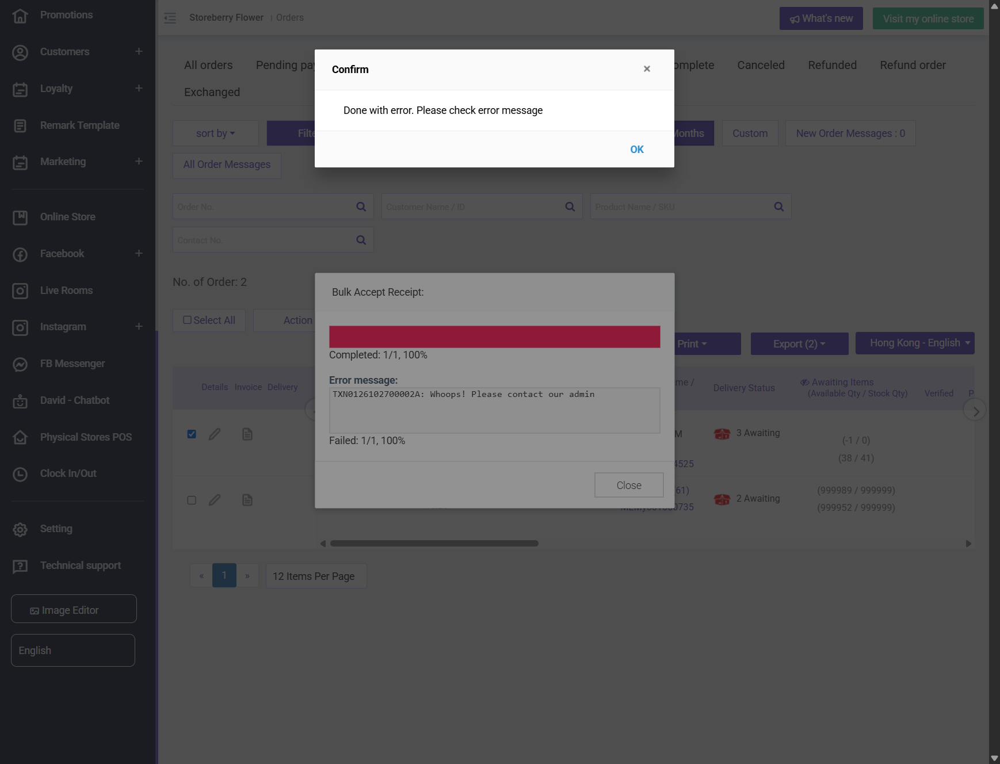

## Summary
Bank transfer orders cannot be approved. After the customer uploads a receipt the order moves to Payment Review, but accepting the receipt fails in both places: Orders > Payment review > Action > "Bulk Accept Receipt" (POST /orders/bulk-receipt-review-and-process) and Order Detail > Receipt > Accept (POST /orders/receipt-change-status). Both return HTTP 200 {"result":"FAIL","error_type":"ERROR_UNDEFINE","error_code":0,"message":"Whoops! Please contact our admin"}. The order stays in Payment Review / Pending payment. Deny works (order becomes Payment Rejected).

## Steps to reproduce
1. On the eShop, as a member, place an order paid by Bank Transfer (e.g. 1 x product test 2)
2. My Orders > the order > Upload Receipt, attach an image, Submit ("Your receipt is successfully uploaded, and waiting for approval")
3. In the CRM open Orders > Payment review, tick only that order, Action > Bulk Accept Receipt (1) > Start
4. Alternatively open the order detail > Receipt tab > Accept > OK

## Expected
The receipt is accepted and the order moves to Processing with payment status Paid.

## Actual
Bulk dialog: "Completed: 1/1, 100% Error message: <order>: Whoops! Please contact our admin  Failed: 1/1, 100%". Detail: warning modal "Whoops! Please contact our admin". Status unchanged. Reproduced on TXN0126102700002A (edited order), TXN0126102700003 (1 x 偈油x10, TaiPo stock 0) and TXN0126102700004 (1 x product test 2, in stock), 4 attempts total.

## Evidence
- Screenshot: 
- Screenshot: 
- Deny on TXN0126102700003 worked: status Payment Rejected.
- Existing case SCRM-048 (approve a payment-review order) will fail until this is fixed.

## Environment
- Base URL: https://www.stagingl10.storeberry.xyz/orders/detail?id=10969
- Env: staging

## History
- 2026-10-27: filed from explorations/2026-10-27-crm-eshop-critical.md in the Test Manager app.
