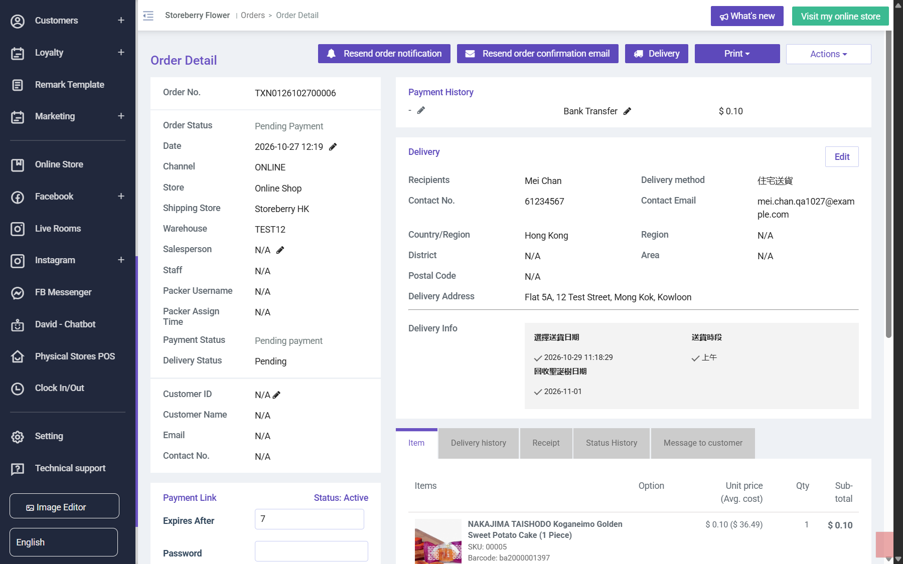

## Summary
On a Pending Payment bank-transfer order the Actions menu lists Refund this order. The panel offers "Refund amount: $ 0.10" for money never received; after Refund > Yes the page reloads with no change and no message.

## Steps to reproduce
1. Place a guest Bank Transfer order on the eShop (no receipt)
2. CRM order detail > Actions > Refund this order
3. Original Payment Method > Refund > Yes

## Expected
Refund is hidden or disabled for unpaid orders; if refused, a message explains why.

## Actual
Refund offered, confirmation accepted, order stays Pending Payment, no refund order, no message. Reproduced twice on TXN0126102700006.

## Evidence
- Screenshot: 
- Screenshot: 

## Environment
- Base URL: https://www.stagingl10.storeberry.xyz/orders/detail?id=10977
- Env: staging

## History
- 2026-10-27: filed from explorations/2026-10-27-pos-order-lifecycle.md in the Test Manager app.
