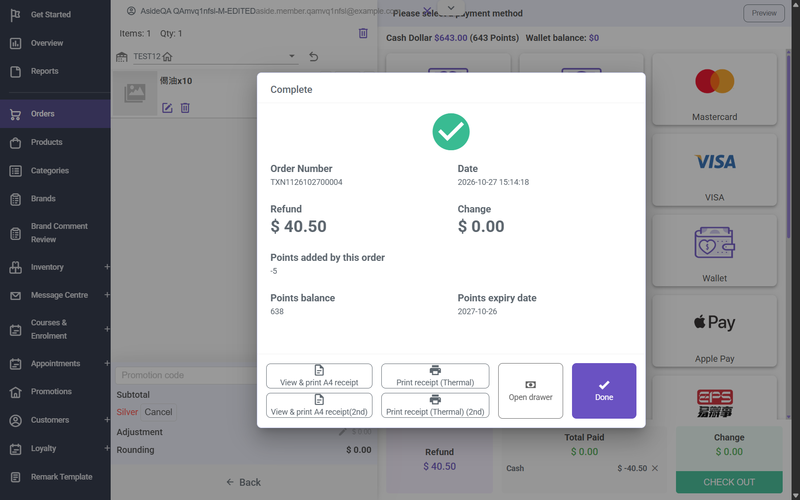

## Summary
Order TXN0126102700004 (HKD 49) earned 4 points. Exchanging its item at Storeberry HK for 偈油x10 (HKD 10, Silver -1.50 = 8.50) refunded HKD 40.50 and recorded "Point Earned TXN1126102700004 -5". The member ends 1 point below where they started although they still bought an HKD 8.50 item (which earns 0). Looks like the refund 40.50/10 = 4.05 is rounded down as a negative number (floor(-4.05) = -5).

## Steps to reproduce
1. Member places and pays an online order of HKD 49 (earns +4 points)
2. CRM order detail > Exchange / Partial Return > Storeberry HK
3. Select the item (qty 1), Next, add 偈油x10, Exchange & refund $40.50, tender Cash
4. Customer > Point History

## Expected
Points deducted are at most what the original order earned for the returned value: -4 (net 0 for the kept HKD 8.50).

## Actual
-5 points (balance 643 -> 638); POS completion screen also says "Points added by this order -5".

## Evidence
- Screenshot: 
- Point History: +4 TXN0126102700004 at 15:06:49, -5 TXN1126102700004 at 15:14:19

## Environment
- Base URL: https://www.stagingl10.storeberry.xyz/orders/detail?id=10969
- Env: staging

## History
- 2026-10-27: filed from explorations/2026-10-27-fulfilment-stock.md in the Test Manager app.
