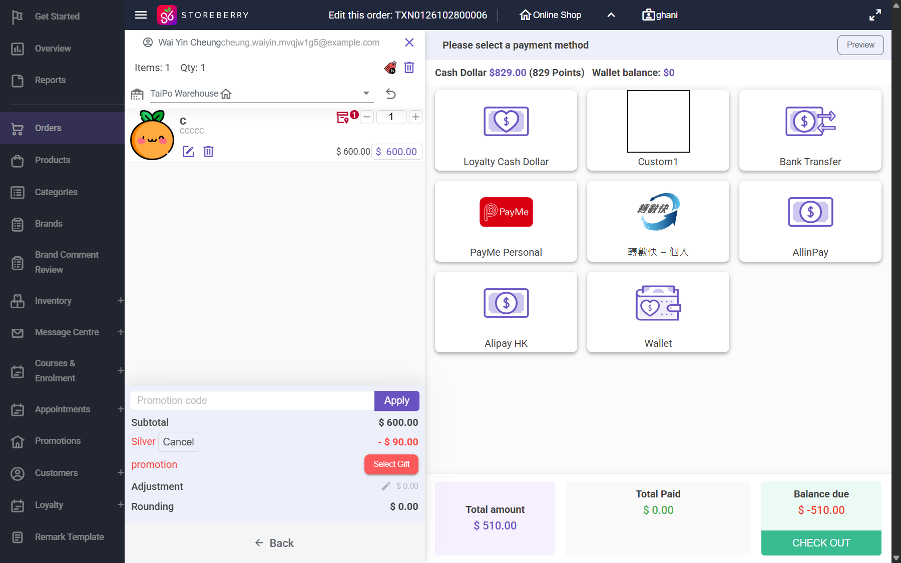
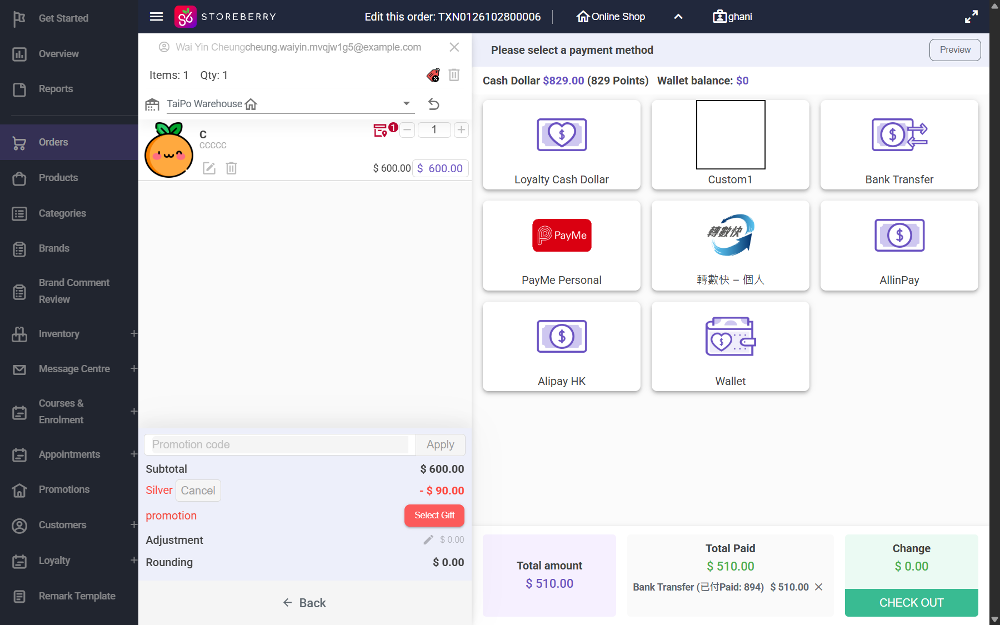
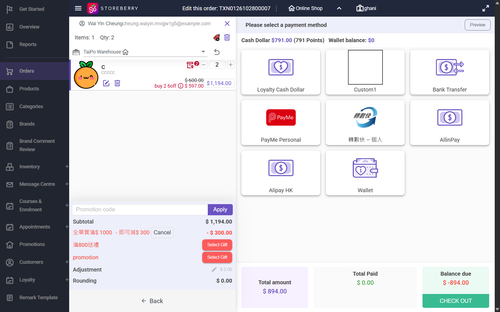
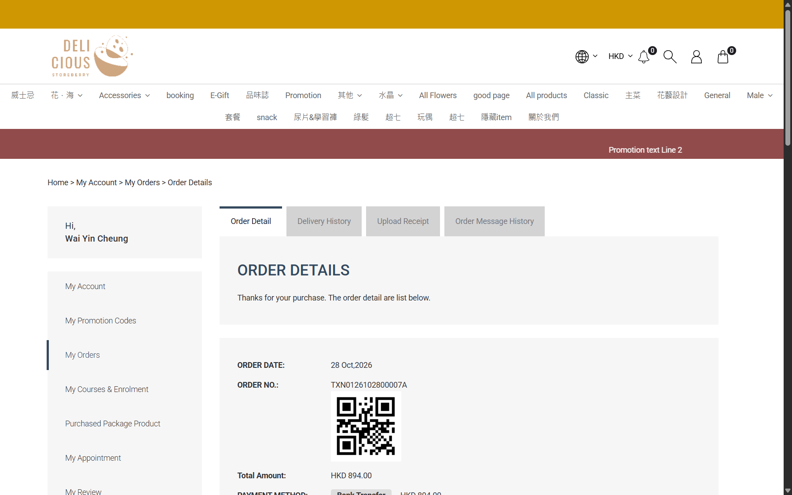

## Summary
Order detail > Actions > Edit this order on an order whose bank transfer receipt was accepted (Payment Status Complete) ignores the money already paid. The POS asks for the full new total, the original order is Canceled without any refund record, and the replacement order "<number>A" is Pending Payment with the full new total outstanding. Points earned on the paid order are voided and none are earned on the replacement. The customer is asked on the eShop to pay the full amount again.

## Steps to reproduce
1. eShop (QA member): order product C x2 (HKD 894.00 after buy-2 and basket discounts), Bank Transfer, upload a receipt; CRM order detail > Receipt > Accept > OK (Processing / Payment Complete, points +89)
2. CRM order detail > Actions > Edit this order > Use order creation date
3. POS: reduce C to 1 (Total HKD 510.00), Total; payment step shows Total Paid $0.00, Balance due $ -510.00
4. Click Bank Transfer: the tender reads "Bank Transfer (已付Paid: 894) $510.00", Change $0.00; CHECK OUT > OK -> TXN...A
5. Open the original order, the A order, and the member Point History / level spending (CRM and eShop My Account)
6. Repeat on a paid HKD 510.00 order (C x1) raising C to 2 (HKD 894.00)

## Expected
The POS shows what was already paid and only the difference: lower total -> refund of HKD 384.00 recorded; higher total -> balance due HKD 384.00 only. The replacement keeps the paid amount (Payment Status Complete for the lower case, Outstanding = difference for the higher case). Points and level spending follow the new paid total.

## Actual
Lower (TXN0126102800006 -> 006A): 006 Canceled / Payment Canceled, its Payment History still shows HKD 894.00 received, no refund line anywhere. 006A Pending Payment, Outstanding balance HKD 510.00, payment line "Bank Transfer (已付Paid: 894) HKD 510.00" with no payment date. Points: "Void - Transaction -89", nothing earned for 006A; level spending drops by 894. Higher (TXN0126102800007 -> 007A): POS Balance due $ -894.00 (full total, not 384); 007A Pending Payment, Outstanding balance HKD 894.00, "Bank Transfer (已付Paid: 510) HKD 894.00"; points -51 voided. The customer sees 007A on the eShop as Pending Payment HKD 894.00 with Upload Receipt / Resume Payment.

## Evidence
- 
- 
- 
- 
- Orders: TXN0126102800006/006A (id 11021/11022), TXN0126102800007/007A (id 11023)

## Environment
- Base URL: https://www.stagingl10.storeberry.xyz/orders/detail?id=11021
- Env: staging

## History
- 2026-10-28: filed from explorations/2026-10-28-paid-order-changes.md in the Test Manager app.
