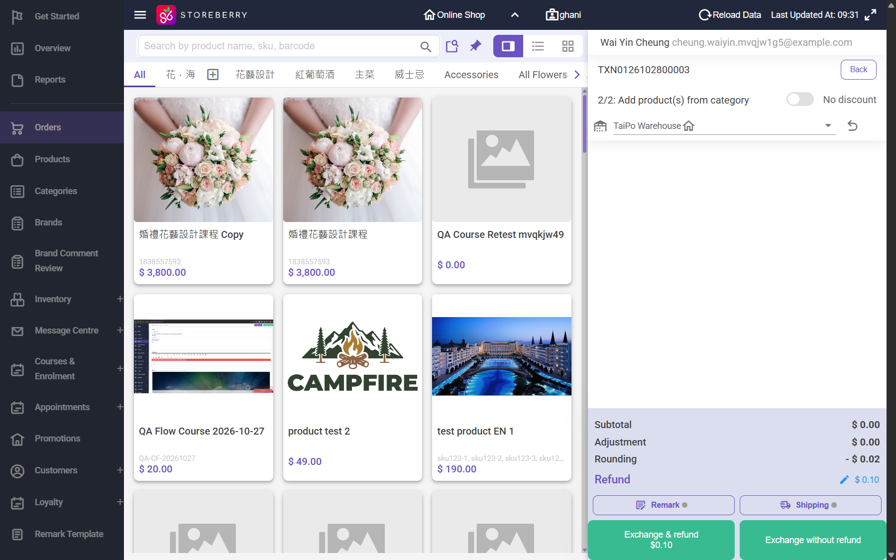
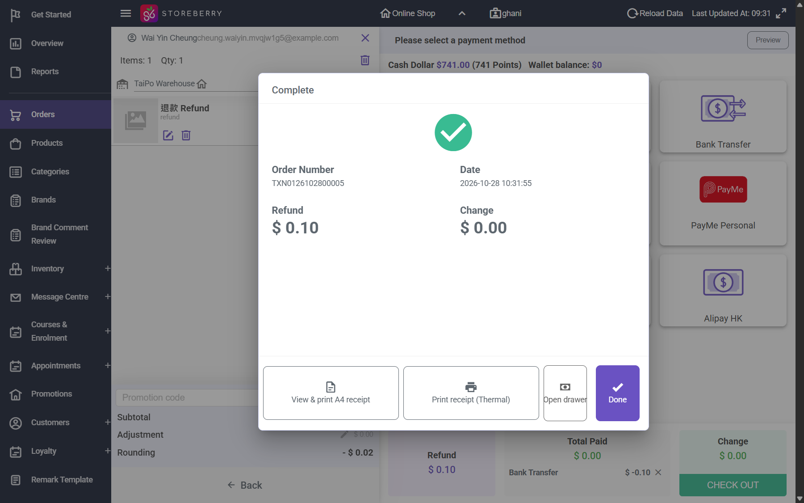

## Summary
The Exchange / Partial Return POS applies "Rounding (1 decimal place)" by rounding down, which on a refund (negative total) increases the amount refunded. Returning one item refunded the whole order total while the customer kept another item, and returning the kept item afterwards refunded more than was ever paid.

## Steps to reproduce
1. Paid eShop order TXN0126102800003: C HKD 600.00 + NAKAJIMA cake HKD 0.10, Silver 15%, rounding -0.09, Total HKD 510.00 paid by Bank Transfer
2. CRM order detail > Exchange / Partial Return > Online Shop; select C: the item share shown is HKD 509.92
3. Next (cancel the Shipping popup): Rounding - $0.08, Total $ -510.00; Exchange & refund > Bank Transfer -> refund TXN0126102800004 HKD 510.00
4. Exchange / Partial Return again, select the cake (share HKD 0.08): Rounding - $0.02, Refund $0.10; Bank Transfer -> refund TXN0126102800005 HKD 0.10

## Expected
A refund never exceeds the returned items share (509.92, or 509.90 if rounded to 0.1 toward zero); the sum of refunds on an order never exceeds the amount paid (510.00).

## Actual
Refund 004 = HKD 510.00 (the full order total) for C alone; refund 005 = HKD 0.10 for the HKD 0.08 cake. Total refunded HKD 510.10 on an order paid HKD 510.00. Points also went 1 below the points earned (+51, -51, -1).

## Evidence
- 
- 
- 

## Environment
- Base URL: https://www.stagingl10.storeberry.xyz/orders/detail?id=11018
- Env: staging

## History
- 2026-10-28: filed from explorations/2026-10-28-paid-order-changes.md in the Test Manager app.
- 2026-10-29: status open -> wont-fix.
- 2026-10-30: Closed as wont-fix: linked cases updated to the accepted behavior (SCRM-132 now allows rounding up to HKD 0.10); tests list emptied..
