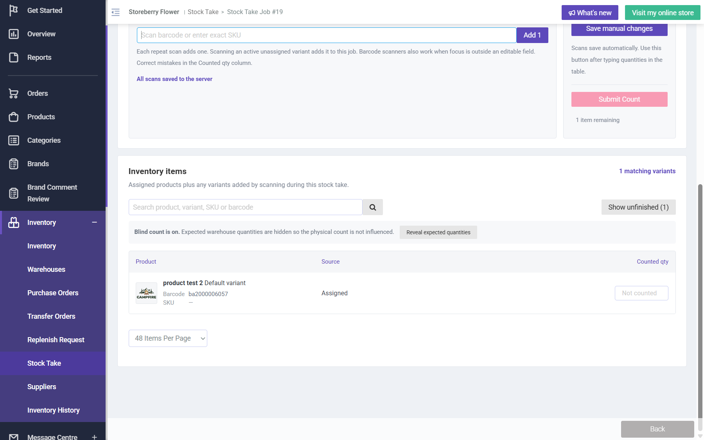

## Summary
Choosing Quantity visibility 'Open count' when creating a stock take job is shown on the Review step, but once counting starts the job is in Blind count ('Blind count is on. Expected warehouse quantities are hidden...'). Counters do not get the expected quantities the admin chose to show (they can still click Reveal expected quantities).

## Steps to reproduce
1. CRM Stock Take > Create Job: name QA-ST-visibility-check, warehouse Causeway Bay, assignee ghani, Quantity visibility Open count (card active, aria-pressed=true), Continue
2. Choose specific variants: product test 2, Review Job -> 'Quantity visibility Open count'
3. Create Job > OK, Start Counting > OK

## Expected
The job counts in Open count: current/snapshot quantities visible, no Blind count banner.

## Actual
Count inventory says 'Expected warehouse quantities stay hidden during counting. Blind count' and the table banner 'Blind count is on.' Seen on job #18 and job #19 (job #19 then cancelled).

## Evidence
- Screenshot: 

## Environment
- Base URL: https://www.stagingl10.storeberry.xyz/stock-take/create
- Env: staging

## History
- 2026-10-28: filed from explorations/2026-10-28-payment-recovery-fix-retests.md in the Test Manager app.
