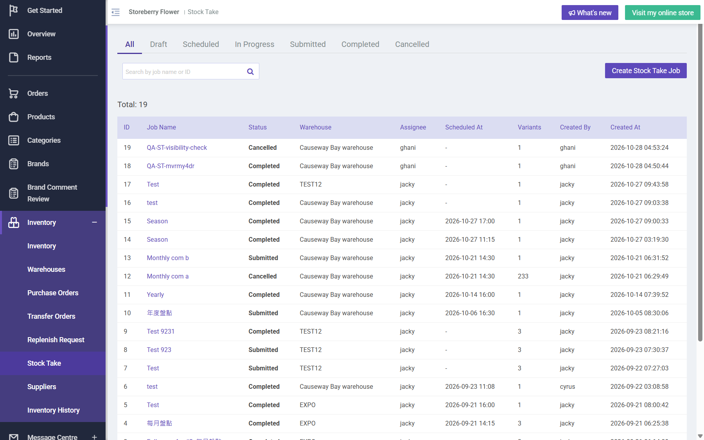

## Summary
A stock take job created at 12:50 HKT shows Created At 2026-10-28 04:50:44 on the Stock Take list and 'Created at 28 Oct 2026, 04:50' on the job detail, while the same job's snapshot and count times on the review table are local (28 Oct 2026, 12:51 / 12:52) and Inventory History shows the reconciliation at 12:52:05.

## Steps to reproduce
1. CRM Stock Take > Create Job at about 12:50 HKT (job #18 QA-ST-mvrmy4dr)
2. Read Created at on the job detail and Created At on the Stock Take list
3. Start, count, submit: read the Snapshot Instock Qty time

## Expected
Created At in local time (12:50), consistent with the snapshot times and the rest of the CRM.

## Actual
Created At 04:50 / 04:50:44 (UTC) while the snapshot shows 12:51 and Inventory History 12:52:05.

## Evidence
- Screenshot: 

## Environment
- Base URL: https://www.stagingl10.storeberry.xyz/stock-take
- Env: staging

## History
- 2026-10-28: filed from explorations/2026-10-28-payment-recovery-fix-retests.md in the Test Manager app.
