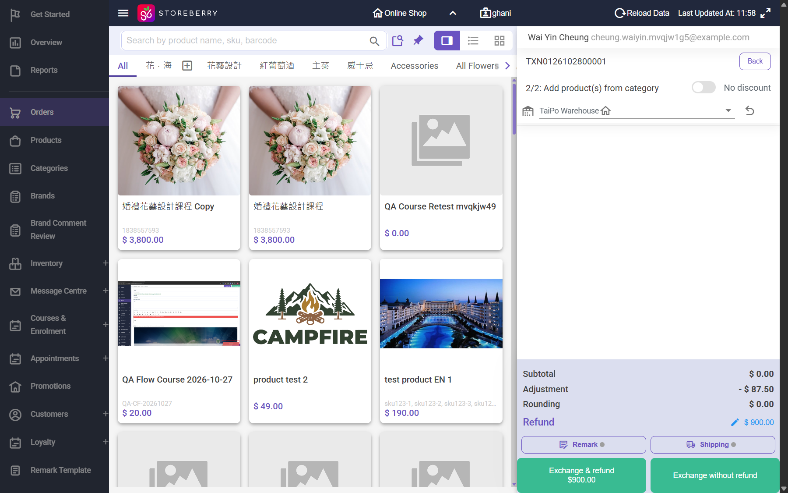

## Summary
In the Exchange / Partial Return POS, the Refund amount has a pencil (Adjust balance due > Adjust final price). Any amount is accepted and refunded, even when it makes the order's total refunds larger than what the customer paid. Refund this order is no longer offered after a partial return, so this is the only refund path, and it has no cap. The over-refund also takes back more points than the order earned and pushes level spending down so the member is downgraded.

## Steps to reproduce
1. CRM order TXN0126102800001 (paid Bank Transfer 1,300.00; C already returned with refund 487.50, remaining paid 812.50)
2. Actions > Exchange / Partial Return > Online Shop; select product test 2 (share $812.50), Next
3. Refund pencil > Adjust final price: -900 > Submit -> Refund $900.00 (Adjustment -$87.50)
4. Exchange & refund $900.00 > Bank Transfer

## Expected
A refund above the amount still paid (812.50) is refused with a message; total refunds on an order never exceed the amount paid.

## Actual
Refund order TXN0126102800015 completed, Total $ -900.00 (Bank Transfer -900); order 001 refunds now 487.50 + 900 = 1,387.50 of 1,300.00 paid. Second time: TXN0126102800016 (paid 2,088.00), return 1 C (share 522.00) with final price -2100 -> TXN0126102800017 refund $2,100.00 (more than the whole order). Points: -90 and -210 (order earned 208); member MEMy001164526 went from Level 3 back to Level 1.

## Evidence
- Screenshot: 
- Screenshot: 

## Environment
- Base URL: https://www.stagingl10.storeberry.xyz/orders/detail?id=11016
- Env: staging

## History
- 2026-10-28: filed from explorations/2026-10-28-payment-recovery-fix-retests.md in the Test Manager app.
