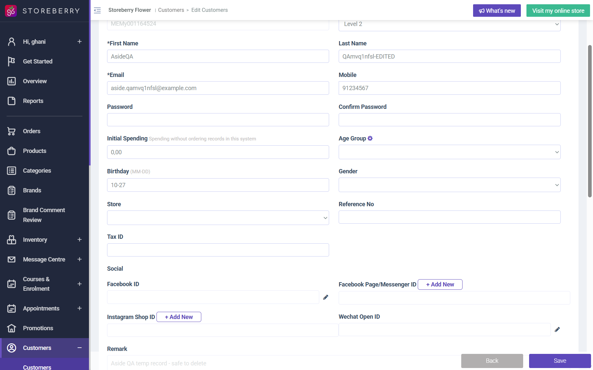

## Question
Is the comma decimal on the Edit Customer form intended, or a locale formatting bug?

## Context
Customer Edit for MEMy001164524 showed Initial Spending "0,00"; Add Customer shows "0". Saving worked. Store locale is Hong Kong - English.

## Evidence
- Screenshot: 

## Answer
Not answered yet.

## History
- 2026-10-27: asked from explorations/2026-10-27-crm-eshop-critical.md.
