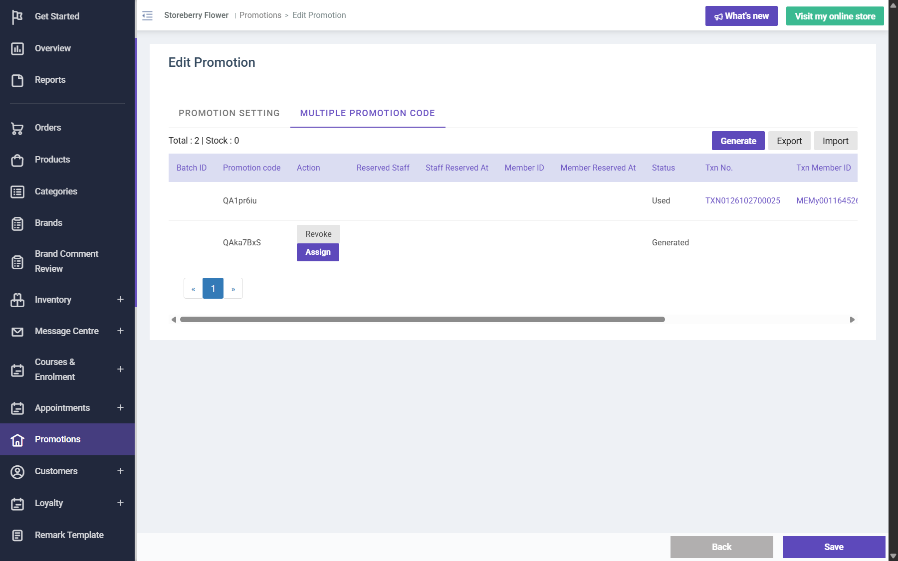

## Question
A generated single-use code (Multiple Promotion Code) is marked Used with the order number when an unpaid eShop order is placed. After the order is voided in the CRM (Canceled, stock released) the code stays Used and the customer cannot use it again. Is that intended, or should voiding/cancelling an order return the code to Generated (or Assigned)? If it stays used, how should staff give the customer a replacement?

## Context
Promotion 662 (10% code, Online Shop). Code QA1pr6iu used by TXN0126102700025 (member MEMy001164526, Bank Transfer, HKD 459.00), voided 2026-10-28 06:06 HKT; list still shows Used / TXN0126102700025. Re-applying it on the eShop gives "Promotion code is invalid, expired or exceed the usage limit".

## Evidence
- 

## Answer
Not answered yet.

## History
- 2026-10-28: asked from explorations/2026-10-28-promo-code-orders.md.
- 2026-10-28: same after a full refund of a paid order (QC39DgTk, TXN0126102700026 Refunded): the code stays Used.
