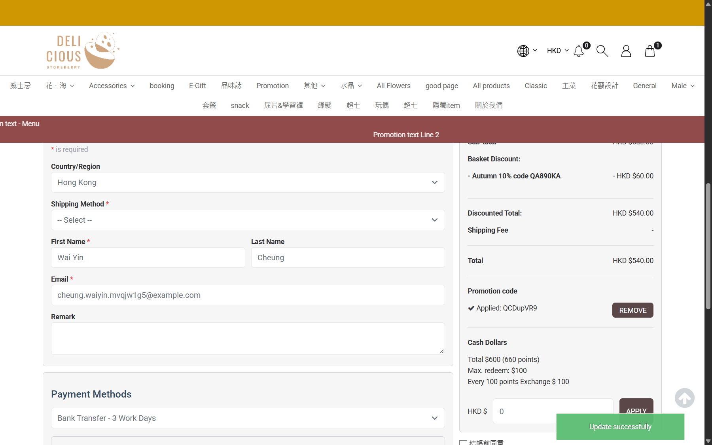

## Question
With "Cannot apply with other promotions" ticked, applying a 10% code to a Silver member basket replaces Silver 15%: Total goes from HKD 510.00 to HKD 540.00 and the checkout just says the code is applied. Should the checkout warn the customer (or keep the better deal), or is this accepted behavior?

## Context
Promotion 662 (10% code, exclusive), member MEMy001164526 (Silver 15%), product C HKD 600.00, code QCDupVR9, 2026-10-28. No order placed.

## Evidence
- 

## Answer
Not answered yet.

## History
- 2026-10-28: asked from explorations/2026-10-28-promo-code-orders.md.
