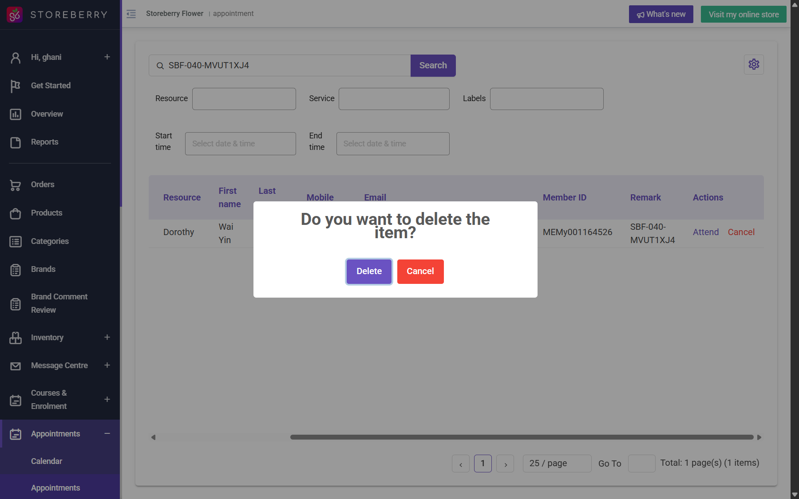

## Question
In CRM Appointments, Cancel opens a confirmation titled Do you want to delete the item? with Delete and Cancel buttons. Is Delete the intended appointment cancellation action, and does it preserve a canceled record and release the slot, or permanently remove the record?

## Context
While checking a QA booking end to end, staff clicked Cancel on the uniquely marked booking. The deletion confirmation was not approved; the user explicitly chose to keep the booking. The prompt was dismissed. The booking remains Pending. The effect of Delete was not tested.

## Evidence
- CRM /appointment/list, booking remark SBF-040-MVUT1XJ4, Thai, 2026-11-02 10:00-10:30.
- Observed confirmation text: Do you want to delete the item?; buttons Delete / Cancel.
- Retained booking: 

## Answer
Not answered yet.

## History
- 2026-10-30: asked from explorations/2026-10-30-appointment-sync.md.
