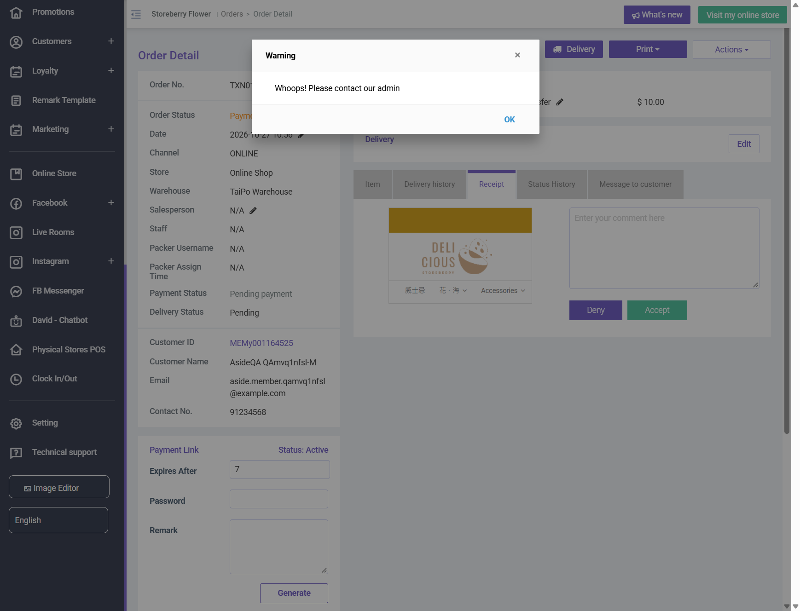
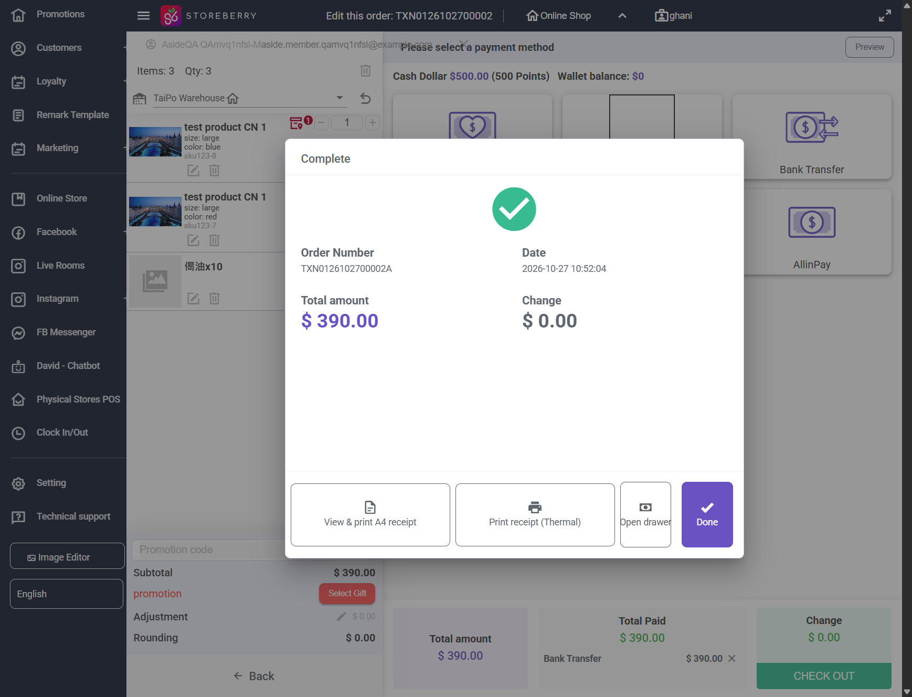
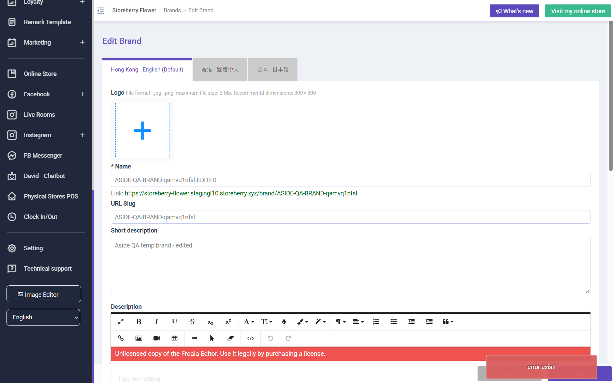
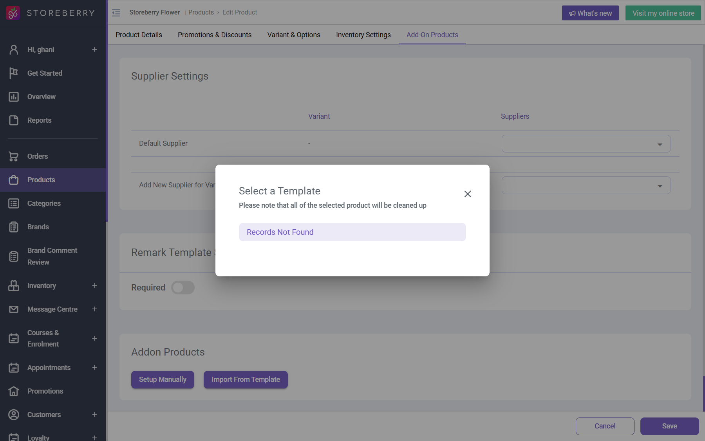

# Run report: storeberry-crm / exploratory-2026-10-27 / staging

| Field | Value |
|---|---|
| Result | **FAIL (11 failed)** |
| Run | 2026-10-27_1016_staging_manual |
| Runner | manual |
| Base URL | https://www.stagingl10.storeberry.xyz/ |
| Started | 2026-10-27 10:16 |
| Duration | 0.9s |

## Summary

| Total | Pass | Fail | Flaky | Blocked | Skipped |
|---:|---:|---:|---:|---:|---:|
| 23 | 12 | 11 | 0 | 0 | 0 |

## Results

| ID | Title | Status | Checks | Time | Notes | Evidence |
|---|---|---|---|---|---|---|
| SCRM-001 | CRM login page loads with sign-in controls | pass | 2/2 | 0.0s | - | - |
| SCRM-005 | Store admin signs in to Storeberry Flower CRM | pass | 2/2 | 0.0s | - | - |
| SCRM-004 | CRM customer list loads with search controls | pass | 3/3 | 0.0s | - | - |
| SCRM-020 | Add Customer requires First Name and Email | fail | 1/2 | 0.0s | untriaged | - |
| SCRM-021 | Create customer respects email opt-in and member level | pass | 3/3 | 0.0s | - | - |
| SCRM-054 | Reject duplicate customer email or Member ID values | pass | 2/2 | 0.0s | - | - |
| SCRM-057 | Product form rejects a non-positive price | fail | 0/2 | 0.0s | untriaged | - |
| SCRM-071 | Customer birthday rejects an impossible date | fail | 1/3 | 0.0s | product-bug; BUG-001 | [1](screenshots/SCRM-071-m01-01-birthday-02-30-saved-as-today.png) |
| SCRM-072 | Delete removes only the selected QA customer | pass | 4/4 | 0.0s | - | - |
| SCRM-073 | Add Customer validates email format and password confirmation | pass | 3/3 | 0.0s | - | - |
| SCRM-074 | Order list paid date never shows Invalid date | fail | 0/1 | 0.0s | product-bug; BUG-002 | - |
| SCRM-047 | Checkout review shows delivery and payment choices without submitting | pass | 3/3 | 0.0s | - | - |
| SCRM-048 | Approve a payment-review order and verify processing status | fail | 0/2 | 0.0s | product-bug; BUG-009 | [1](screenshots/SCRM-048-m01-07-accept-receipt-whoops.png) |
| SCRM-075 | Accept an uploaded bank transfer receipt from the order detail | fail | 0/3 | 0.0s | product-bug; BUG-009 | [1](screenshots/SCRM-075-m01-08-receipt-accept-detail.png) |
| SCRM-076 | Deny an uploaded bank transfer receipt | pass | 2/2 | 0.0s | - | - |
| SCRM-077 | Edit this order keeps warehouse, shipping store, remark and product names | fail | 2/5 | 0.0s | product-bug; BUG-010 | [1](screenshots/SCRM-077-m01-06-order-edit-result.png) |
| SCRM-078 | Create, edit and cancel a purchase order | pass | 4/4 | 0.0s | - | - |
| SCRM-079 | Create, edit and delete a hidden category | pass | 4/4 | 0.0s | - | - |
| SCRM-080 | Create, edit and delete a brand | fail | 2/3 | 0.0s | product-bug; BUG-011 | [1](screenshots/SCRM-080-m01-09-brand-edit-500.png) |
| SCRM-081 | Adjust member points with admin endorsement | pass | 4/4 | 0.0s | - | - |
| SCRM-082 | Existing product detail opens without an error message | fail | 0/2 | 0.0s | product-bug; BUG-005 | [1](screenshots/SCRM-082-m01-02-product-detail-unexpected-error.png) |
| SCRM-083 | Edit a pending transfer order and save the change | fail | 0/2 | 0.0s | product-bug; BUG-008 | [1](screenshots/SCRM-083-m01-04-transfer-edit-submit.png) |
| SCRM-084 | Edit an awaiting replenish request and save the change | fail | 0/2 | 0.0s | product-bug; BUG-008 | [1](screenshots/SCRM-084-m01-05-replenish-edit-submit.png) |

## Failures and warnings

### SCRM-020: Add Customer requires First Name and Email (fail)

- Failure type: untriaged
- Source: `projects/storeberry-crm/cases/customers/SCRM-020-add-customer-requires-first-name-and.md`
- Failed: The form stays open and indicates that First Name and Email are required.
- Note: Empty Save shows "The First Name is required. The Language Perference is required." Email is not flagged until First Name is filled (validation comes in stages). No customer created.

### SCRM-057: Product form rejects a non-positive price (fail)

- Failure type: untriaged
- Source: `projects/storeberry-crm/cases/products/SCRM-057-product-form-rejects-a-non-positive.md`
- Failed: The form displays a price validation error for each attempted non-positive value.
- Failed: No product is created with the invalid price.
- Note: Negative input resets to 0; HKD 0.00 hidden product saved without message (id 3199, terminated after). Open question whether HKD 0 must be allowed; triage after product owner answers.

### SCRM-071: Customer birthday rejects an impossible date (fail)

- Failure type: product-bug (bug BUG-001)
- Source: `projects/storeberry-crm/cases/customers/SCRM-071-customer-birthday-rejects-an-impossible.md`
- Failed: 02-30 and 13-45 are rejected with a validation message, or the previous birthday is kept
- Failed: Birthday never becomes today's date unless typed
- Note: 02-30 and 13-45 saved as 10-27 (today); 05-15 saved correctly.

### SCRM-074: Order list paid date never shows Invalid date (fail)

- Failure type: product-bug (bug BUG-002)
- Source: `projects/storeberry-crm/cases/orders/SCRM-074-order-list-paid-date-never-shows.md`
- Failed: No cell reads "Invalid date"
- Note: TXN1226102600001 (HKD 0, paid by eGift) shows "Invalid date" (1 of 100 rows).

### SCRM-048: Approve a payment-review order and verify processing status (fail)

- Failure type: product-bug (bug BUG-009)
- Source: `projects/storeberry-crm/cases/orders/SCRM-048-approve-a-payment-review-order-and.md`
- Failed: The order leaves Payment review and shows the resulting processing/approved status.
- Failed: The order history records the approval and updated status.
- Note: Bulk Accept Receipt on TXN0126102700002A and TXN0126102700003: "Whoops! Please contact our admin", Failed 1/1; order stays in Payment Review.

### SCRM-075: Accept an uploaded bank transfer receipt from the order detail (fail)

- Failure type: product-bug (bug BUG-009)
- Source: `projects/storeberry-crm/cases/orders/SCRM-075-accept-an-uploaded-bank-transfer.md`
- Failed: No warning is shown
- Failed: Order Status Processing, Payment Status Paid
- Failed: eShop shows the order as Processing
- Note: Receipt tab > Accept on TXN0126102700003 and TXN0126102700004: /orders/receipt-change-status returns FAIL "Whoops! Please contact our admin".

### SCRM-077: Edit this order keeps warehouse, shipping store, remark and product names (fail)

- Failure type: product-bug (bug BUG-010)
- Source: `projects/storeberry-crm/cases/orders/SCRM-077-edit-this-order-keeps-warehouse.md`
- Failed: Warehouse and Shipping Store equal the original
- Failed: Customer remark appears once
- Failed: Product names are unchanged (same language as the original)
- Note: Replacement TXN0126102700002A: warehouse TaiPo (was Office, stock -1), Shipping Store dropped, remark duplicated, names "test product CN 1". Internal remark carried over.

### SCRM-080: Create, edit and delete a brand (fail)

- Failure type: product-bug (bug BUG-011)
- Source: `projects/storeberry-crm/cases/brands/SCRM-080-create-edit-and-delete-a-brand.md`
- Failed: "Update successful"-type message and the new name persists
- Note: Brand 24: create OK, edit returns HTTP 500 "error exist!" (twice), delete OK.

### SCRM-082: Existing product detail opens without an error message (fail)

- Failure type: product-bug (bug BUG-005)
- Source: `projects/storeberry-crm/cases/products/SCRM-082-existing-product-detail-opens-without.md`
- Failed: No error toast appears (e.g. "undefined: Unexpected Error")
- Failed: The template picker lists templates or says none exist, with no "Cannot Fetch Templates" error
- Note: Toast "undefined: Unexpected Error" on 5 of 5 products; GET cmsapiv2.storeberry.ai/cmsapi/addon-products/templates/... returns 500; Import From Template -> "Cannot Fetch Templates".

### SCRM-083: Edit a pending transfer order and save the change (fail)

- Failure type: product-bug (bug BUG-008)
- Source: `projects/storeberry-crm/cases/inventory/SCRM-083-edit-a-pending-transfer-order-and-save.md`
- Failed: "Update successful"-type message, no "The deleted ids must be a valid JSON string."
- Failed: Detail shows Qty 2 and the new remark
- Note: QA transfer 306: "The deleted ids must be a valid JSON string." (error_code 2208), also after removing/re-adding the row. Cancelled afterwards.

### SCRM-084: Edit an awaiting replenish request and save the change (fail)

- Failure type: product-bug (bug BUG-008)
- Source: `projects/storeberry-crm/cases/inventory/SCRM-084-edit-an-awaiting-replenish-request-and.md`
- Failed: "Update successful"-type message, no "The deleted ids must be a valid JSON string."
- Failed: Detail shows Qty 2 and the new remark
- Note: QA replenish request 154: same "deleted ids" error. Cancelled afterwards.

## Notes

Results from the 2026-10-27 exploratory sessions (Aside browser). Only cases actually executed today are included; partially covered cases were left out. Explorations: explorations/2026-10-27-*.md
