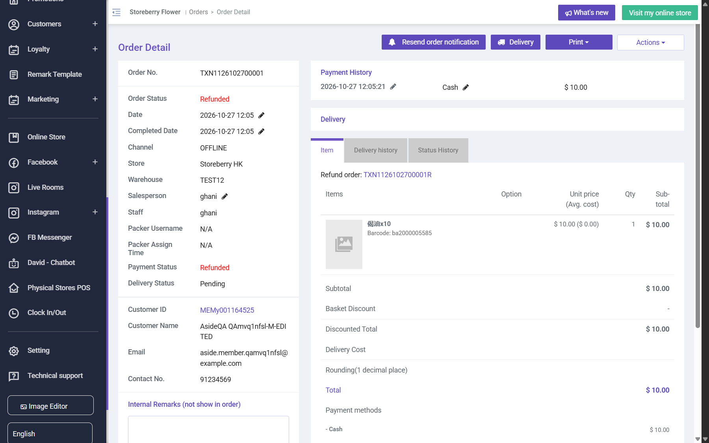
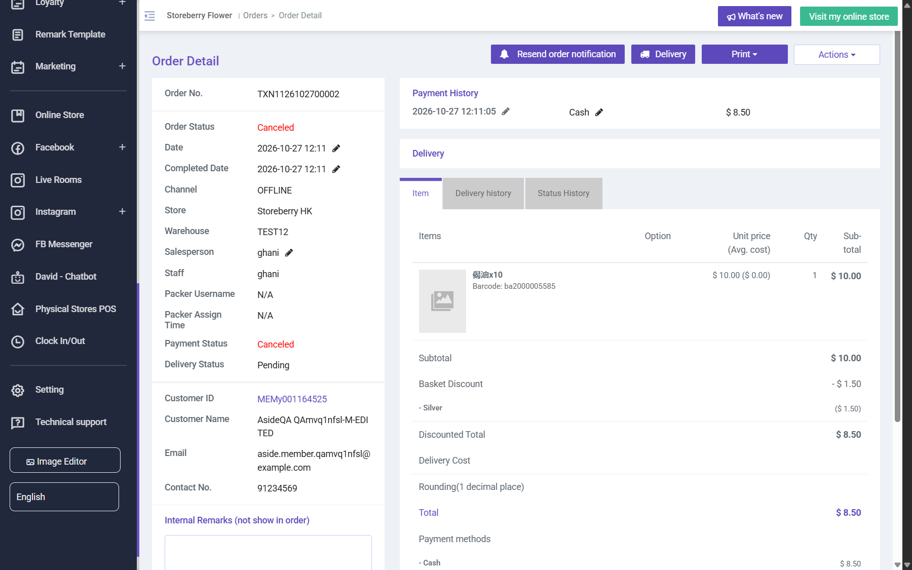
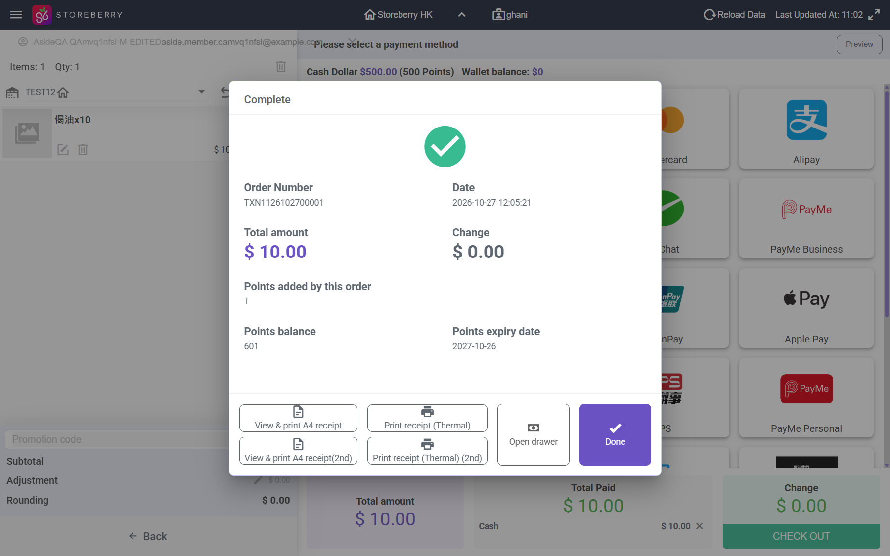
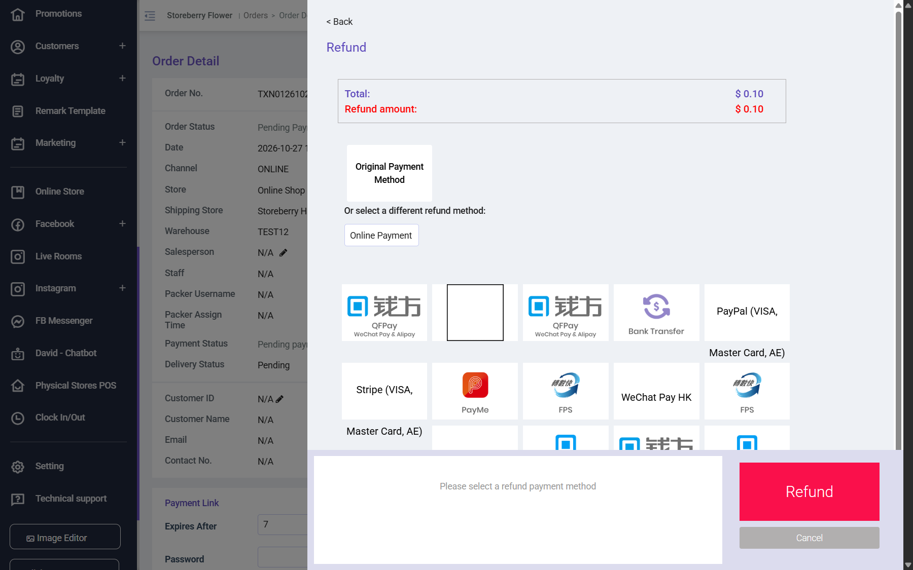

# Run report: storeberry-crm / exploratory-2026-10-27-pos / staging

| Field | Value |
|---|---|
| Result | **FAIL (4 failed)** |
| Run | 2026-10-27_1125_staging_manual |
| Runner | manual |
| Base URL | https://www.stagingl10.storeberry.xyz/ |
| Started | 2026-10-27 11:25 |
| Duration | 0.4s |

## Summary

| Total | Pass | Fail | Flaky | Blocked | Skipped |
|---:|---:|---:|---:|---:|---:|
| 7 | 3 | 4 | 0 | 0 | 0 |

## Results

| ID | Title | Status | Checks | Time | Notes | Evidence |
|---|---|---|---|---|---|---|
| SCRM-085 | Web POS cash sale for a member creates a completed order and earns points | pass | 3/3 | 0.0s | - | - |
| SCRM-086 | Refund a completed POS cash sale reverses payment and points and keeps fulfilment closed | fail | 2/3 | 0.0s | product-bug; BUG-012 | [1](screenshots/SCRM-086-m01-delivery-pending-after-refund.png) |
| SCRM-087 | Void a completed POS sale cancels it and keeps fulfilment closed | fail | 1/2 | 0.0s | product-bug; BUG-012 | [1](screenshots/SCRM-087-m01-delivery-pending-after-void.png) |
| SCRM-088 | POS checkout tells the cashier when no cash drawer is selected | fail | 0/1 | 0.0s | product-bug; BUG-014 | [1](screenshots/SCRM-088-m01-pos-context.png) |
| SCRM-089 | Refund is not offered on an unpaid order | fail | 0/2 | 0.0s | product-bug; BUG-013 | [1](screenshots/SCRM-089-m01-refund-offered-unpaid.png) |
| SCRM-050 | Cancel an eligible unpaid order and verify its history | pass | 2/2 | 0.0s | - | - |
| SCRM-051 | Refund a completed QA order and reconcile the refund amount | pass | 3/3 | 0.0s | - | - |

## Failures and warnings

### SCRM-086: Refund a completed POS cash sale reverses payment and points and keeps fulfilment closed (fail)

- Failure type: product-bug (bug BUG-012)
- Source: `projects/storeberry-crm/cases/pos/SCRM-086-refund-a-completed-pos-cash-sale.md`
- Failed: Delivery Status stays Complete (the goods left the store at the sale)
- Note: Refunded, refund order TXN1126102700001R Cash -10, -1 point. Delivery Status Complete -> Pending.

### SCRM-087: Void a completed POS sale cancels it and keeps fulfilment closed (fail)

- Failure type: product-bug (bug BUG-012)
- Source: `projects/storeberry-crm/cases/pos/SCRM-087-void-a-completed-pos-sale-cancels-it.md`
- Failed: Delivery Status stays Complete
- Note: TXN1126102700002 voided -> Canceled; Delivery Status Complete -> Pending.

### SCRM-088: POS checkout tells the cashier when no cash drawer is selected (fail)

- Failure type: product-bug (bug BUG-014)
- Source: `projects/storeberry-crm/cases/pos/SCRM-088-pos-checkout-tells-the-cashier-when-no.md`
- Failed: A visible message asks to select a cash drawer (Settings > Cash In Out), or the payment screen opens
- Note: Total does nothing; console.error only.

### SCRM-089: Refund is not offered on an unpaid order (fail)

- Failure type: product-bug (bug BUG-013)
- Source: `projects/storeberry-crm/cases/orders/SCRM-089-refund-is-not-offered-on-an-unpaid-order.md`
- Failed: Refund this order is not listed (or disabled) for unpaid orders
- Failed: If an action is refused, a message explains why
- Note: TXN0126102700006: Refund offered on Pending Payment; confirm does nothing, no message (twice).

## Notes

Exploratory session 2026-10-27: POS sale, refund, void, unpaid refund/void.
