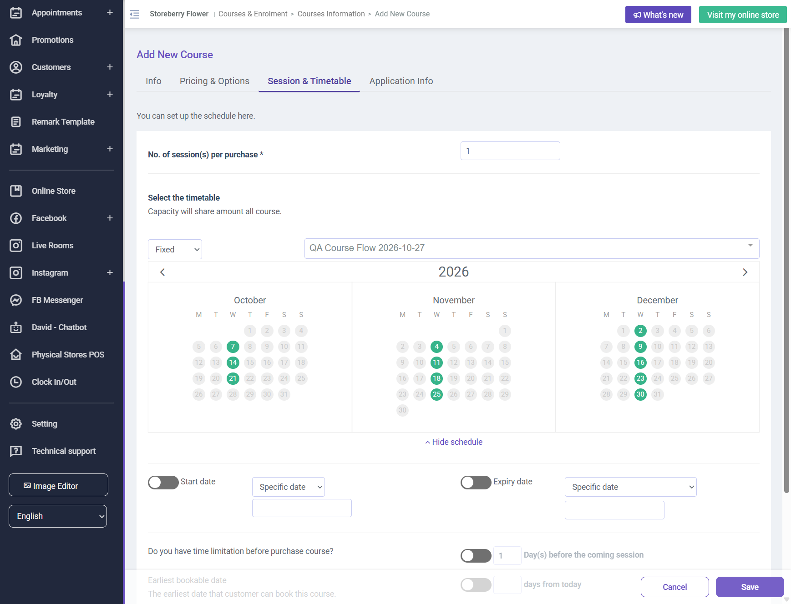

# Run report: storeberry-crm / exploratory-2026-10-27-course-flow / staging

| Field | Value |
|---|---|
| Result | **FAIL (1 failed)** |
| Run | 2026-10-27_1220_staging_manual |
| Runner | manual |
| Base URL | https://www.stagingl10.storeberry.xyz/ |
| Started | 2026-10-27 12:20 |
| Duration | 0.1s |

## Summary

| Total | Pass | Fail | Flaky | Blocked | Skipped |
|---:|---:|---:|---:|---:|---:|
| 1 | 0 | 1 | 0 | 0 | 0 |

## Results

| ID | Title | Status | Checks | Time | Notes | Evidence |
|---|---|---|---|---|---|---|
| SCRM-090 | Course creation retains the required category across tabs | fail | 0/2 | 3m 0s | product-bug; BUG-015 | [1](screenshots/SCRM-090-m01-course-category-lost.png) |

## Failures and warnings

### SCRM-090: Course creation retains the required category across tabs (fail)

- Failure type: product-bug (bug BUG-015)
- Source: `projects/storeberry-crm/cases/courses/SCRM-090-create-a-course-retains-required-category.md`
- Failed: The category remains selected when switching tabs.
- Failed: The course saves successfully and appears in the course list with the selected category and timetable.
- Note: Category chip appeared after selecting existing Course category, then disappeared on Session & Timetable tab. Save failed twice with exact message: Please select a category! Created QA timetable ID 70, but course was not saved; storefront visibility not reached.

## Notes

Exploratory course creation: category selection lost across tabs, blocking course save. Enrollment not reached. QA timetable ID 70 was created.
