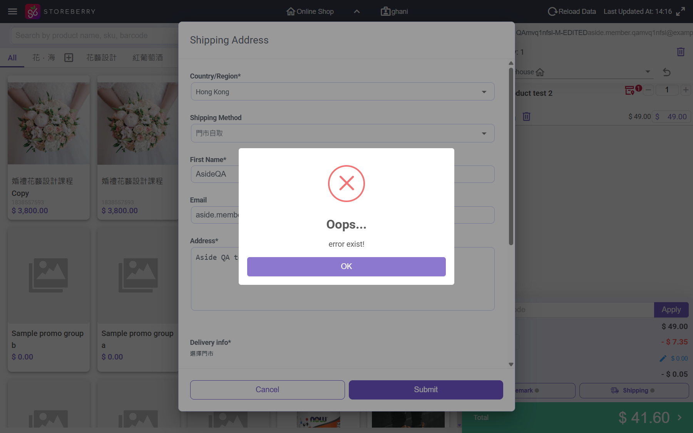
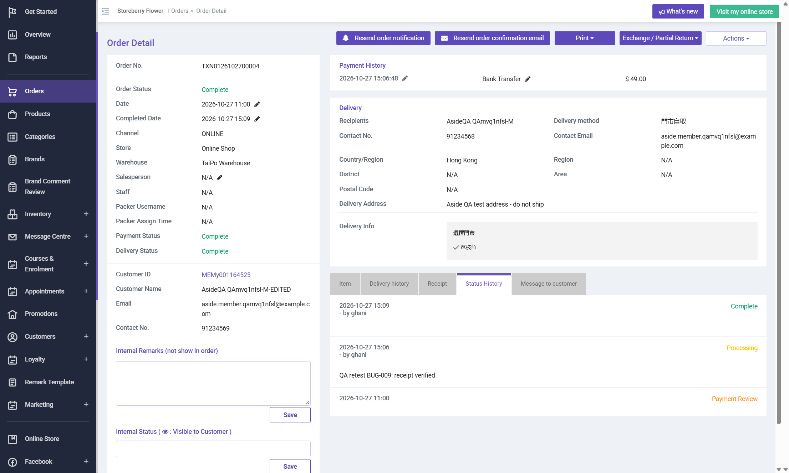

# Run report: storeberry-crm / exploratory-2026-10-27-fulfilment / staging

| Field | Value |
|---|---|
| Result | **FAIL (3 failed)** |
| Run | 2026-10-27_1606_staging_manual |
| Runner | manual |
| Base URL | https://www.stagingl10.storeberry.xyz/ |
| Started | 2026-10-27 16:06 |
| Duration | 0.4s |

## Summary

| Total | Pass | Fail | Flaky | Blocked | Skipped |
|---:|---:|---:|---:|---:|---:|
| 8 | 5 | 3 | 0 | 0 | 0 |

## Results

| ID | Title | Status | Checks | Time | Notes | Evidence |
|---|---|---|---|---|---|---|
| SCRM-075 | Accept an uploaded bank transfer receipt from the order detail | pass | 2/2 | 0.0s | - | - |
| SCRM-048 | Approve a payment-review order and verify processing status | pass | 2/2 | 0.0s | - | - |
| SCRM-065 | Award loyalty points once for an eligible QA purchase | pass | 3/3 | 0.0s | - | - |
| SCRM-091 | Fulfil a paid online pickup order: pack, dispatch and complete | pass | 4/4 | 0.0s | - | - |
| SCRM-052 | Exchange a completed QA order and verify the linked exchange | fail | 2/2 | 0.0s | product-bug; BUG-017 | [1](screenshots/SCRM-052-m01-points-minus5.png) |
| SCRM-027 | Receiving a purchase order updates warehouse stock | pass | 3/3 | 0.0s | - | - |
| SCRM-092 | Staff creates an online store order via Add Order (WebPOS) with store pickup | fail | 0/2 | 0.0s | product-bug; BUG-016 | [1](screenshots/SCRM-092-m01-check-shipping-500.png) |
| SCRM-093 | Order delivery panel tells staff why Dispatch or Save is refused | fail | 0/2 | 0.0s | product-bug; BUG-018 | [1](screenshots/SCRM-093-m01-order-complete-context.png) |

## Failures and warnings

### SCRM-052: Exchange a completed QA order and verify the linked exchange (fail)

- Failure type: product-bug (bug BUG-017)
- Source: `projects/storeberry-crm/cases/orders/SCRM-052-exchange-a-completed-qa-order-and.md`
- Note: TXN0126102700004 exchanged at Storeberry HK for 偈油x10 -> TXN1126102700004 (Complete, Exchange Order, refund 40.50 Cash); original shows Exchanged: 1 and is in the Exchanged tab; returned unit +1 at TEST12. Points -5 although the order earned +4 (BUG-017).

### SCRM-092: Staff creates an online store order via Add Order (WebPOS) with store pickup (fail)

- Failure type: product-bug (bug BUG-016)
- Source: `projects/storeberry-crm/cases/orders/SCRM-092-staff-creates-an-online-store-order-via.md`
- Failed: Shipping is accepted and shown on the cart
- Failed: A new online order is created in Pending payment with the chosen pickup store
- Note: Shipping Submit -> "Oops... error exist!" (POST /webpos/check-shipping 500), 4/4; Total blocked. No order created.

### SCRM-093: Order delivery panel tells staff why Dispatch or Save is refused (fail)

- Failure type: product-bug (bug BUG-018)
- Source: `projects/storeberry-crm/cases/orders/SCRM-093-order-delivery-panel-tells-staff-why.md`
- Failed: Dispatch with nothing packed shows a message (e.g. pack items first)
- Failed: Save with packed qty above ordered qty shows a message or caps the qty
- Note: TXN0126102700004: both actions silent, no request.

## Notes

Exploratory session 2026-10-27 (fulfilment, exchange, add order, PO receive). Notes: explorations/2026-10-27-fulfilment-stock.md
