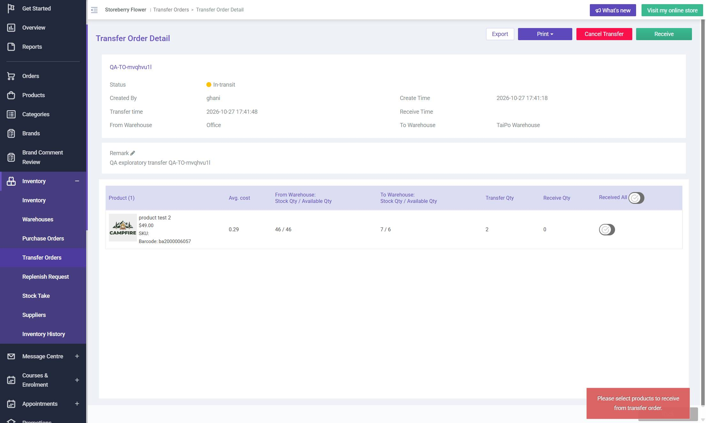

# Run report: storeberry-crm / exploratory-2026-10-27-stock-movement / staging

| Field | Value |
|---|---|
| Result | **FAIL (1 failed)** |
| Run | 2026-10-27_1652_staging_manual |
| Runner | manual |
| Base URL | https://www.stagingl10.storeberry.xyz/ |
| Started | 2026-10-27 16:52 |
| Duration | 0.2s |

## Summary

| Total | Pass | Fail | Flaky | Blocked | Skipped |
|---:|---:|---:|---:|---:|---:|
| 5 | 4 | 1 | 0 | 0 | 0 |

## Results

| ID | Title | Status | Checks | Time | Notes | Evidence |
|---|---|---|---|---|---|---|
| SCRM-022 | Inventory quantities reflect selected warehouse and product variants | pass | 3/3 | 0.0s | - | - |
| SCRM-028 | Transfer receipt moves stock between warehouses | pass | 3/3 | 0.0s | - | - |
| SCRM-029 | Approved replenishment request creates a linked transfer | pass | 2/2 | 0.0s | - | - |
| SCRM-049 | Reject a payment-review order and verify rejection history | pass | 2/2 | 0.0s | - | - |
| SCRM-094 | Receiving a transfer with no product toggled tells staff to select items | fail | 1/2 | 0.0s | product-bug; BUG-019 | [1](screenshots/SCRM-094-m01-receive-nothing-toggled.jpg) |

## Failures and warnings

### SCRM-094: Receiving a transfer with no product toggled tells staff to select items (fail)

- Failure type: product-bug (bug BUG-019)
- Source: `projects/storeberry-crm/cases/inventory/SCRM-094-receiving-a-transfer-with-no-product.md`
- Failed: A message says to select at least one product (or Receive is disabled)
- Note: Receive > OK with no row toggled: POST /inventory/transfer-receive 200, no message, still In-transit (twice).

## Notes

Exploratory session explorations/2026-10-27-stock-movement.md
