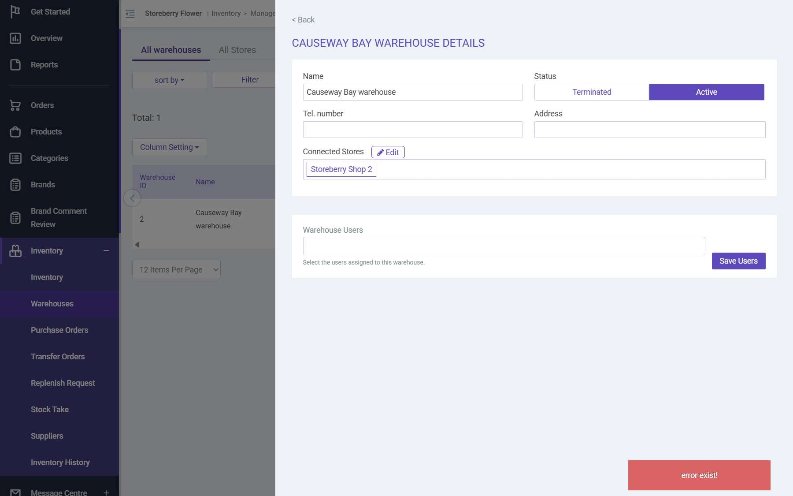

# Run report: storeberry-crm / exploratory-2026-10-27-stock-take-setup / staging

| Field | Value |
|---|---|
| Result | **FAIL (1 failed)** |
| Run | 2026-10-27_1700_staging_manual |
| Runner | manual |
| Base URL | https://www.stagingl10.storeberry.xyz/ |
| Started | 2026-10-27 17:00 |
| Duration | 0.1s |

## Summary

| Total | Pass | Fail | Flaky | Blocked | Skipped |
|---:|---:|---:|---:|---:|---:|
| 1 | 0 | 1 | 0 | 0 | 0 |

## Results

| ID | Title | Status | Checks | Time | Notes | Evidence |
|---|---|---|---|---|---|---|
| SCRM-095 | Warehouse Users panel shows the users already mapped to the warehouse | fail | 0/2 | 0.0s | product-bug; BUG-020 | [1](screenshots/SCRM-095-m01-warehouse-users-empty.jpg) |

## Failures and warnings

### SCRM-095: Warehouse Users panel shows the users already mapped to the warehouse (fail)

- Failure type: product-bug (bug BUG-020)
- Source: `projects/storeberry-crm/cases/inventory/SCRM-095-warehouse-users-panel-shows-the-users.md`
- Failed: The mapped users are shown as selected chips
- Failed: No "error exist!" toast appears
- Note: TaiPo (twice) and Causeway Bay: Warehouse Users empty + "error exist!" while get-warehouse-detail mapped_user_ids holds users (serialized PHP collection object).

## Notes

Stock take setup follow-up, explorations/2026-10-27-stock-movement.md
