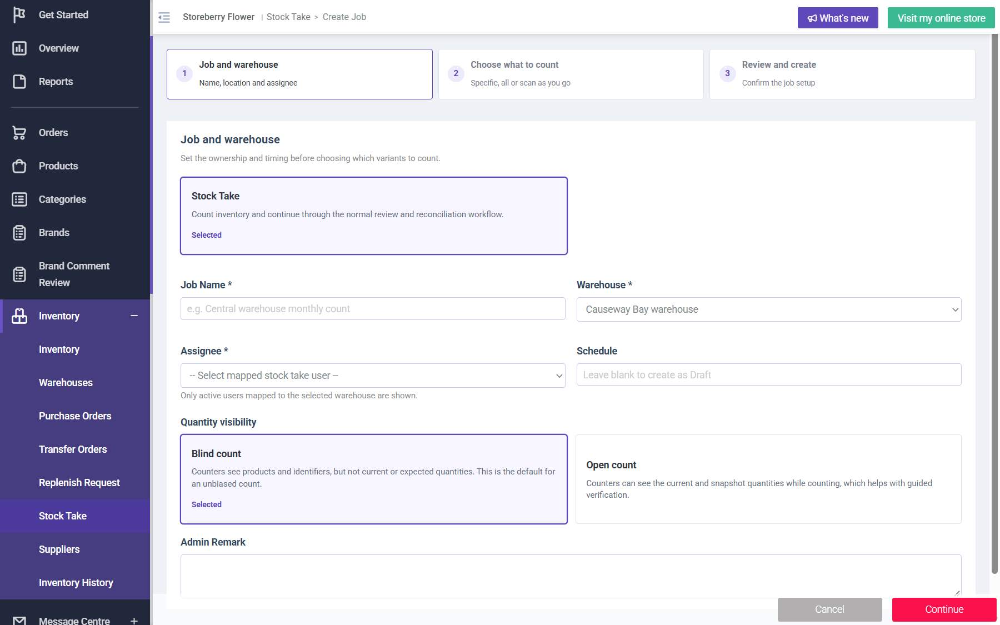

# Run report: storeberry-crm / exploratory-2026-10-27-stock-take / staging

| Field | Value |
|---|---|
| Result | **FAIL (1 failed)** |
| Run | 2026-10-27_1707_staging_manual |
| Runner | manual |
| Base URL | https://www.stagingl10.storeberry.xyz/ |
| Started | 2026-10-27 17:07 |
| Duration | 0.1s |

## Summary

| Total | Pass | Fail | Flaky | Blocked | Skipped |
|---:|---:|---:|---:|---:|---:|
| 1 | 0 | 1 | 0 | 0 | 0 |

## Results

| ID | Title | Status | Checks | Time | Notes | Evidence |
|---|---|---|---|---|---|---|
| SCRM-030 | Completed stock take records variances and updates inventory | fail | 0/3 | 0.0s | product-bug; BUG-021 | [1](screenshots/SCRM-030-m01-assignee-empty.jpg) |

## Failures and warnings

### SCRM-030: Completed stock take records variances and updates inventory (fail)

- Failure type: product-bug (bug BUG-021)
- Source: `projects/storeberry-crm/cases/inventory/SCRM-030-completed-stock-take-records-variances.md`
- Failed: The job progresses through the applicable In Progress, Submitted, Reviewed, and Completed states.
- Failed: The initial variance equals staff count minus the snapshot quantity.
- Failed: The completed count is reflected in inventory and a corresponding movement appears in Inventory History.
- Note: Blocked at job creation: Assignee list empty for every warehouse although ghani now has Stock Take Staff + Admin and is mapped (also after re-login). No job could be created.

## Notes

Stock take retest after the user gave ghani Stock Take roles
