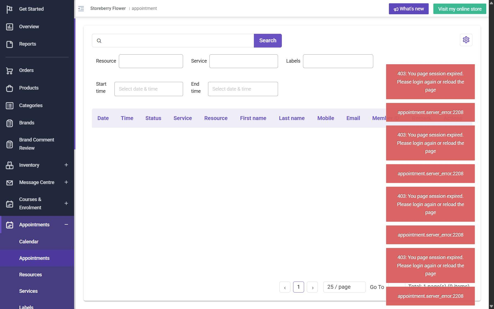

# Run report: storeberry-crm / exploratory-2026-10-27-appointments-loyalty-prom / staging

| Field | Value |
|---|---|
| Result | **FAIL (1 failed)** |
| Run | 2026-10-27_1745_staging_manual |
| Runner | manual |
| Base URL | https://www.stagingl10.storeberry.xyz/ |
| Started | 2026-10-27 17:45 |
| Duration | 0.2s |

## Summary

| Total | Pass | Fail | Flaky | Blocked | Skipped |
|---:|---:|---:|---:|---:|---:|
| 4 | 3 | 1 | 0 | 0 | 0 |

## Results

| ID | Title | Status | Checks | Time | Notes | Evidence |
|---|---|---|---|---|---|---|
| SCRM-059 | Book an available appointment slot for a QA customer | fail | 1/3 | 0.0s | product-bug; BUG-022 | [1](screenshots/SCRM-059-m01-appointments-empty-403.jpg) |
| SCRM-066 | Redeem loyalty points and reconcile balance and checkout discount | pass | 3/3 | 0.0s | - | - |
| SCRM-035 | Eligible cart items receive the promotion-code discount | pass | 3/3 | 0.0s | - | - |
| SCRM-036 | Free-gift promotion offers its gift when the threshold is met | pass | 3/3 | 0.0s | - | - |

## Failures and warnings

### SCRM-059: Book an available appointment slot for a QA customer (fail)

- Failure type: product-bug (bug BUG-022)
- Source: `projects/storeberry-crm/cases/appointments/SCRM-059-book-an-available-appointment-slot-for.md`
- Failed: The appointment record shows the selected service, resource, date, and time.
- Failed: The appointment has a confirmed/booked state and is linked to the QA customer.
- Note: CRM Appointments cannot show anything (403 on all appointment APIs). Booked instead from the eShop as guest Siu Ming Wong (example.com): resource Course, service Thai, 2026-10-29 14:00-14:30 -> "Your appointment is scheduled", record page token f99476b6...; validation OK (required fields, numeric mobile, email format). Overlapping slots 13:45/14:00/14:15 disappear afterwards. Not visible in the CRM.

## Notes

Exploratory: appointments, loyalty redemption, promotions
