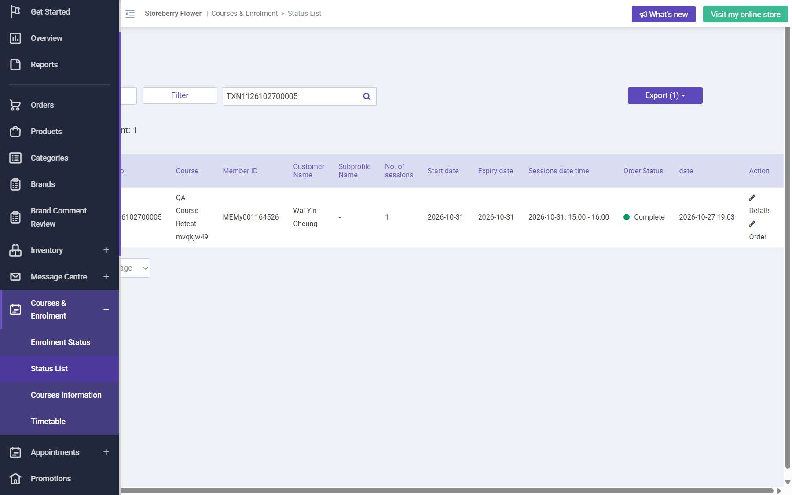

# Run report: storeberry-crm / exploratory-2026-10-27-course-reports-egift / staging

| Field | Value |
|---|---|
| Result | **FAIL (1 failed)** |
| Run | 2026-10-27_1838_staging_manual |
| Runner | manual |
| Base URL | https://www.stagingl10.storeberry.xyz/ |
| Started | 2026-10-27 18:38 |
| Duration | 0.3s |

## Summary

| Total | Pass | Fail | Flaky | Blocked | Skipped |
|---:|---:|---:|---:|---:|---:|
| 8 | 7 | 1 | 0 | 0 | 0 |

## Results

| ID | Title | Status | Checks | Time | Notes | Evidence |
|---|---|---|---|---|---|---|
| SCRM-096 | Member buys a course on the eShop and is enrolled after payment is accepted | pass | 3/3 | 0.0s | - | - |
| SCRM-064 | Reject enrollment when a course session is full | pass | 2/2 | 0.0s | - | - |
| SCRM-097 | Status List Details and Order links open the enrolment and its order | fail | 0/2 | 0.0s | product-bug; BUG-023 | [1](screenshots/SCRM-097-m01-status-list.jpg) |
| SCRM-031 | Sales report updates by channel and date period | pass | 2/2 | 0.0s | - | - |
| SCRM-032 | Payment report separates payments, refunds, and net amounts | pass | 2/2 | 0.0s | - | - |
| SCRM-033 | Top-products report ranks results for the selected period | pass | 2/2 | 0.0s | - | - |
| SCRM-067 | Reserve and redeem an eligible QA eGift | pass | 2/2 | 0.0s | - | - |
| SCRM-068 | Reject redemption of an expired or unavailable eGift | pass | 2/2 | 0.0s | - | - |

## Failures and warnings

### SCRM-097: Status List Details and Order links open the enrolment and its order (fail)

- Failure type: product-bug (bug BUG-023)
- Source: `projects/storeberry-crm/cases/courses/SCRM-097-status-list-details-and-order-links.md`
- Failed: Details opens the enrolment (session, learner, status)
- Failed: Order opens the linked order detail
- Note: Details and Order do nothing on any row.

## Notes

Course eShop flow, reports, eGift
