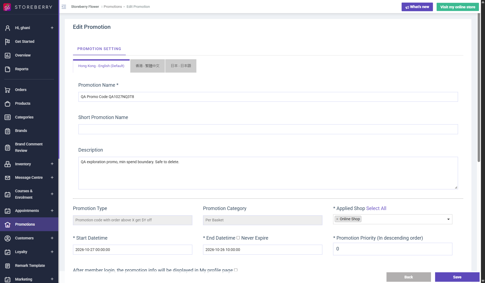
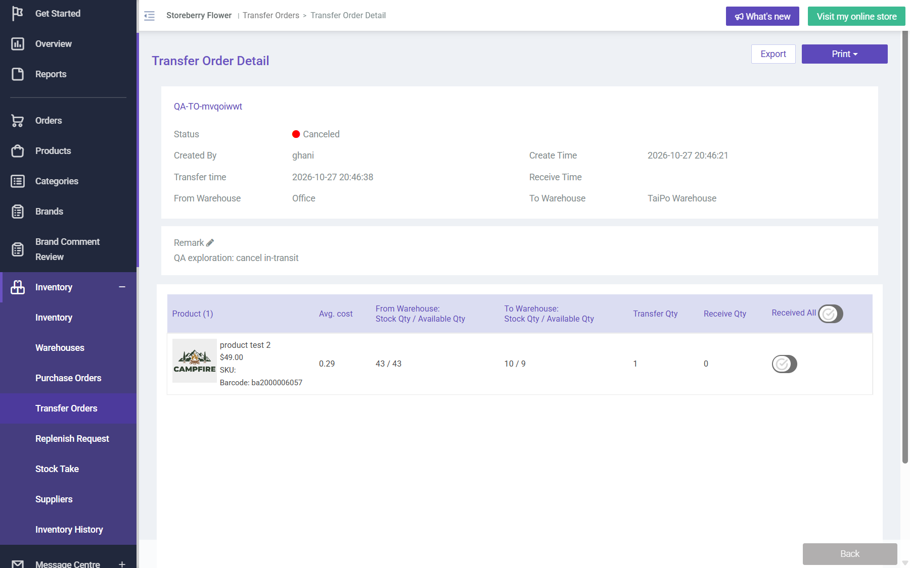

# Run report: storeberry-crm / exploratory-2026-10-27-promotions-transfers / staging

| Field | Value |
|---|---|
| Result | **FAIL (2 failed)** |
| Run | 2026-10-28_0514_staging_manual |
| Runner | manual |
| Base URL | https://www.stagingl10.storeberry.xyz/ |
| Started | 2026-10-28 05:14 |
| Duration | 0.4s |

## Summary

| Total | Pass | Fail | Flaky | Blocked | Skipped |
|---:|---:|---:|---:|---:|---:|
| 8 | 6 | 2 | 0 | 0 | 0 |

## Results

| ID | Title | Status | Checks | Time | Notes | Evidence |
|---|---|---|---|---|---|---|
| SCRM-098 | Minimum-spend promo code created in the CRM discounts an eShop basket that reaches the minimum | pass | 3/3 | 0.0s | - | - |
| SCRM-099 | Promo discount is removed when the basket drops below the minimum spend | pass | 3/3 | 0.0s | - | - |
| SCRM-100 | Promo code is refused when the basket is below the minimum spend | pass | 3/3 | 0.0s | - | - |
| SCRM-101 | Expired promo code is refused on the eShop | pass | 3/3 | 0.0s | - | - |
| SCRM-102 | Promotion save rejects an End Datetime earlier than the Start Datetime | fail | 0/2 | 0.0s | product-bug; BUG-024 | [1](screenshots/SCRM-102-m01-end-before-start-saved.png) |
| SCRM-103 | Edit a QA promotion, then delete it with confirmation | pass | 2/2 | 0.0s | - | - |
| SCRM-104 | Partial receive moves stock only for the received transfer row | pass | 4/4 | 0.0s | - | - |
| SCRM-105 | Cancelling an In-transit transfer returns the stock to the source warehouse | fail | 2/3 | 0.0s | product-bug; BUG-025 | [1](screenshots/SCRM-105-m01-transfer-time-is-cancel-time.png) |

## Failures and warnings

### SCRM-102: Promotion save rejects an End Datetime earlier than the Start Datetime (fail)

- Failure type: product-bug (bug BUG-024)
- Source: `projects/storeberry-crm/cases/promotions/SCRM-102-promotion-save-rejects-an-end-datetime.md`
- Failed: A message says the end datetime must be after the start datetime
- Failed: The page stays on the form and no promotion is added (list count unchanged)
- Note: End datetime before start saved silently; listed as expired (BUG-024).

### SCRM-105: Cancelling an In-transit transfer returns the stock to the source warehouse (fail)

- Failure type: product-bug (bug BUG-025)
- Source: `projects/storeberry-crm/cases/inventory/SCRM-105-cancelling-an-in-transit-transfer-returns.md`
- Failed: Transfer time is empty or shows the real shipping time (not the cancel time)
- Note: Transfer 312 QA-TO-mvqoiwwt: Canceled, Office 43/43 restored, history complete. Transfer time 20:46:38 = the cancel time (BUG-025). Screenshot taken 2026-10-28 from the same transfer.

## Notes

Recorded 2026-10-28 for the 2026-10-27 evening exploration (promotions, transfers).
