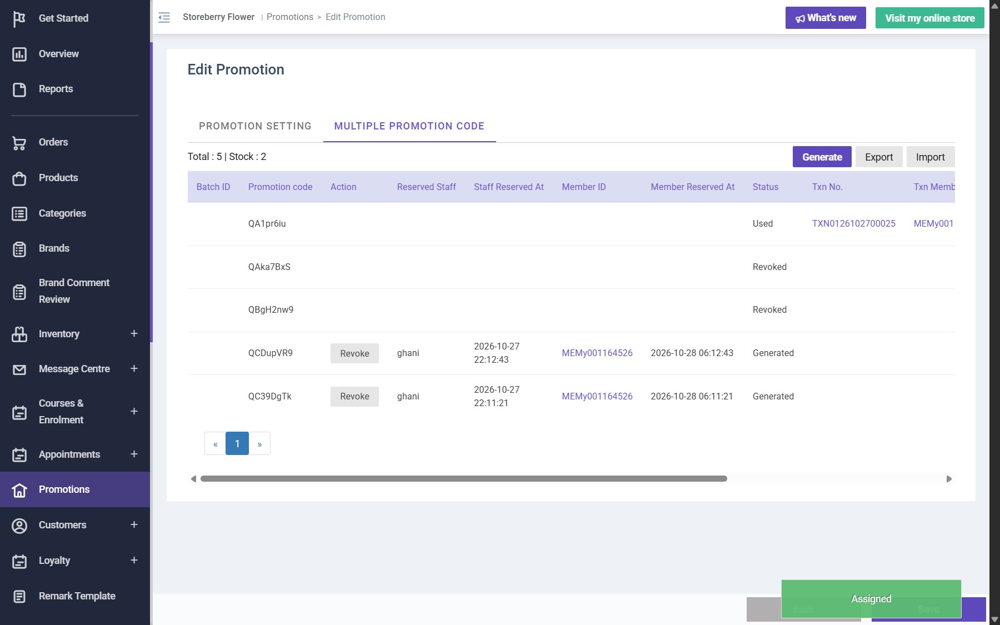

# Run report: storeberry-crm / exploratory-2026-10-28-promo-code-orders / staging

| Field | Value |
|---|---|
| Result | **FAIL (1 failed)** |
| Run | 2026-10-28_0516_staging_manual |
| Runner | manual |
| Base URL | https://www.stagingl10.storeberry.xyz/ |
| Started | 2026-10-28 05:16 |
| Duration | 0.3s |

## Summary

| Total | Pass | Fail | Flaky | Blocked | Skipped |
|---:|---:|---:|---:|---:|---:|
| 6 | 5 | 1 | 0 | 0 | 0 |

## Results

| ID | Title | Status | Checks | Time | Notes | Evidence |
|---|---|---|---|---|---|---|
| SCRM-106 | Single-use generated promo code discounts an eShop order once and is marked Used with the order | pass | 5/5 | 0.0s | - | - |
| SCRM-107 | Generating promotion codes is limited by the promotion code quota | pass | 3/3 | 0.0s | - | - |
| SCRM-108 | A revoked promotion code is refused on the eShop, also when it was applied before it was revoked | pass | 3/3 | 0.0s | - | - |
| SCRM-109 | Codes that require member assignment work only after they are assigned to the member | pass | 4/4 | 0.0s | - | - |
| SCRM-110 | Voiding an unpaid eShop order releases its reserved stock | pass | 3/3 | 0.0s | - | - |
| SCRM-111 | Promotion code list shows all times in the same local time zone | fail | 0/2 | 0.0s | product-bug; BUG-026 | [1](screenshots/SCRM-111-m01-staff-reserved-at-8h-behind.png) |

## Failures and warnings

### SCRM-111: Promotion code list shows all times in the same local time zone (fail)

- Failure type: product-bug (bug BUG-026)
- Source: `projects/storeberry-crm/cases/promotions/SCRM-111-promotion-code-list-shows-all-times-in.md`
- Failed: Staff Reserved At and Member Reserved At equal the local time of the assignment
- Failed: Created At / Updated At are local time in the same readable format (no UTC "Z" marker on local times)
- Note: Staff Reserved At 2026-10-27 22:12:43 vs Member Reserved At 2026-10-28 06:12:43 (QCDupVR9); Updated At 2026-10-28T06:12:43.000000Z.

## Notes

Exploration 2026-10-28: single-use promo codes on real eShop orders, revoke, assignment, void and stock.
