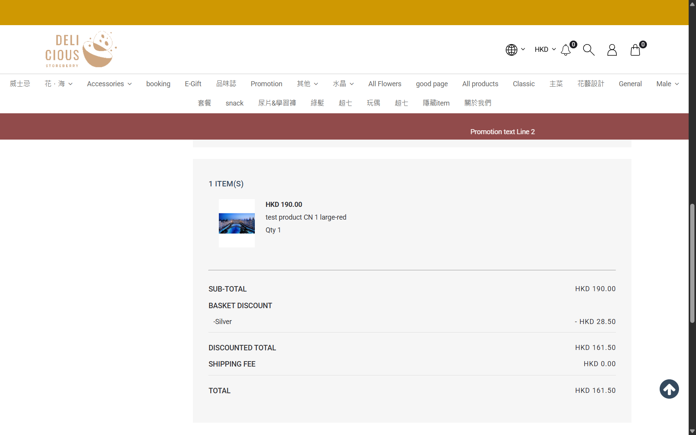

# Run report: storeberry-crm / retest-bug-010-order-edit / staging

| Field | Value |
|---|---|
| Result | **FAIL (1 failed)** |
| Run | 2026-10-28_0549_staging_manual |
| Runner | manual |
| Base URL | https://www.stagingl10.storeberry.xyz/ |
| Started | 2026-10-28 05:49 |
| Duration | 0.2s |

## Summary

| Total | Pass | Fail | Flaky | Blocked | Skipped |
|---:|---:|---:|---:|---:|---:|
| 1 | 0 | 1 | 0 | 0 | 0 |

## Results

| ID | Title | Status | Checks | Time | Notes | Evidence |
|---|---|---|---|---|---|---|
| SCRM-077 | Edit this order keeps warehouse, shipping store, remark and product names | fail | 2/5 | 0.0s | product-bug; BUG-010 | [1](screenshots/SCRM-077-m01-pos-preselects-taipo.png) [2](screenshots/SCRM-077-m02-replacement-order.png) [3](screenshots/SCRM-077-m03-customer-sees-cn-name.png) |

## Failures and warnings

### SCRM-077: Edit this order keeps warehouse, shipping store, remark and product names (fail)

- Failure type: product-bug (bug BUG-010)
- Source: `projects/storeberry-crm/cases/orders/SCRM-077-edit-this-order-keeps-warehouse.md`
- Failed: Warehouse and Shipping Store equal the original
- Failed: Customer remark appears once
- Failed: Product names are unchanged (same language as the original)
- Note: TXN0126102700027 -> 027A: original Canceled, total 323.00 -> 161.50 (correct). Warehouse Office -> TaiPo (line now Pre-order Qty 1), Shipping Store dropped, customer remark twice, "test product CN 1" in CRM and eShop. Internal remark has the original number. 027A voided afterwards.

## Notes

Retest of BUG-010 (Edit this order), 2026-10-28.
