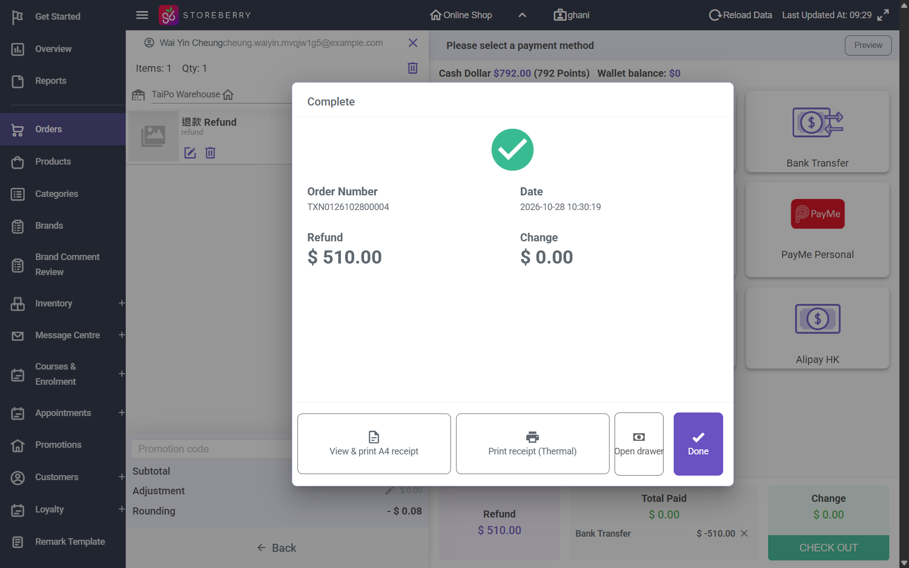

# Run report: storeberry-crm / exploratory-2026-10-28-paid-order-changes / staging

| Field | Value |
|---|---|
| Result | **FAIL (4 failed)** |
| Run | 2026-10-28_0943_staging_manual |
| Runner | manual |
| Base URL | https://www.stagingl10.storeberry.xyz/ |
| Started | 2026-10-28 09:43 |
| Duration | 10.7s |

## Summary

| Total | Pass | Fail | Flaky | Blocked | Skipped |
|---:|---:|---:|---:|---:|---:|
| 4 | 0 | 4 | 0 | 0 | 0 |

## Results

| ID | Title | Status | Checks | Time | Notes | Evidence |
|---|---|---|---|---|---|---|
| SCRM-117 | Partial refund of one item from a paid multi-item order refunds its share of the discounts, points and stock | fail | - | 0.0s | product-bug; BUG-028 | [1](screenshots/SCRM-117-m01-01-partial-return-refunds-full-total.png) |
| SCRM-120 | Editing a paid order to a lower total records the difference as a refund and adjusts the points | fail | - | 0.0s | product-bug; BUG-027 | [1](screenshots/SCRM-120-m01-05-edit-paid-order-payment-step.png) |
| SCRM-121 | Editing a paid order to a higher total leaves the extra amount outstanding until it is paid | fail | - | 0.0s | product-bug; BUG-027 | [1](screenshots/SCRM-121-m01-12-customer-asked-to-pay-full-894.png) |
| SCRM-132 | Partial returns never refund more than the item share, and refunds on an order never exceed the amount paid | fail | - | 0.0s | product-bug; BUG-029 | [1](screenshots/SCRM-132-m01-02-cake-return-refunds-beyond-paid.png) |

## Failures and warnings

### SCRM-117: Partial refund of one item from a paid multi-item order refunds its share of the discounts, points and stock (fail)

- Failure type: product-bug (bug BUG-028)
- Source: `projects/storeberry-crm/cases/orders/SCRM-117-partial-refund-of-one-item-from-a-paid.md`
- Note: TXN0126102800001 -> refund 002: share 487.50, refund, points (-49) and stock right; level spending 1,042.00 instead of 1,529.50 (deducted twice). Reproduced on 004 and 005.

### SCRM-120: Editing a paid order to a lower total records the difference as a refund and adjusts the points (fail)

- Failure type: product-bug (bug BUG-027)
- Source: `projects/storeberry-crm/cases/orders/SCRM-120-editing-a-paid-order-to-a-lower-total.md`
- Note: Paid 894.00 order edited to 510.00: POS asked for full 510 (Total Paid 0), 006A Pending Payment with 510 outstanding, 006 Canceled with no refund, points voided.

### SCRM-121: Editing a paid order to a higher total leaves the extra amount outstanding until it is paid (fail)

- Failure type: product-bug (bug BUG-027)
- Source: `projects/storeberry-crm/cases/orders/SCRM-121-editing-a-paid-order-to-a-higher-total.md`
- Note: Paid 510.00 order edited to 894.00: Balance due 894 (not 384); 007A Pending Payment, 894 outstanding; eShop asks the customer for the full 894.

### SCRM-132: Partial returns never refund more than the item share, and refunds on an order never exceed the amount paid (fail)

- Failure type: product-bug (bug BUG-029)
- Source: `projects/storeberry-crm/cases/orders/SCRM-132-partial-returns-never-refund-more-than.md`
- Note: TXN0126102800003 paid 510.00: C share 509.92 refunded 510.00, cake share 0.08 refunded 0.10; 510.10 refunded in total.

