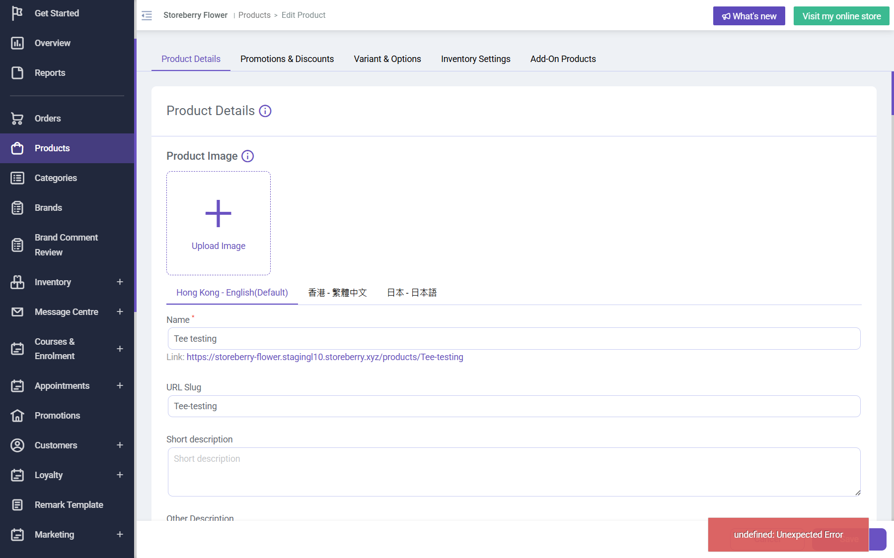

# Run report: storeberry-crm / retest-bug-005 / staging

| Field | Value |
|---|---|
| Result | **FAIL (1 failed)** |
| Run | 2026-10-30_1244_staging_manual |
| Runner | manual |
| Base URL | https://www.stagingl10.storeberry.xyz/ |
| Started | 2026-10-30 12:44 |
| Duration | 0.6s |

## Summary

| Total | Pass | Fail | Flaky | Blocked | Skipped |
|---:|---:|---:|---:|---:|---:|
| 1 | 0 | 1 | 0 | 0 | 0 |

## Results

| ID | Title | Status | Checks | Time | Notes | Evidence |
|---|---|---|---|---|---|---|
| SCRM-082 | Existing product detail opens without an error message | fail | - | 0.0s | product-bug; BUG-005 | [1](screenshots/SCRM-082-m01-toast-undefined-error.png) |

## Failures and warnings

### SCRM-082: Existing product detail opens without an error message (fail)

- Failure type: product-bug (bug BUG-005)
- Source: `projects/storeberry-crm/cases/products/SCRM-082-existing-product-detail-opens-without.md`
- Note: Retest 2026-10-30 after BUG-005 was set to verified: toast 'undefined: Unexpected Error' still shows on product detail (3 of 3: ids 3187, 3198, 3148); GET cmsapiv2.stagingl10.storeberry.xyz/cmsapi/addon-products/templates/product/3187 -> 500.

