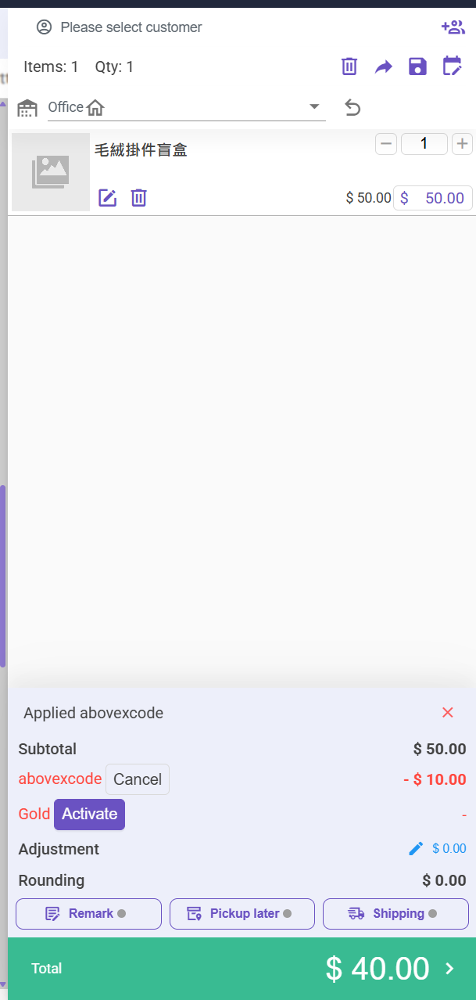

# Run report: storeberry-crm / web-pos-abovexcode / staging

| Field | Value |
|---|---|
| Result | **FAIL (1 failed)** |
| Run | 2026-11-20_0711_staging_manual |
| Runner | manual |
| Base URL | https://www.stagingl10.storeberry.xyz/ |
| Started | 2026-11-20 07:11 |
| Duration | 0.9s |

## Summary

| Total | Pass | Fail | Flaky | Blocked | Skipped |
|---:|---:|---:|---:|---:|---:|
| 2 | 1 | 1 | 0 | 0 | 0 |

## Results

| ID | Title | Status | Checks | Time | Notes | Evidence |
|---|---|---|---|---|---|---|
| SCRM-187 | Web POS takes 20% off when the cart exceeds the promo code threshold | pass | - | 0.0s | - | [1](screenshots/SCRM-187-m01-03-abovexcode-above.png) |
| SCRM-188 | Web POS enforces the advertised cutoff for an above-threshold promo code | fail | - | 0.0s | untriaged | [1](screenshots/SCRM-188-m01-02-abovexcode-exact.png) |

## Failures and warnings

### SCRM-188: Web POS enforces the advertised cutoff for an above-threshold promo code (fail)

- Failure type: untriaged
- Source: `projects/storeberry-crm/cases/pos/SCRM-188-web-pos-enforces-the-advertised-cutoff.md`
- Note: HKD 49 no discount but code marked Applied. HKD 50 received HKD 10 despite above HKD 50 wording. See Q-025.

