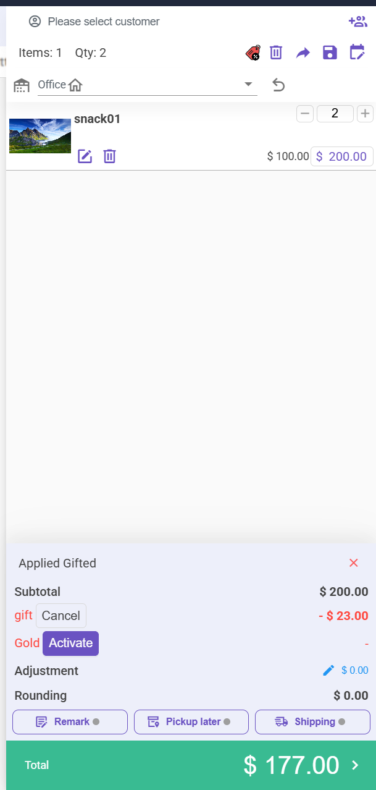

# Run report: storeberry-crm / web-pos-gifted / staging

| Field | Value |
|---|---|
| Result | **FAIL (1 failed)** |
| Run | 2026-11-20_0718_staging_manual |
| Runner | manual |
| Base URL | https://www.stagingl10.storeberry.xyz/ |
| Started | 2026-11-20 07:18 |
| Duration | 0.9s |

## Summary

| Total | Pass | Fail | Flaky | Blocked | Skipped |
|---:|---:|---:|---:|---:|---:|
| 2 | 1 | 1 | 0 | 0 | 0 |

## Results

| ID | Title | Status | Checks | Time | Notes | Evidence |
|---|---|---|---|---|---|---|
| SCRM-189 | Web POS deducts the fixed amount when a code meets its spending requirement | pass | - | 0.0s | - | [1](screenshots/SCRM-189-m01-gifted-above-cutoff.png) |
| SCRM-190 | Web POS enforces the advertised cutoff for a fixed-amount minimum-spend code | fail | - | 0.0s | untriaged | [1](screenshots/SCRM-190-m01-gifted-at-cutoff.png) |

## Failures and warnings

### SCRM-190: Web POS enforces the advertised cutoff for a fixed-amount minimum-spend code (fail)

- Failure type: untriaged
- Source: `projects/storeberry-crm/cases/pos/SCRM-190-web-pos-enforces-the-advertised-cutoff.md`
- Note: HKD 100 gave no discount although marked Applied. Exactly HKD 200 received the HKD 23 discount despite over wording. See Q-025.

