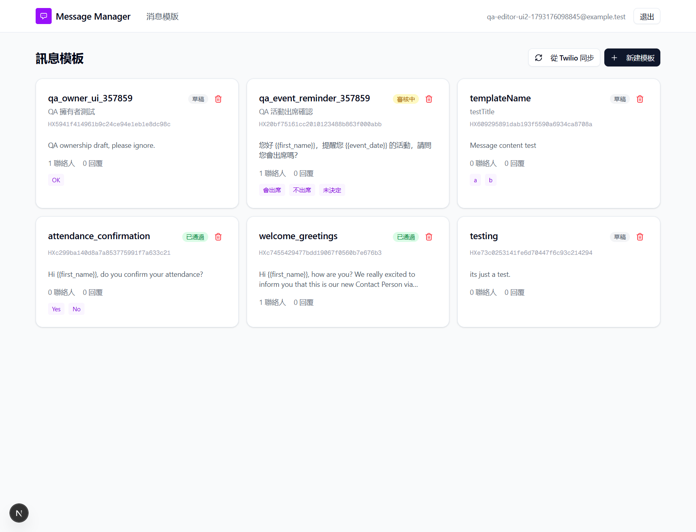

## Summary
A user with the Editor role can see and change the contacts of a template that belongs to another user. The server checks who owns the template on the template page, but not on the contacts list, the report download or the send action:
- Template page: GET /api/templates/<id> correctly returns 404 (not found) to a user who does not own the template.
- Contacts list: GET /api/templates/<id>/contacts returns the owner's contacts (names, phone numbers, member data).
- Report download: GET /api/templates/<id>/export returns the owner's report.
- Send: POST /api/send lets the request through its permission check.

## Steps to reproduce
UI only (no API calls needed):
1. Log in as admin. Create a draft template named qa_owner_<n> (Meta unticked) and upload data/contacts-valid-hk.xlsx to it.
2. Go to 用戶管理 (User management) > 添加用户 (Add user) and create a QA editor. Log out, then log in as the editor.
3. On 消息模版 (Message templates), click 從 Twilio 同步 (Sync from Twilio). The admin's templates appear in the editor's list.
4. Click the qa_owner_<n> card. The page says 模板不存在 ("Template does not exist"). This part is correct.
5. Add /contacts to the end of the URL. The 聯繫人管理 (Contact management) page lists QA Tester, phone 85265248661, with their member data.
6. Open the report link: in the template URL, change /templates/ to /api/templates/ and add /export at the end. The file reply_report_<id>.xlsx downloads.
7. On the contacts page, click 全部重置 (Reset all) and confirm: "重置成功！" ("Reset successful!") appears. Click the trash icon of QA Tester and confirm: the contact is deleted.

Sending from another user's template has no path in the UI; it was checked through the API only (see TWW-013).

## Expected
The contacts, export and send endpoints return 404 (not found) or 403 (forbidden) to a user who does not own the template, the same as the template page endpoint does.

## Actual
- Contacts: 200 (OK) with [{"name":"QA Tester","phone":"85265248661","customVars":{"會員編號":"M0001",...}}] (會員編號 = member number).
- Export: 200 (OK), the xlsx file downloads.
- Send: 400 "沒有待發送的聯繫人" ("No contacts waiting to be sent"). This error comes after the permission check, so the check passed. If the template had pending contacts, the editor would have sent real WhatsApp messages.

Reproduced twice.

## Evidence
- Screenshot: 
- Screenshot: 
- Screenshot: 
- API responses: ../explorations/2026-10-28-core-journeys/11-editor-api-probe.txt
- Screenshot: 

## Environment
- Base URL: http://localhost:3000/api/templates/<id>/contacts
- Env: local

## History
- 2026-10-28: filed from explorations/2026-10-28-core-journeys.md in the Test Manager app.
- 2026-10-28: also writes: a QA editor ran 全部重置 ("重置成功！") and deleted a contact on the admin template; the contacts page shows the data in the UI (40-editor-sees-admin-contacts.png). Linked TWW-084.
- 2026-10-28: steps rewritten as UI-only and reproduced in the browser (editor: sync, card, /contacts, report link, 全部重置, delete). Send stays API-only (TWW-013).
- 2026-10-28: rewrote Summary, Steps, Expected and Actual in plain English with English translations of the Chinese UI text; facts unchanged, no retest, status unchanged.
