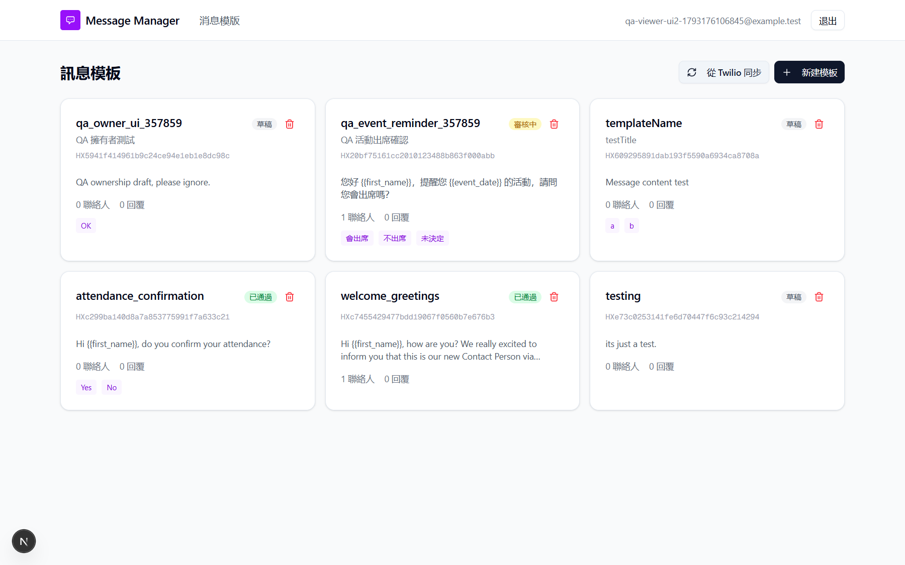
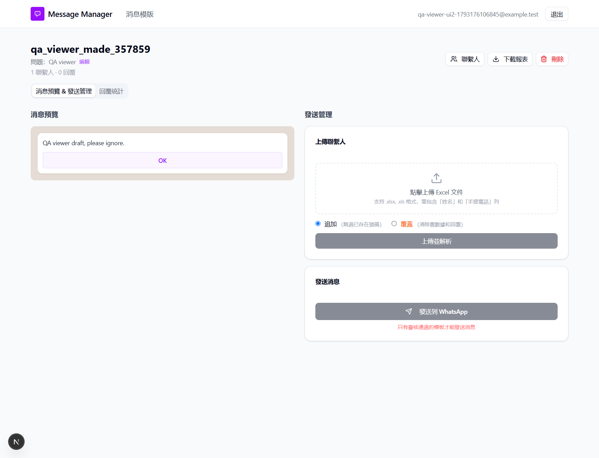

## Summary
A viewer (read-only role) can create and delete templates, upload contacts and start sends, and can see every user's templates through Sync from Twilio.

## Steps to reproduce
1. As admin, in 用戶管理 (User management) > 添加用户 (Add user), create a user with role 查看者 (Viewer). Log in as the viewer.
2. On 消息模版 (Message templates), click 從 Twilio 同步 (Sync from Twilio).
3. Click 新建模板 (New template), untick Meta, enter a unique name (e.g. qa_viewer_<n>), body "QA viewer draft", one button "OK", and click 創建模板 (Create template).
4. Open the new template and upload an Excel file with one contact (columns 姓名 (Name) and 手提電話 (Mobile phone)).
5. Delete the template (this is also the cleanup).
6. Optional API check, in the browser console: `await fetch('/api/twilio/templates').then(r => r.json())` and `await fetch('/api/templates').then(r => r.json())`

## Expected
Every write action is refused with 403 "無權限" ("No permission"). The viewer only sees templates it is allowed to read.

## Actual
- Step 2: "同步成功！共 <N> 個模板" ("Sync successful! <N> templates in total") and all of the admin's templates are listed.
- Step 3: "模板已創建！" ("Template created!").
- Step 4: "上傳成功！" ("Upload successful!") and 1 聯繫人 (1 contact).
- Step 5: the template is deleted.
- Step 6: /api/twilio/templates returns 200 (OK) with all of the admin's templates, while /api/templates returns [] (empty list) for the same user.

Our run: sync said "同步成功！共 6 個模板". Direct API calls as the viewer: create returned 400 "模板名稱和內容為必填" ("Template name and content are required"), a form check, so the permission check had passed; upload 500 "處理Excel失敗" ("Failed to process Excel"); send 400 "沒有待發送的聯繫人" ("No contacts waiting to be sent"). None of them was a permission error.

## Evidence
- Screenshot: 
- Screenshot: 
- API responses: ../explorations/2026-10-28-core-journeys/11-editor-api-probe.txt
- Screenshot: 

## Environment
- Base URL: http://localhost:3000/api/twilio/templates/create
- Env: local

## History
- 2026-10-28: filed from explorations/2026-10-28-core-journeys.md in the Test Manager app.
- 2026-10-28: UI check: the viewer gets the same UI as an editor (新建模板 form, sync); an editor's 從 Twilio 同步 lists all admin templates (41-editor-after-sync.png). Linked TWW-087, TWW-088.
- 2026-10-28: steps rewritten as UI-only and reproduced in the browser (viewer: sync shows admin templates, create template, upload contacts, delete own template).
- 2026-10-28: rewrote Summary, Steps, Expected and Actual in plain English with English translations of the Chinese UI text; facts unchanged, no retest, status unchanged.
- 2026-10-28: steps made reproducible on any local setup (placeholders 
, <template id>, <n> and test data described row by row instead of our template IDs, phone and data files); Summary shortened to 1-2 sentences; our observed values kept under Actual ("Our run").
