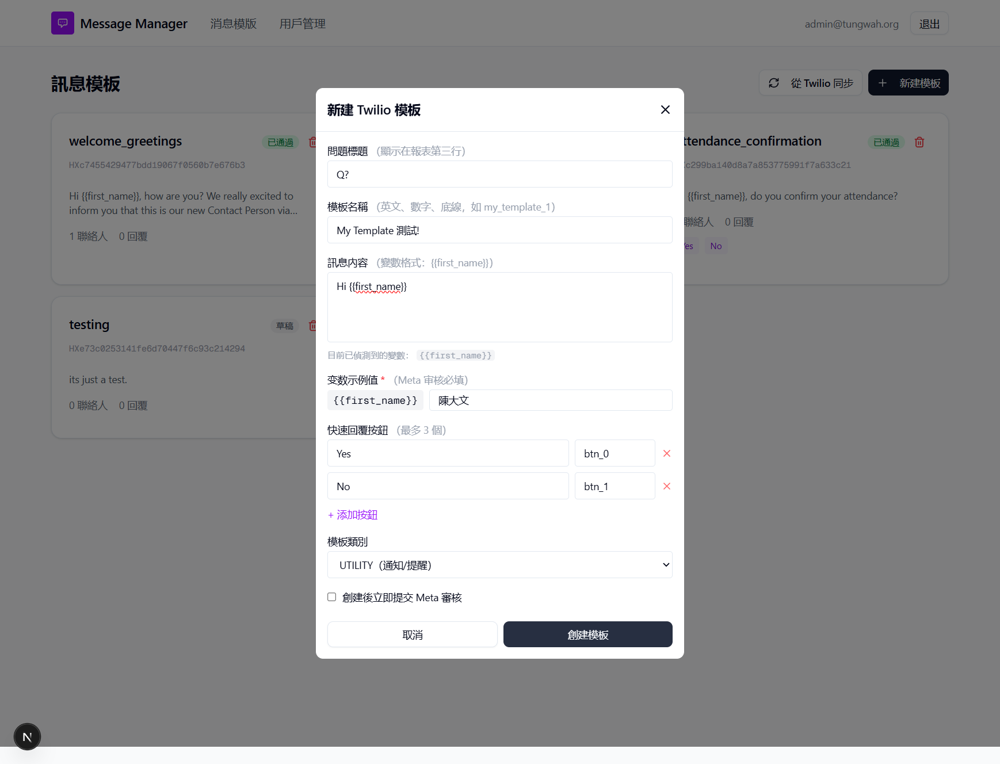

## Summary
The template name hint says to use only English letters, numbers and underscores. However, the form, API and Twilio accept a name with spaces and Chinese characters; the original report says Meta will reject it on submission.

## UI labels in English
- 新建模板: New template
- 創建模板: Create template
- 模板已創建！: Template created!

## Steps to reproduce
1. Open 新建模板, untick Meta submission
2. Name "QA Draft 測試 1793168875770", body "QA draft, please ignore.", button OK
3. Click 創建模板

## Expected
A validation message; no template created.

## Actual
Alert "模板已創建！"; Twilio content HX4fdb2bf84325db06231c9e4e918bc937 created with that friendly_name (deleted afterwards).

## Evidence
- Screenshot: 

## Environment
- Base URL: http://localhost:3000/templates
- Env: local

## History
- 2026-10-28: Clarified the report in English and replaced personal details in the report text with placeholders; no retest or status change.
- 2026-10-28: filed from explorations/2026-10-28-core-journeys.md in the Test Manager app.
