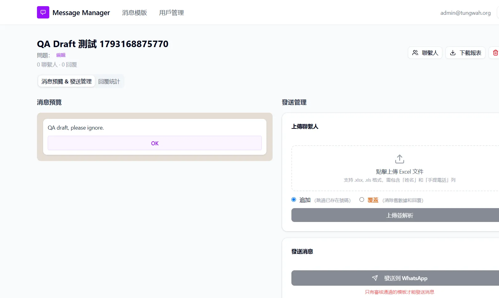

## Summary
A question title containing only spaces is saved. The header displays "問題：" (Question:) with nothing after it, instead of the unset-title message; the report question row would also be blank.

## UI labels in English
- 儲存: Save
- 編輯: Edit
- 問題: Question

## Steps to reproduce
1. Open a template with a question title
2. Click 編輯, enter "   ", click 儲存

## Expected
Title cleared; header shows 未設定問題標題.

## Actual
Header shows "問題：" with nothing after it.

## Evidence
- Screenshot: 

## Environment
- Base URL: http://localhost:3000/templates
- Env: local

## History
- 2026-10-28: Clarified the report in English and replaced personal details in the report text with placeholders; no retest or status change.
- 2026-10-28: filed from explorations/2026-10-28-core-journeys.md in the Test Manager app.
