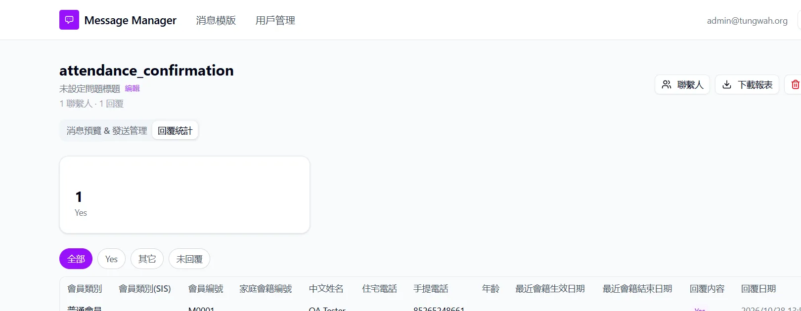

## Summary
The WhatsApp webhook does not check Twilio's signature, so anyone who can reach the URL can save fake Yes/No replies for any member who was sent a template.

## Steps to reproduce
1. With the app running, send a request without an X-Twilio-Signature header, from PowerShell or a terminal: `curl.exe -X POST http://localhost:3000/api/webhook/whatsapp -d "From=whatsapp:+85200000000" -d "Body=QA unsigned probe" -d "MessageSid=SMqa123"` (use `curl` on macOS/Linux).
2. Look at the response and the dev server log.
3. Optional: repeat with From=whatsapp:+852
 where 852
 is a contact that was sent a template, and Body=Yes; then open 回覆統計 (Reply statistics).

## Expected
Requests without a valid Twilio signature are rejected (403) and not saved as replies.

## Actual
- 200 (OK). The log shows "Twilio Webhook 收到消息 ... QA unsigned probe" ("Twilio webhook received message"), then "未找到匹配的聯繫人" ("No matching contact found"), only because +85200000000 belongs to no contact.
- With a contact's number (step 3), the fake answer is recorded.
- Code: handleTwilioWebhook has no signature check. (The WhatsApp Cloud API branch does check the x-hub-signature-256 header.)

Our run: sent to the public ngrok URL https://<ngrok-domain>/api/webhook/whatsapp, so it works from the internet whenever the app is exposed for Twilio.

## Evidence
- Screenshot: 

## Environment
- Base URL: https://<ngrok-domain>/api/webhook/whatsapp
- Env: local

## History
- 2026-10-28: filed from explorations/2026-10-28-core-journeys.md in the Test Manager app.
- 2026-10-28: rewrote Summary, Steps, Expected and Actual in plain English with English translations of the Chinese UI text; facts unchanged, no retest, status unchanged.
- 2026-10-28: steps made reproducible on any local setup (placeholders 
, <template id>, <n> and test data described row by row instead of our template IDs, phone and data files); Summary shortened to 1-2 sentences; our observed values kept under Actual ("Our run").
- 2026-10-29: status open -> verified; Retest passed in runs/2026-10-29_1630_local_manual (dev fix commit af9a789)..
