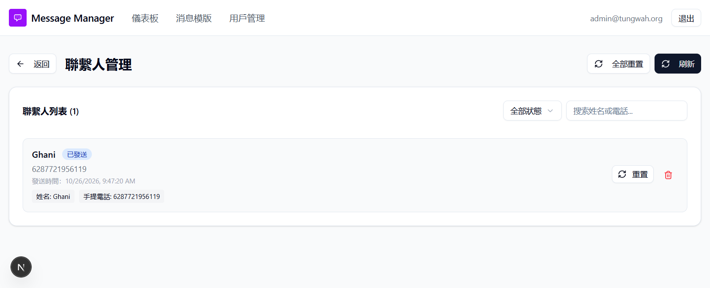

## Summary
The app never tracks delivery, read or failure from Twilio, so a message that was never delivered still shows 已發送 (Sent) and delivery/read times stay empty.

## Steps to reproduce
A. Read receipts (only the app and your phone, nothing to type in a console)
1. In the app open an approved template (消息模版 > the template), upload an Excel row with your own WhatsApp number 852
 and click 發送到 WhatsApp (Send to WhatsApp).
2. On your phone open the message so WhatsApp shows two blue ticks (read). Do not reply.
3. In the app click 聯繫人 (Contacts), then 刷新 (Refresh). Also open 儀表板 (Dashboard) > 消息記錄 (Message records).

B. Failed delivery (no new message needed if such a contact already exists)
4. Find or create a contact whose number cannot receive WhatsApp (e.g. a number that has no WhatsApp account) and send to it as in step 1.
5. Open 聯繫人 (Contacts) and click 刷新 (Refresh).

Optional cross-check of what Twilio knows: Twilio Console > Monitor > Logs > Messaging, search the number.

## Expected
Contact status follows the message: 已送達 (Delivered) once it reaches the phone, 已讀 (Read) once opened, 失敗 (Failed) with the reason if it is not delivered. The app already has these labels.

## Actual
- Step 3: the contact stays 已發送 (Sent) with only 發送時間 (Sent time); it never changes to 已送達 or 已讀. It only changes (to 已讀, still without delivered/read times) when the member replies.
- Step 5: the contact shows 已發送 (Sent) although Twilio reports the message Undelivered.
- Cause: sends set no status callback (Twilio's status_callback_url for the sender is empty) and the webhook has no MessageStatus handling.

Our run (2026-10-29, no new send): welcome_greetings > 聯繫人, contact Ghani (+62 877 2195 6119), sent 26 Oct: the app shows 已發送; Twilio reports undelivered, error 63058. QA Tester (+852 6524 8661) on qa_event_reminder_357859: Twilio read, app READ only because a reply arrived, deliveredAt and readAt empty. Earlier runs: +8520000000 Undelivered in Twilio, SENT in the app.

## Evidence
- Contact still 已發送 (Sent) although Twilio says undelivered: 
- Screenshot: 

## Environment
- Base URL: http://localhost:3000/templates/<template id>/contacts
- Env: local

## History
- 2026-10-28: filed from explorations/2026-10-28-core-journeys.md in the Test Manager app.
- 2026-10-28: reproduced with the tunnel up: +8520000000 Undelivered in Twilio, contact stays SENT (22-twilio-merged-and-invalid.jpg).
- 2026-10-28: rewrote Summary, Steps, Expected and Actual in plain English with English translations of the Chinese UI text; facts unchanged, no retest, status unchanged.
- 2026-10-28: steps made reproducible on any local setup (placeholders 
, <template id>, <n> and test data described row by row instead of our template IDs, phone and data files); Summary shortened to 1-2 sentences; our observed values kept under Actual ("Our run").
- 2026-10-29: Still fails in runs/2026-10-29_1630_local_manual: af9a789 only records send errors (errorCode/errorMessage/failedAt); no Twilio status callback is set, so a message Twilio reports delivered/read stays 已發送 until the member replies..
- 2026-10-29: steps rewritten to use only the app screens and the phone (no browser console); added the no-send check on an existing undelivered contact (Ghani, Twilio error 63058); status unchanged.
- 2026-10-30: status open -> verified; Retest passed in runs/2026-10-30_1349_local_manual (TWW-039): real send DELIVERED then READ through our ngrok callback, both timestamps populated and Twilio status read; signed undelivered replay on the disposable contact returned 200 and recorded FAILED/63058/failedAt. Runtime PUBLIC_URL had to be set to our tunnel. No new send to a non-HK number..
