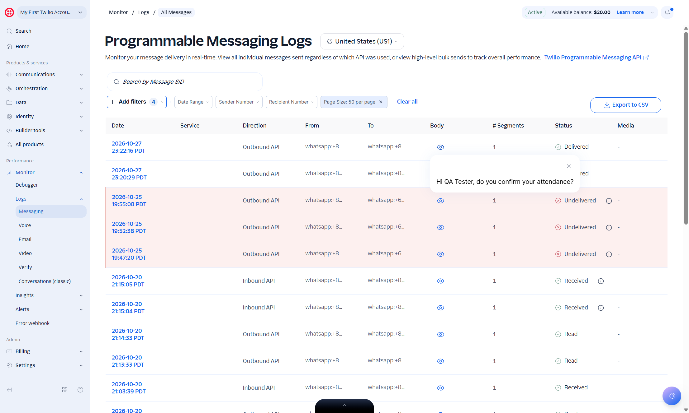

## Summary
The app never learns from Twilio whether a message was delivered, read or failed:
- When sending, the app gives Twilio no status callback (the URL where Twilio reports status changes).
- The webhook has no code for MessageStatus updates.

So deliveredAt and readAt (delivery and read times) always stay empty (null). A message that Twilio marks Undelivered (contact Ghani, +6287721956119) still shows 已發送 (Sent). A message that was delivered and read only changes to READ when the member replies.

## Steps to reproduce
1. With the tunnel up, send attendance_confirmation to the QA contact.
2. Let it be delivered and read (Twilio log: Delivered, then Read).
3. Before any reply, open 聯繫人 (Contacts) or the contacts API.
4. Check the contact Ghani on the template welcome_greetings (Twilio: Undelivered).

## Expected
Contact status and times follow Twilio (delivered, read, failed/undelivered).

## Actual
- Status stays SENT and deliveredAt/readAt stay null until a reply arrives; then the status becomes READ, still without times.
- Ghani stays 已發送 (Sent) although Twilio says Undelivered.
- In Twilio, the sender's status_callback_url is empty.

## Evidence
- Screenshot: 

## Environment
- Base URL: http://localhost:3000/templates/cmvongu2u0007kjy3stn25txd/contacts
- Env: local

## History
- 2026-10-28: filed from explorations/2026-10-28-core-journeys.md in the Test Manager app.
- 2026-10-28: reproduced with the tunnel up: +8520000000 Undelivered in Twilio, contact stays SENT (22-twilio-merged-and-invalid.jpg).
- 2026-10-28: rewrote Summary, Steps, Expected and Actual in plain English with English translations of the Chinese UI text; facts unchanged, no retest, status unchanged.
