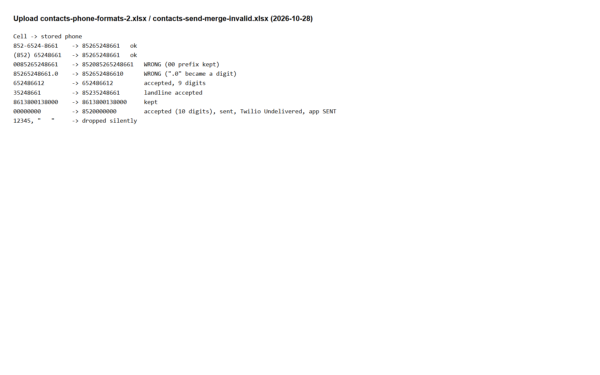

## Summary
Upload accepts phone numbers that are not valid HK mobiles and turns some common formats into wrong numbers, so messages can go to wrong or non-existent numbers (even abroad).

## Steps to reproduce
1. Open a draft template with no contacts.
2. Upload an Excel file (columns 姓名 (Name), 手提電話 (Mobile phone)) with these phones: "00852
", "852
.0", a 9-digit number (e.g. "
2"), a 10-digit number, "00000000".
3. Open 聯繫人 (Contacts).
4. Optional (sends real messages): upload "00000000" to an APPROVED template and send.

## Expected
"00852
" and "852
.0" both become 852
. The 9-digit, 10-digit and all-zero numbers are rejected and reported.

## Actual
- "00852
" becomes 8520852
 (wrong number: 852 is added in front of 0852
).
- "852
.0" becomes 852
0 (wrong number).
- The 9-digit number is kept as it is.
- "00000000" becomes 8520000000; when sent, Twilio says Undelivered while the app shows SENT.

Our run (data/contacts-phone-formats-2.xlsx, data/contacts-send-merge-invalid.xlsx): "0085265248661" became 852085265248661; "85265248661.0" became 852652486610; "652486612" stayed 652486612; "00000000" became 8520000000.

## Evidence
- Screenshot: 
- Screenshot: 

## Environment
- Base URL: http://localhost:3000/templates/<template id>
- Env: local

## History
- 2026-10-28: filed from explorations/2026-10-28-core-journeys.md in the Test Manager app.
- 2026-10-28: rewrote Summary, Steps, Expected and Actual in plain English with English translations of the Chinese UI text; facts unchanged, no retest, status unchanged.
- 2026-10-28: steps made reproducible on any local setup (placeholders 
, <template id>, <n> and test data described row by row instead of our template IDs, phone and data files); Summary shortened to 1-2 sentences; our observed values kept under Actual ("Our run").
