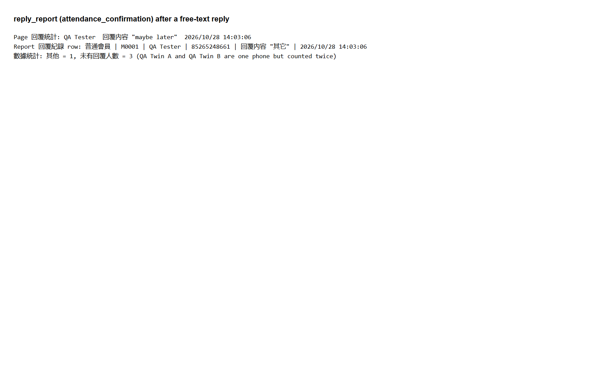
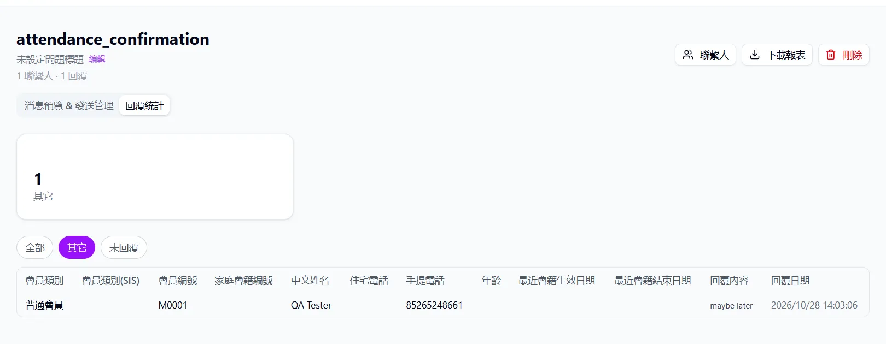

## Summary
In the downloaded reply report, a typed (free-text) reply shows as 其它 (Other) instead of the text the member wrote.

## Steps to reproduce
1. Set up replies (see Before you start). Send an APPROVED template with quick-reply buttons to your number 852
.
2. On your phone, type a reply such as "maybe later" instead of tapping a button.
3. Open the template's 回覆統計 (Reply statistics) tab.
4. Click 下載報表 (Download report) and open the 回覆紀錄 (Reply records) sheet.

## Expected
The 回覆內容 (Reply content) column contains "maybe later".

## Actual
回覆內容 (Reply content) is "其它" (Other). The 回覆統計 (Reply statistics) page shows "maybe later", so staff can only read the answer on the page.

## Evidence
- Screenshot: 
- Screenshot: 

## Environment
- Base URL: http://localhost:3000/api/templates/<template id>/export
- Env: local

## History
- 2026-10-28: filed from explorations/2026-10-28-core-journeys.md in the Test Manager app.
- 2026-10-28: rewrote Summary, Steps, Expected and Actual in plain English with English translations of the Chinese UI text; facts unchanged, no retest, status unchanged.
- 2026-10-28: steps made reproducible on any local setup (placeholders 
, <template id>, <n> and test data described row by row instead of our template IDs, phone and data files); Summary shortened to 1-2 sentences; our observed values kept under Actual ("Our run").
- 2026-10-29: status open -> verified; Retest passed in runs/2026-10-29_1630_local_manual (dev fix commit af9a789)..
