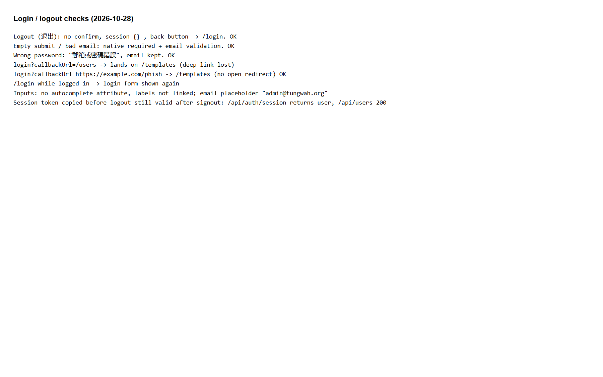

## Summary
Two login problems:
- After logging in, the user always lands on /templates, so the page they asked for (for example /users) is lost. The callbackUrl in the login URL is ignored.
- /login can still be opened while logged in.

## Steps to reproduce
1. Log out, then open /users. The app redirects to /login?callbackUrl=/users.
2. Log in.
3. Open /login again.

## Expected
After login, the user lands on /users. Opening /login while logged in redirects away.

## Actual
The user lands on /templates; the login form is shown again.

## Evidence
- Screenshot: 

## Environment
- Base URL: http://localhost:3000/login?callbackUrl=%2Fusers
- Env: local

## History
- 2026-10-28: filed from explorations/2026-10-28-core-journeys.md in the Test Manager app.
- 2026-10-28: rewrote Summary, Steps, Expected and Actual in plain English with English translations of the Chinese UI text; facts unchanged, no retest, status unchanged.
