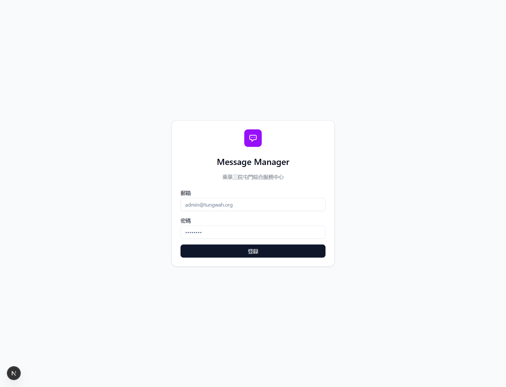

## Summary
On the login form the labels are not linked to their fields, password managers get no hints, and the email placeholder shows the real admin account.

## Steps to reproduce
1. Open http://localhost:3000/login and inspect the form (right-click > Inspect).

## Expected
郵箱 (Email) and 密碼 (Password) labels linked to their inputs, autocomplete="username" and autocomplete="current-password", and a generic placeholder.

## Actual
The labels are not linked, there are no autocomplete attributes, and the email placeholder is "admin@tungwah.org".

## Evidence
- Screenshot: 

## Environment
- Base URL: http://localhost:3000/login
- Env: local

## History
- 2026-10-28: filed from explorations/2026-10-28-core-journeys.md in the Test Manager app.
- 2026-10-28: rewrote Summary, Steps, Expected and Actual in plain English with English translations of the Chinese UI text; facts unchanged, no retest, status unchanged.
- 2026-10-28: steps made reproducible on any local setup (placeholders 
, <template id>, <n> and test data described row by row instead of our template IDs, phone and data files); Summary shortened to 1-2 sentences; our observed values kept under Actual ("Our run").
