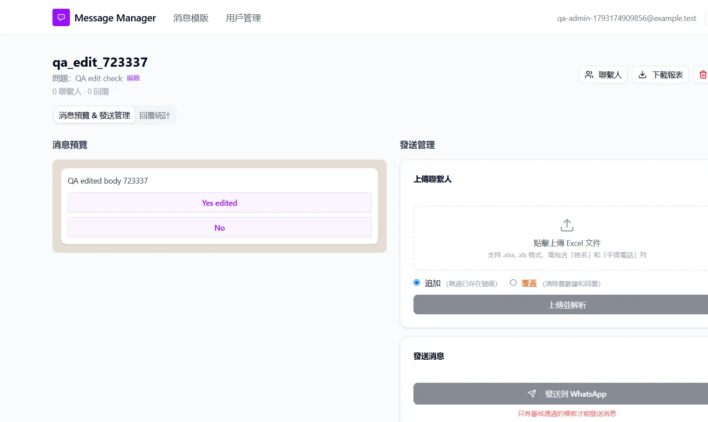
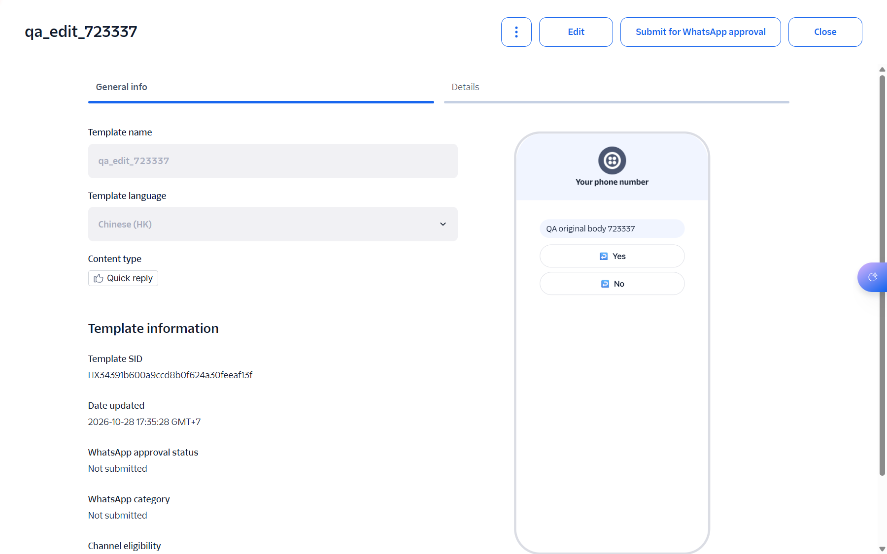

## Summary
Saving the edit page (編輯消息模板, Edit message template) of a Twilio template changes the body and buttons only in the app's database. Twilio keeps the old content, so the app shows text that WhatsApp does not send, and 從 Twilio 同步 (Sync from Twilio) later overwrites the edit without warning.

## Steps to reproduce
1. As an admin, click 新建模板 (New template), fill 模板名稱 (Template name) qa_edit_<n>, 訊息內容 (Message content) QA original body <n>, buttons Yes and No, untick 創建後立即提交 Meta 審核 (Submit to Meta after creating) and click 創建模板 (Create template). This creates a draft in Twilio (no Meta submission).
2. Open the template card and note the id in the address bar: /templates/<template id>.
3. Open http://localhost:3000/templates/<template id>/edit (the page has no link in the app).
4. Change 消息正文 (Message body) to QA edited body <n> and button 1 to Yes edited, then click 保存修改 (Save changes).
5. In the Twilio console, open Messaging > Templates > qa_edit_<n>.
6. Back in the app, click 從 Twilio 同步 (Sync from Twilio) on 消息模版 (Message templates) and open the template again.
7. Clean up: click 刪除 (Delete) on the template page (this also deletes it in Twilio).

## Expected
Either the edit page is not offered for templates that exist in Twilio (Twilio content cannot be edited after creation; a new template is needed), or the change reaches Twilio, so the app and Twilio show the same text and buttons.

## Actual
- Step 4: the page returns to the template and 消息預覽 (Message preview) shows "QA edited body <n>" with buttons "Yes edited" and "No".
- Step 5: Twilio still shows "QA original body <n>" with buttons Yes and No; Date updated is still the creation time.
- Step 6: no warning; the app shows the original text and buttons again, the edit is lost.
- Code: PATCH /api/templates/<id> only updates the database row; the webhook matches replies against the database button titles, so while an edit is in place a member tapping "Yes" (from Twilio) does not match "Yes edited".

Our run (2026-10-28, QA admin): template qa_edit_723337 (HX34391b600a9ccd8b0f624a30feeaf13f), deleted afterwards. Severity minor because the edit page has no link in the UI; it would be major if the page gets linked.

## Evidence
- Screenshot: 
- Screenshot: 

## Environment
- Base URL: http://localhost:3000/templates/<template id>/edit
- Env: local

## History
- 2026-10-28: filed from manual run TWW-098 in the Test Manager app.
