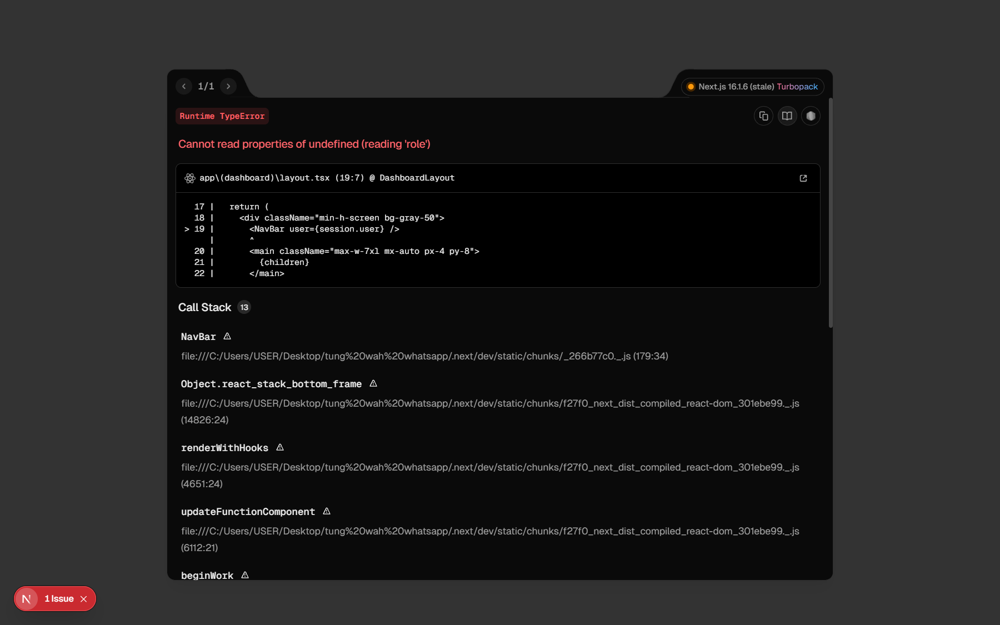

## Summary
Since the BUG-019 fix, a session of a deleted user returns an empty session, but the dashboard pages still render and crash on user.role instead of sending the user to /login.

## Steps to reproduce
1. As admin, in 用戶管理 (User management) > 添加用戶 (Add user), create a user with role 編輯者 (Editor).
2. In a second browser (or a private window), log in as that user.
3. As admin, delete the user.
4. In the user's window, reload http://localhost:3000/templates (or /dashboard).

## Expected
The user is sent to /login (the APIs already return 401).

## Actual
500 Runtime TypeError "Cannot read properties of undefined (reading 'role')" at components/nav-bar.tsx:27 (<NavBar user={session.user} /> in app/(dashboard)/layout.tsx:19). The APIs correctly return 401 未授權 (Unauthorized), so no data is exposed. Cause: the middleware (proxy.ts) still accepts the JWT cookie; the session callback returns user undefined, which the layout does not handle.

## Evidence
- Screenshot: 

## Environment
- Base URL: http://localhost:3000/templates
- Env: local

## History
- 2026-10-29: filed from BUG retest 2026-10-29 (fix commit af9a789) in the Test Manager app.
