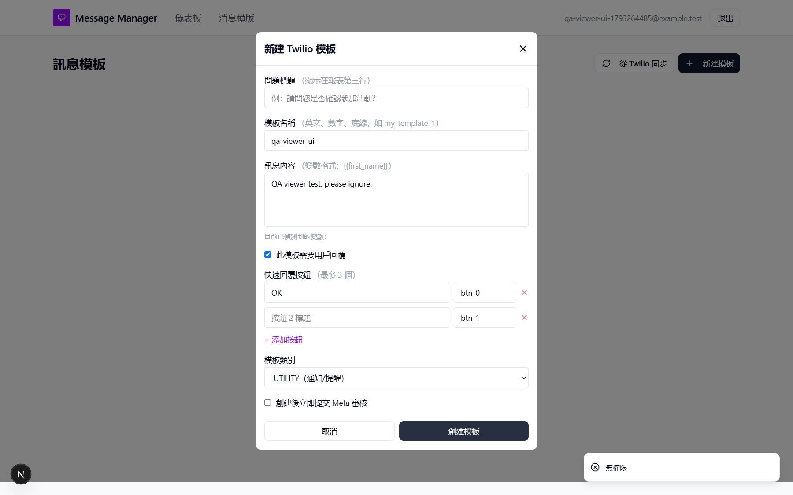

## Summary
The server now blocks viewers (BUG-002 fixed), but the UI still offers the create form and sync buttons, so a viewer fills in a whole template before learning they may not create it.

## Steps to reproduce
1. As admin create a user with role 查看者 (Viewer) and log in as that user.
2. Open 消息模版 (Message templates).
3. Click 新建模板 (New template), fill name, body and a button, untick Meta submission and click 創建模板 (Create template).

## Expected
No 新建模板 (New template) button or other write controls for viewers. 從 Twilio 同步 (Sync from Twilio) stays: viewers may sync read-only (product owner, 2026-10-29).

## Actual
Both 從 Twilio 同步 (Sync from Twilio) and 新建模板 (New template) are shown; the form opens; submitting shows the toast 無權限 (No permission). Nothing is created in Twilio.

## Evidence
- Screenshot: 

## Environment
- Base URL: http://localhost:3000/templates
- Env: local

## History
- 2026-10-29: filed from BUG retest 2026-10-29 (fix commit af9a789) in the Test Manager app.
- 2026-10-29: Scope narrowed 2026-10-29: viewers are meant to sync (read-only, see BUG-039), so only 新建模板 and other write controls should be hidden..
