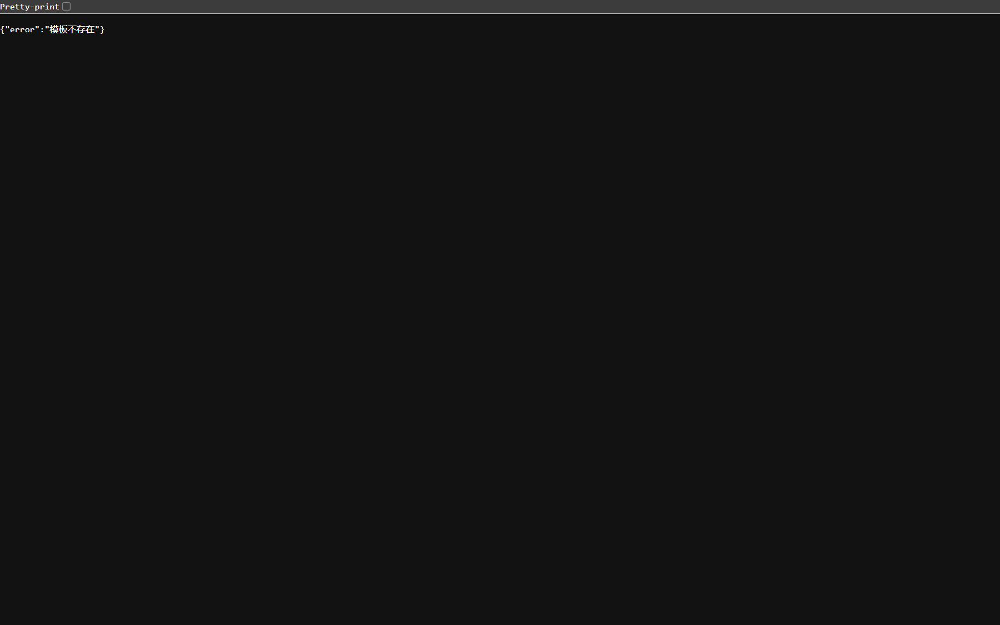

## Summary
An editor or viewer can open a shared template and read its contacts and replies, but cannot download its reply report. The download request says the template does not exist.

## Preconditions
- A template created by another user contains contacts.
- An editor account and a viewer account can read that template.

## Steps to reproduce
1. Log in with your editor account.
2. Open 消息模版 (Message templates), then open the template created by the other user.
3. Click 下載報表 (Download report).
4. Repeat with your viewer account on a template created by another user.

## Expected
Both roles can download the Excel reply report for every template they are allowed to read.

## Actual
The shared template and contacts return 200, but GET /api/templates/<template-id>/export returns 404 with {"error":"模板不存在"} (Template does not exist). Confirmed twice for each role in the 30 Oct retest. The export route still permits only the creator or an admin.

## Evidence
- Screenshot: 
- Retest API evidence: [role checks](../explorations/2026-10-30-report-retest/retest-api-evidence.json)
- Observed 2026-10-30 on build 1cdd076 through https://murmuring-amused-diaper.ngrok-free.dev. Residual report-access defect split from BUG-038 and BUG-039; linked tests TWW-012 and TWW-105.

## Environment
- Base URL: https://murmuring-amused-diaper.ngrok-free.dev/templates/<template-id>
- Env: local

## History
- 2026-10-30: filed from runs/2026-10-30_1349_local_manual in the Test Manager app.
