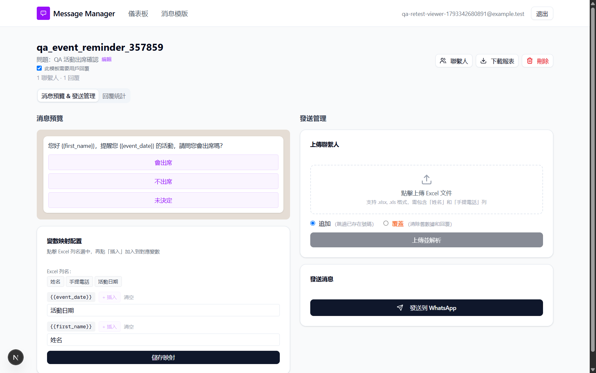
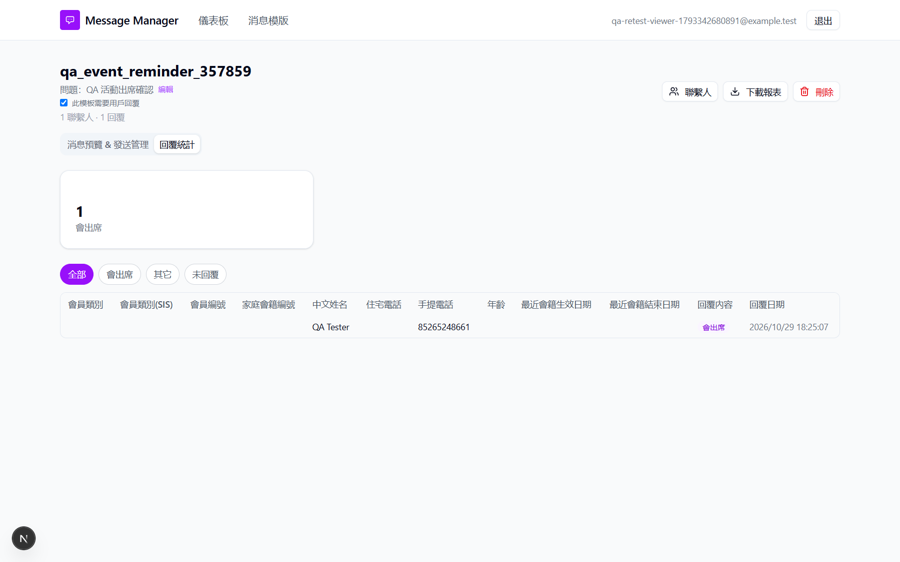

## Summary
The template detail page presents write actions to a read-only viewer. The interface suggests the viewer can change or send campaign data, even though the checked write requests are refused.

## Preconditions
- A viewer account can open a shared template with contacts, message variables and replies.

## Steps to reproduce
1. Log in with your viewer account.
2. Open 消息模版 (Message templates) and open that template.
3. Inspect the controls beside the title and under 消息預覽 & 發送管理 (Message preview and sending).
4. Open 回覆統計 (Reply statistics) and inspect the controls beside the title again.

## Expected
The viewer can read the message, contacts and replies and download a report. Edit, delete, upload, mapping-save and send controls are hidden or disabled. Read-only sync remains available.

## Actual
The viewer sees enabled 編輯 (Edit), 刪除 (Delete), editable mapping fields with 儲存映射 (Save mapping), contact upload controls and 發送到 WhatsApp (Send to WhatsApp). The upload section remains visible; its submit button was disabled in the inspected no-file-selected state. Checked viewer PATCH and DELETE requests on a throwaway draft returned 403 無權限 (No permission); this observation does not establish a server authorization bypass. The detail-page controls were observed in both preview and reply-statistics views.

## Evidence
- Screenshot: 
- Screenshot: 
- Observed 2026-10-30 on build 1cdd076 through https://murmuring-amused-diaper.ngrok-free.dev. Split from BUG-039. BUG-037 separately covers the New template action on the template list; this report covers the detail-page write controls.

## Environment
- Base URL: https://murmuring-amused-diaper.ngrok-free.dev/templates/<template-id>
- Env: local

## History
- 2026-10-30: filed from runs/2026-10-30_1349_local_manual in the Test Manager app.
- 2026-10-30: status open -> wont-fix.
- 2026-10-30: Accepted visibility synchronized to TWW-087 and TWW-105: visible write controls no longer fail these cases. Server authorization expectations unchanged. Cleared tests list; no new execution..
