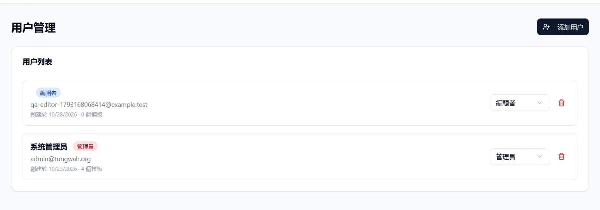
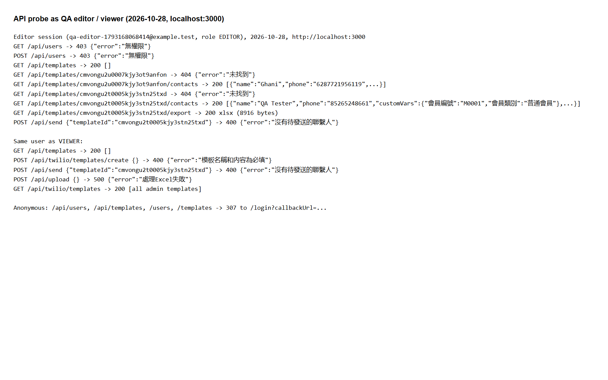
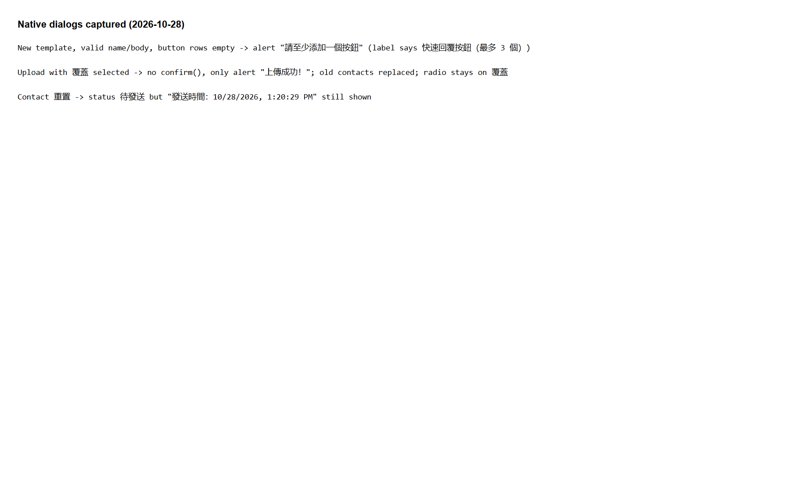
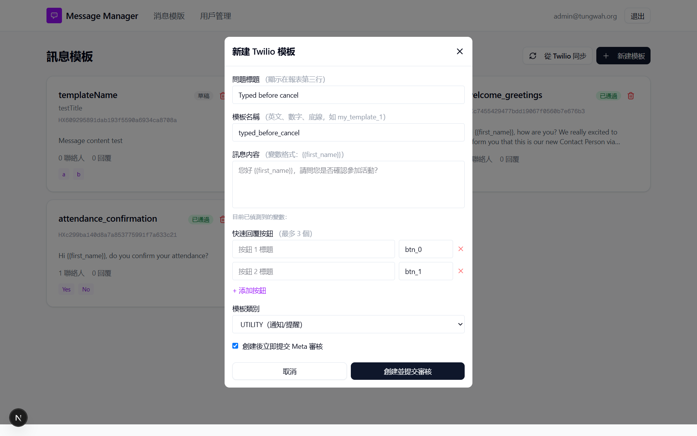
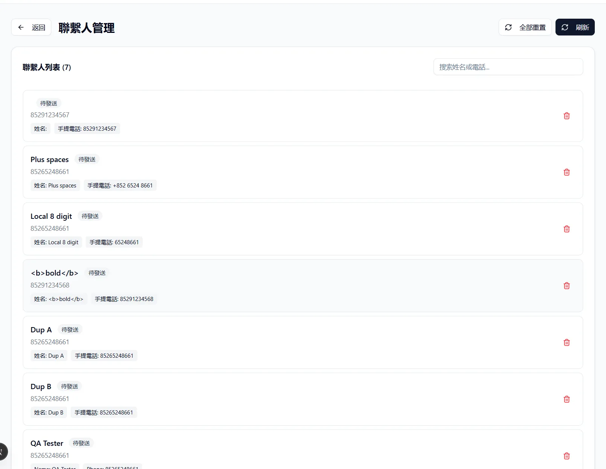
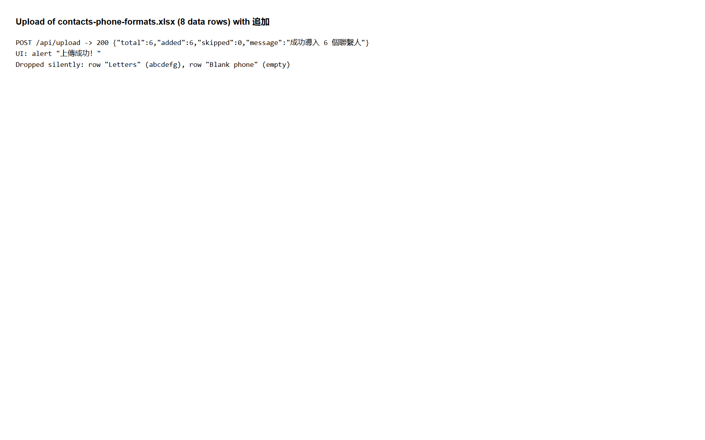
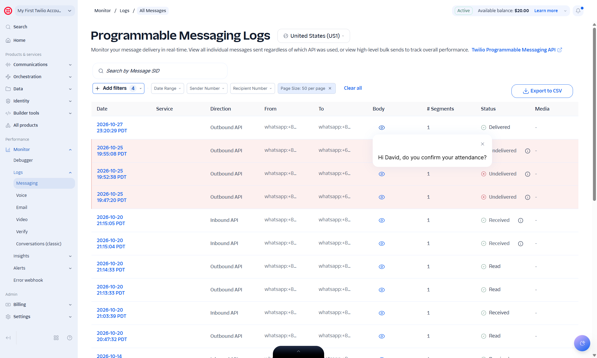
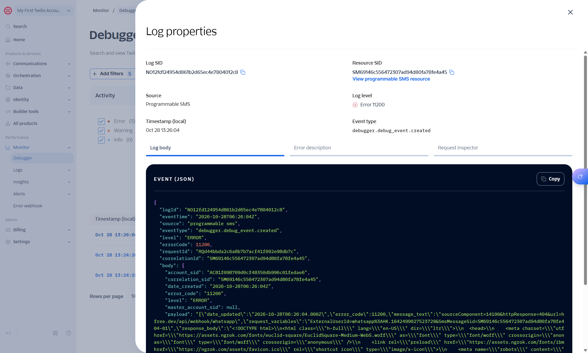
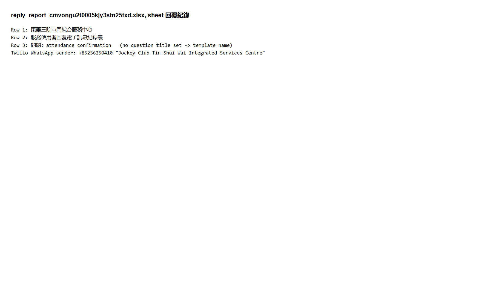
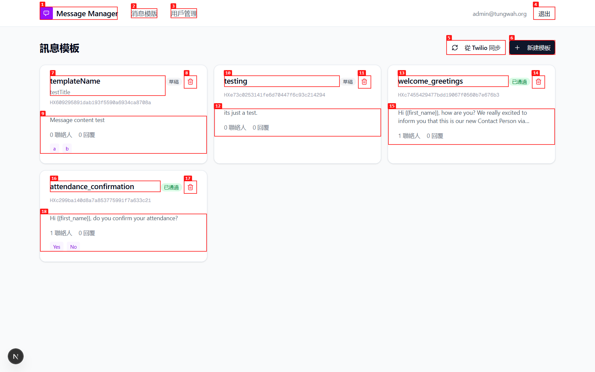

# Run report: tung-wah-whatsapp / exploratory-2026-10-28 / local

| Field | Value |
|---|---|
| Result | **FAIL (16 failed)** |
| Run | 2026-10-28_1340_local_manual |
| Runner | manual |
| Base URL | http://localhost:3000/ |
| Started | 2026-10-28 13:40 |
| Duration | 30.2s |

## Summary

| Total | Pass | Fail | Flaky | Blocked | Skipped |
|---:|---:|---:|---:|---:|---:|
| 41 | 22 | 16 | 0 | 3 | 0 |

## Results

| ID | Title | Status | Checks | Time | Notes | Evidence |
|---|---|---|---|---|---|---|
| TWW-002 | Admin creates an editor user | pass | - | 0.0s | - | - |
| TWW-003 | Add user form rejects empty, invalid email and short password | pass | - | 0.0s | - | - |
| TWW-004 | Duplicate email is rejected when adding a user | pass | - | 0.0s | - | - |
| TWW-005 | User name of only spaces is rejected | fail | - | 0.0s | product-bug; BUG-005 | [1](screenshots/TWW-005-m01-02-blank-name-user.png) |
| TWW-006 | Admin changes a user role | pass | - | 0.0s | - | - |
| TWW-007 | Admin deletes a user after confirmation | pass | - | 0.0s | - | - |
| TWW-009 | User management page uses Traditional Chinese consistently | fail | - | 0.0s | product-bug; BUG-009 | [1](screenshots/TWW-009-m01-02-blank-name-user.png) |
| TWW-010 | Anonymous visitor is redirected to login | pass | - | 0.0s | - | - |
| TWW-012 | Editor cannot read another user's contacts or report | fail | - | 0.0s | product-bug; BUG-001 | [1](screenshots/TWW-012-m01-11-editor-api-probe.png) |
| TWW-013 | Editor cannot send messages from another user's template | fail | - | 0.0s | product-bug; BUG-001 | [1](screenshots/TWW-013-m01-11-editor-api-probe.png) |
| TWW-014 | Viewer cannot create templates, upload contacts or send | fail | - | 0.0s | product-bug; BUG-002 | [1](screenshots/TWW-014-m01-11-editor-api-probe.png) |
| TWW-015 | New template form requires name and content | pass | - | 0.0s | - | - |
| TWW-016 | Template name accepts only English letters, digits and underscore | fail | - | 0.0s | product-bug; BUG-006 | [1](screenshots/TWW-016-m01-04-template-form-filled.png) |
| TWW-017 | Quick-reply buttons are limited to three | pass | - | 0.0s | - | - |
| TWW-018 | Template without quick-reply buttons can be created | fail | - | 0.0s | untriaged | [1](screenshots/TWW-018-m01-17-alerts-buttons-overwrite.png) |
| TWW-019 | Create a draft template without Meta submission | pass | - | 0.0s | - | - |
| TWW-020 | Deleting a template removes it from Twilio | pass | - | 0.0s | - | - |
| TWW-021 | Sync from Twilio lists Twilio templates | pass | - | 0.0s | - | - |
| TWW-022 | Edit the question title of a template | pass | - | 0.0s | - | - |
| TWW-023 | Blank question title falls back to 未設定問題標題 | fail | - | 0.0s | product-bug; BUG-008 | [1](screenshots/TWW-023-m01-10-blank-question-title.webp) |
| TWW-024 | New template form is reset after cancel | fail | - | 0.0s | untriaged | [1](screenshots/TWW-024-m01-13-form-kept-after-cancel.png) |
| TWW-025 | Sending is disabled for templates that are not approved | pass | - | 0.0s | - | - |
| TWW-026 | Upload an Excel file of contacts | pass | - | 0.0s | - | - |
| TWW-027 | Upload with no contacts shows a clear error | pass | - | 0.0s | - | - |
| TWW-028 | Phone numbers are normalized to the 852 format | pass | - | 0.0s | - | - |
| TWW-029 | Append mode skips numbers already in the list | fail | - | 0.0s | product-bug; BUG-004 | [1](screenshots/TWW-029-m01-05-append-duplicates-not-skipped.webp) |
| TWW-030 | Upload summary reports rows that were not imported | fail | - | 0.0s | product-bug; BUG-007 | [1](screenshots/TWW-030-m01-15-upload-summary.png) |
| TWW-031 | Overwrite mode replaces contacts after confirmation | fail | - | 0.0s | untriaged | [1](screenshots/TWW-031-m01-17-alerts-buttons-overwrite.png) |
| TWW-032 | Search contacts by name or phone | pass | - | 0.0s | - | - |
| TWW-033 | Delete a contact after confirmation | pass | - | 0.0s | - | - |
| TWW-034 | Reset a sent contact to pending | fail | - | 0.0s | product-bug; BUG-011 | [1](screenshots/TWW-034-m01-17-alerts-buttons-overwrite.png) |
| TWW-035 | HTML in contact names is shown as plain text | pass | - | 0.0s | - | - |
| TWW-036 | Send a WhatsApp message with a mapped variable | pass | - | 0.0s | - | - |
| TWW-037 | Sending is blocked while a template variable has no mapping | fail | - | 0.0s | product-bug; BUG-003 | [1](screenshots/TWW-037-m01-06-twilio-unmapped-variable-sent-as-david.jpg) |
| TWW-038 | Send with no pending contacts shows a message | pass | - | 0.0s | - | - |
| TWW-039 | Contact status follows Twilio delivery and read receipts | blocked | - | 0.0s | Environment: Twilio webhook got 404 from ngrok (ERR_NGROK_3200, authentic-tactless-pregame.ngrok-free.dev offline). Twilio received Yes/No/maybe later? and shows Delivered/Read, app shows 0 replies and SENT. | - |
| TWW-040 | Quick-reply button answer appears in reply stats | blocked | - | 0.0s | Environment: Twilio webhook got 404 from ngrok (ERR_NGROK_3200, authentic-tactless-pregame.ngrok-free.dev offline). Twilio received Yes/No/maybe later? and shows Delivered/Read, app shows 0 replies and SENT. | [1](screenshots/TWW-040-m01-09-twilio-11200-webhook-error.jpg) |
| TWW-041 | Free-text reply is recorded under 其它 | blocked | - | 0.0s | Environment: Twilio webhook got 404 from ngrok (ERR_NGROK_3200, authentic-tactless-pregame.ngrok-free.dev offline). Twilio received Yes/No/maybe later? and shows Delivered/Read, app shows 0 replies and SENT. | - |
| TWW-043 | Download the reply report | pass | - | 0.0s | - | - |
| TWW-044 | Report header shows the right centre and question | fail | - | 0.0s | untriaged | [1](screenshots/TWW-044-m01-16-report-header.png) |
| TWW-045 | Icon buttons and form fields have accessible names | fail | - | 0.0s | product-bug; BUG-010 | [1](screenshots/TWW-045-m01-14-unnamed-icon-buttons.png) |

## Failures and warnings

### TWW-005: User name of only spaces is rejected (fail)

- Failure type: product-bug (bug BUG-005)
- Source: `projects/tung-wah-whatsapp/cases/users/TWW-005-user-name-of-only-spaces-is-rejected.md`
- Note: Name "   " accepted (201).

### TWW-009: User management page uses Traditional Chinese consistently (fail)

- Failure type: product-bug (bug BUG-009)
- Source: `projects/tung-wah-whatsapp/cases/users/TWW-009-user-management-page-uses-traditional.md`
- Note: 用户管理, 添加用户, 系统管理员 etc. in Simplified.

### TWW-012: Editor cannot read another user's contacts or report (fail)

- Failure type: product-bug (bug BUG-001)
- Source: `projects/tung-wah-whatsapp/cases/security/TWW-012-editor-cannot-read-another-user-s.md`
- Note: Editor: template 404 but contacts 200 with data and export 200 xlsx.

### TWW-013: Editor cannot send messages from another user's template (fail)

- Failure type: product-bug (bug BUG-001)
- Source: `projects/tung-wah-whatsapp/cases/security/TWW-013-editor-cannot-send-messages-from.md`
- Note: Editor send on admin template -> 400 沒有待發送的聯繫人 (authorized).

### TWW-014: Viewer cannot create templates, upload contacts or send (fail)

- Failure type: product-bug (bug BUG-002)
- Source: `projects/tung-wah-whatsapp/cases/security/TWW-014-viewer-cannot-create-templates-upload.md`
- Note: Viewer create 400 validation, upload 500, send 400; GET /api/twilio/templates lists all.

### TWW-016: Template name accepts only English letters, digits and underscore (fail)

- Failure type: product-bug (bug BUG-006)
- Source: `projects/tung-wah-whatsapp/cases/templates/TWW-016-template-name-accepts-only-english.md`
- Note: QA Draft 測試 <n> created in Twilio.

### TWW-018: Template without quick-reply buttons can be created (fail)

- Failure type: untriaged
- Source: `projects/tung-wah-whatsapp/cases/templates/TWW-018-template-without-quick-reply-buttons.md`
- Note: Alert 請至少添加一個按鈕; waiting on Q-001.

### TWW-023: Blank question title falls back to 未設定問題標題 (fail)

- Failure type: product-bug (bug BUG-008)
- Source: `projects/tung-wah-whatsapp/cases/templates/TWW-023-blank-question-title-falls-back-to.md`
- Note: Header shows 問題： (blank).

### TWW-024: New template form is reset after cancel (fail)

- Failure type: untriaged
- Source: `projects/tung-wah-whatsapp/cases/templates/TWW-024-new-template-form-is-reset-after-cancel.md`
- Note: Values kept after 取消; waiting on Q-003.

### TWW-029: Append mode skips numbers already in the list (fail)

- Failure type: product-bug (bug BUG-004)
- Source: `projects/tung-wah-whatsapp/cases/contacts/TWW-029-append-mode-skips-numbers-already-in.md`
- Note: 5 contacts with 85265248661 after append uploads.

### TWW-030: Upload summary reports rows that were not imported (fail)

- Failure type: product-bug (bug BUG-007)
- Source: `projects/tung-wah-whatsapp/cases/contacts/TWW-030-upload-summary-reports-rows-that-were.md`
- Note: total 6 added 6 skipped 0 for 8 rows.

### TWW-031: Overwrite mode replaces contacts after confirmation (fail)

- Failure type: untriaged
- Source: `projects/tung-wah-whatsapp/cases/contacts/TWW-031-overwrite-mode-replaces-contacts-after.md`
- Note: Overwrite replaced data but no confirm and radio stays 覆蓋; waiting on Q-002.

### TWW-034: Reset a sent contact to pending (fail)

- Failure type: product-bug (bug BUG-011)
- Source: `projects/tung-wah-whatsapp/cases/contacts/TWW-034-reset-a-sent-contact-to-pending.md`
- Note: Status 待發送 but old 發送時間 still shown.

### TWW-037: Sending is blocked while a template variable has no mapping (fail)

- Failure type: product-bug (bug BUG-003)
- Source: `projects/tung-wah-whatsapp/cases/sending/TWW-037-sending-is-blocked-while-a-template.md`
- Note: Sent "Hi David, ..." to +85265248661.

### TWW-039: Contact status follows Twilio delivery and read receipts (blocked)

- Source: `projects/tung-wah-whatsapp/cases/sending/TWW-039-contact-status-follows-twilio-delivery.md`
- Note: Environment: Twilio webhook got 404 from ngrok (ERR_NGROK_3200, authentic-tactless-pregame.ngrok-free.dev offline). Twilio received Yes/No/maybe later? and shows Delivered/Read, app shows 0 replies and SENT.

### TWW-040: Quick-reply button answer appears in reply stats (blocked)

- Source: `projects/tung-wah-whatsapp/cases/replies/TWW-040-quick-reply-button-answer-appears-in.md`
- Note: Environment: Twilio webhook got 404 from ngrok (ERR_NGROK_3200, authentic-tactless-pregame.ngrok-free.dev offline). Twilio received Yes/No/maybe later? and shows Delivered/Read, app shows 0 replies and SENT.

### TWW-041: Free-text reply is recorded under 其它 (blocked)

- Source: `projects/tung-wah-whatsapp/cases/replies/TWW-041-free-text-reply-is-recorded-under.md`
- Note: Environment: Twilio webhook got 404 from ngrok (ERR_NGROK_3200, authentic-tactless-pregame.ngrok-free.dev offline). Twilio received Yes/No/maybe later? and shows Delivered/Read, app shows 0 replies and SENT.

### TWW-044: Report header shows the right centre and question (fail)

- Failure type: untriaged
- Source: `projects/tung-wah-whatsapp/cases/reports/TWW-044-report-header-shows-the-right-centre.md`
- Note: Row 1 屯門 centre vs Tin Shui Wai sender; row 3 falls back to template name; waiting on Q-004.

### TWW-045: Icon buttons and form fields have accessible names (fail)

- Failure type: product-bug (bug BUG-010)
- Source: `projects/tung-wah-whatsapp/cases/accessibility/TWW-045-icon-buttons-and-form-fields-have.md`
- Note: Trash/close icons unnamed; add-user inputs unlabelled.

