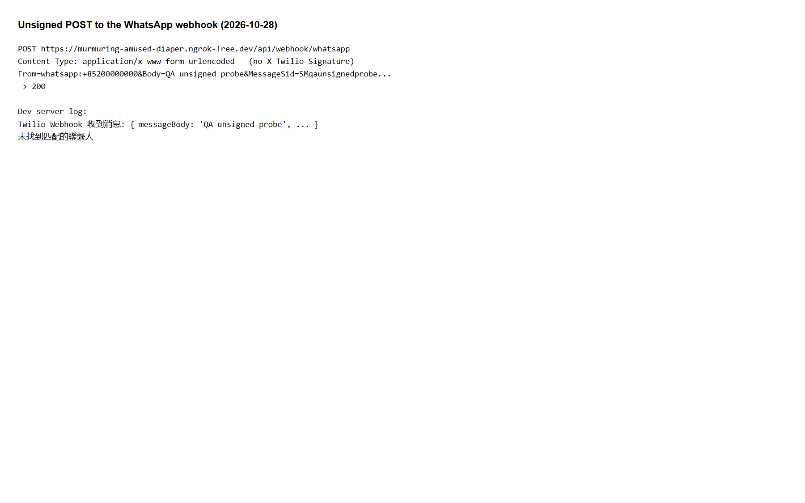

# Run report: tung-wah-whatsapp / ngrok-retest-2026-10-28 / local

| Field | Value |
|---|---|
| Result | **FAIL (2 failed)** |
| Run | 2026-10-28_1358_local_manual |
| Runner | manual |
| Base URL | http://localhost:3000/ |
| Started | 2026-10-28 13:58 |
| Duration | 1.0s |

## Summary

| Total | Pass | Fail | Flaky | Blocked | Skipped |
|---:|---:|---:|---:|---:|---:|
| 4 | 2 | 2 | 0 | 0 | 0 |

## Results

| ID | Title | Status | Checks | Time | Notes | Evidence |
|---|---|---|---|---|---|---|
| TWW-039 | Contact status follows Twilio delivery and read receipts | fail | - | 0.0s | product-bug; BUG-013 | [1](screenshots/TWW-039-m01-07-twilio-mapped-message.jpg) |
| TWW-040 | Quick-reply button answer appears in reply stats | pass | - | 0.0s | - | [1](screenshots/TWW-040-m01-18-reply-recorded-via-ngrok.webp) |
| TWW-042 | Reply filters include each quick-reply button | pass | - | 0.0s | - | - |
| TWW-046 | Webhook rejects requests without a valid Twilio signature | fail | - | 0.0s | product-bug; BUG-012 | [1](screenshots/TWW-046-m01-19-unsigned-webhook-accepted.png) |

## Failures and warnings

### TWW-039: Contact status follows Twilio delivery and read receipts (fail)

- Failure type: product-bug (bug BUG-013)
- Source: `projects/tung-wah-whatsapp/cases/sending/TWW-039-contact-status-follows-twilio-delivery.md`
- Note: Twilio Delivered/Read but app SENT with no times until the reply, then READ; Ghani Undelivered still 已發送.

### TWW-046: Webhook rejects requests without a valid Twilio signature (fail)

- Failure type: product-bug (bug BUG-012)
- Source: `projects/tung-wah-whatsapp/cases/security/TWW-046-webhook-rejects-requests-without-a.md`
- Note: Unsigned POST -> 200 and processed (no matching contact).

