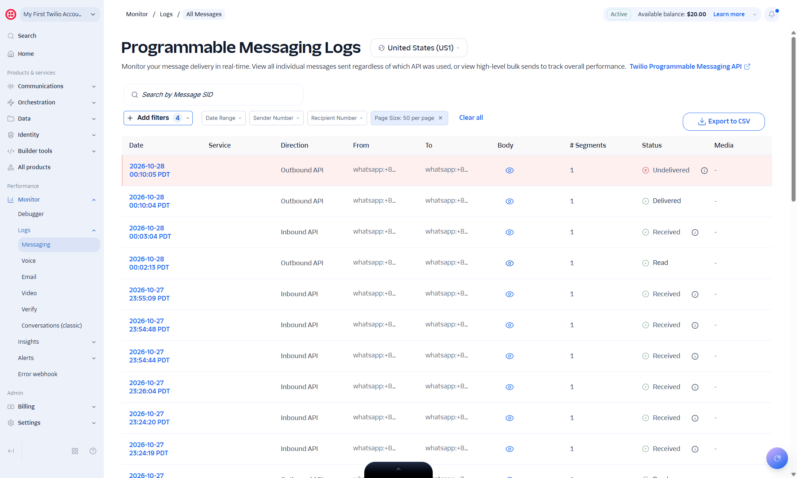
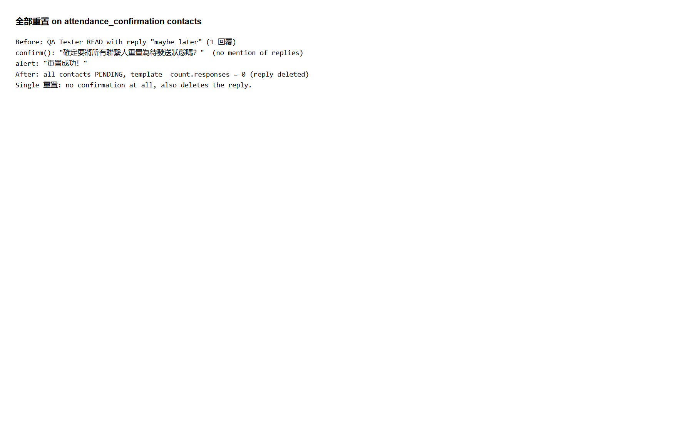
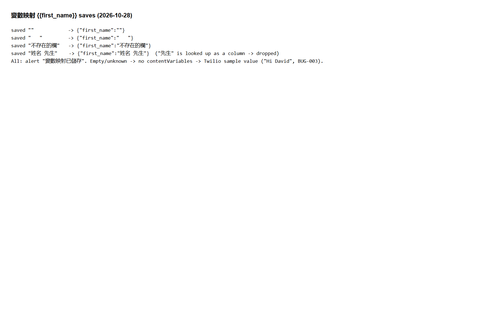
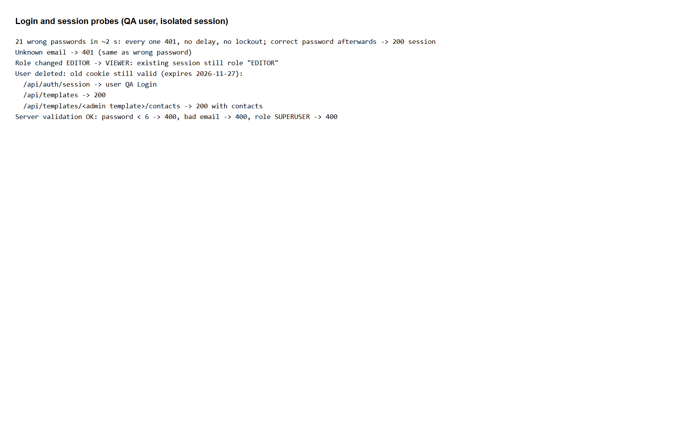
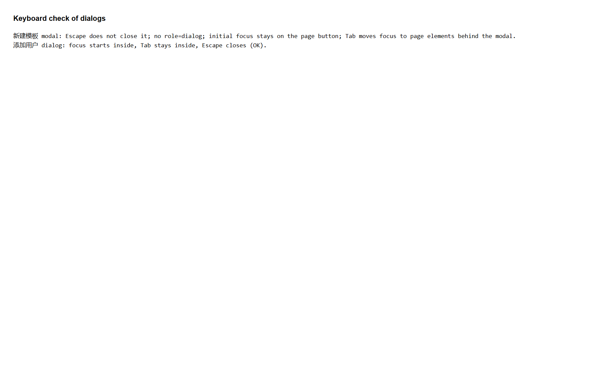
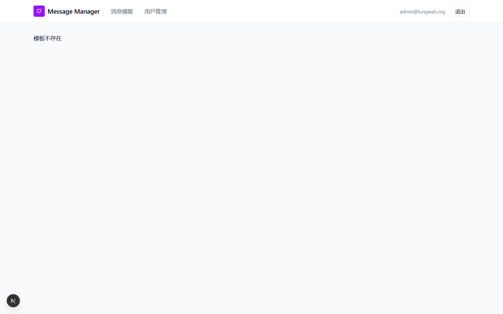

# Run report: tung-wah-whatsapp / exploratory-round3-2026-10-28 / local

| Field | Value |
|---|---|
| Result | **FAIL (12 failed)** |
| Run | 2026-10-28_1416_local_manual |
| Runner | manual |
| Base URL | http://localhost:3000/ |
| Started | 2026-10-28 14:16 |
| Duration | 3.7s |

## Summary

| Total | Pass | Fail | Flaky | Blocked | Skipped |
|---:|---:|---:|---:|---:|---:|
| 16 | 4 | 12 | 0 | 0 | 0 |

## Results

| ID | Title | Status | Checks | Time | Notes | Evidence |
|---|---|---|---|---|---|---|
| TWW-039 | Contact status follows Twilio delivery and read receipts | fail | - | 0.0s | product-bug; BUG-013 | [1](screenshots/TWW-039-m01-22-twilio-merged-and-invalid.jpg) |
| TWW-049 | Invalid or oddly formatted phone numbers are rejected or normalized correctly | fail | - | 0.0s | product-bug; BUG-014 | [1](screenshots/TWW-049-m01-24-phone-normalization.png) |
| TWW-050 | Blank rows in the Excel file are skipped | pass | - | 0.0s | - | - |
| TWW-051 | Excel files with a title row or several sheets | fail | - | 0.0s | untriaged | [1](screenshots/TWW-051-m01-24-phone-normalization.png) |
| TWW-052 | Upload and list 1000 contacts | pass | - | 0.0s | - | - |
| TWW-053 | Double-clicking send sends each message once | pass | - | 0.0s | - | - |
| TWW-054 | Contacts sharing a phone get one message with their own name | fail | - | 0.0s | product-bug; BUG-004 | [1](screenshots/TWW-054-m01-22-twilio-merged-and-invalid.jpg) |
| TWW-055 | Reset warns before deleting recorded replies | fail | - | 0.0s | product-bug; BUG-016 | [1](screenshots/TWW-055-m01-26-reset-all-deletes-replies.png) |
| TWW-056 | Variable mapping must point to an existing Excel column | fail | - | 0.0s | product-bug; BUG-017 | [1](screenshots/TWW-056-m01-27-mapping-no-validation.png) |
| TWW-057 | Report shows the text of free-text replies | fail | - | 0.0s | product-bug; BUG-015 | [1](screenshots/TWW-057-m01-25-report-other-not-text.png) |
| TWW-058 | Repeated wrong passwords are throttled | fail | - | 0.0s | product-bug; BUG-018 | [1](screenshots/TWW-058-m01-28-login-session.png) |
| TWW-059 | Deleting a user ends their sessions | fail | - | 0.0s | product-bug; BUG-019 | [1](screenshots/TWW-059-m01-28-login-session.png) |
| TWW-060 | Role change applies to existing sessions | fail | - | 0.0s | product-bug; BUG-019 | [1](screenshots/TWW-060-m01-28-login-session.png) |
| TWW-061 | Server rejects invalid user data sent directly to the API | pass | - | 0.0s | - | - |
| TWW-062 | New template dialog works with the keyboard | fail | - | 0.0s | product-bug; BUG-020 | [1](screenshots/TWW-062-m01-29-template-modal-keyboard.png) |
| TWW-063 | Unknown pages and templates show a friendly Chinese error | fail | - | 0.0s | product-bug; BUG-021 | [1](screenshots/TWW-063-m01-23-nonexistent-template.png) |

## Failures and warnings

### TWW-039: Contact status follows Twilio delivery and read receipts (fail)

- Failure type: product-bug (bug BUG-013)
- Source: `projects/tung-wah-whatsapp/cases/sending/TWW-039-contact-status-follows-twilio-delivery.md`
- Note: +8520000000 Undelivered in Twilio, app SENT.

### TWW-049: Invalid or oddly formatted phone numbers are rejected or normalized correctly (fail)

- Failure type: product-bug (bug BUG-014)
- Source: `projects/tung-wah-whatsapp/cases/contacts/TWW-049-invalid-or-oddly-formatted-phone.md`
- Note: 00852.. -> 852085265248661, ".0" -> 852652486610, 9-digit kept, 00000000 -> 8520000000.

### TWW-051: Excel files with a title row or several sheets (fail)

- Failure type: untriaged
- Source: `projects/tung-wah-whatsapp/cases/contacts/TWW-051-excel-files-with-a-title-row-or-several.md`
- Note: Title row -> Excel中沒有找到聯繫人; only first sheet read. Waiting on Q-008.

### TWW-054: Contacts sharing a phone get one message with their own name (fail)

- Failure type: product-bug (bug BUG-004)
- Source: `projects/tung-wah-whatsapp/cases/sending/TWW-054-contacts-sharing-a-phone-get-one.md`
- Note: One message "Hi QA Twin A，QA Twin B, ...".

### TWW-055: Reset warns before deleting recorded replies (fail)

- Failure type: product-bug (bug BUG-016)
- Source: `projects/tung-wah-whatsapp/cases/contacts/TWW-055-reset-warns-before-deleting-recorded.md`
- Note: 全部重置 confirm does not mention replies; reply deleted.

### TWW-056: Variable mapping must point to an existing Excel column (fail)

- Failure type: product-bug (bug BUG-017)
- Source: `projects/tung-wah-whatsapp/cases/sending/TWW-056-variable-mapping-must-point-to-an.md`
- Note: "", "   ", unknown column, "姓名 先生" all saved.

### TWW-057: Report shows the text of free-text replies (fail)

- Failure type: product-bug (bug BUG-015)
- Source: `projects/tung-wah-whatsapp/cases/reports/TWW-057-report-shows-the-text-of-free-text.md`
- Note: 回覆內容 = 其它 instead of "maybe later".

### TWW-058: Repeated wrong passwords are throttled (fail)

- Failure type: product-bug (bug BUG-018)
- Source: `projects/tung-wah-whatsapp/cases/security/TWW-058-repeated-wrong-passwords-are-throttled.md`
- Note: 21 wrong passwords, no delay; correct login works.

### TWW-059: Deleting a user ends their sessions (fail)

- Failure type: product-bug (bug BUG-019)
- Source: `projects/tung-wah-whatsapp/cases/security/TWW-059-deleting-a-user-ends-their-sessions.md`
- Note: Deleted user cookie still reads templates and contacts.

### TWW-060: Role change applies to existing sessions (fail)

- Failure type: product-bug (bug BUG-019)
- Source: `projects/tung-wah-whatsapp/cases/security/TWW-060-role-change-applies-to-existing-sessions.md`
- Note: Session still EDITOR after demotion to VIEWER.

### TWW-062: New template dialog works with the keyboard (fail)

- Failure type: product-bug (bug BUG-020)
- Source: `projects/tung-wah-whatsapp/cases/accessibility/TWW-062-new-template-dialog-works-with-the.md`
- Note: Escape ignored, focus not in modal.

### TWW-063: Unknown pages and templates show a friendly Chinese error (fail)

- Failure type: product-bug (bug BUG-021)
- Source: `projects/tung-wah-whatsapp/cases/navigation/TWW-063-unknown-pages-and-templates-show-a.md`
- Note: /nope English 404; contacts page renders for bad template id.

