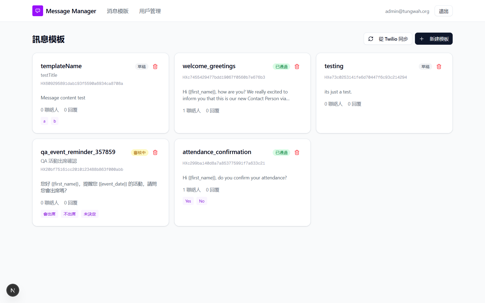
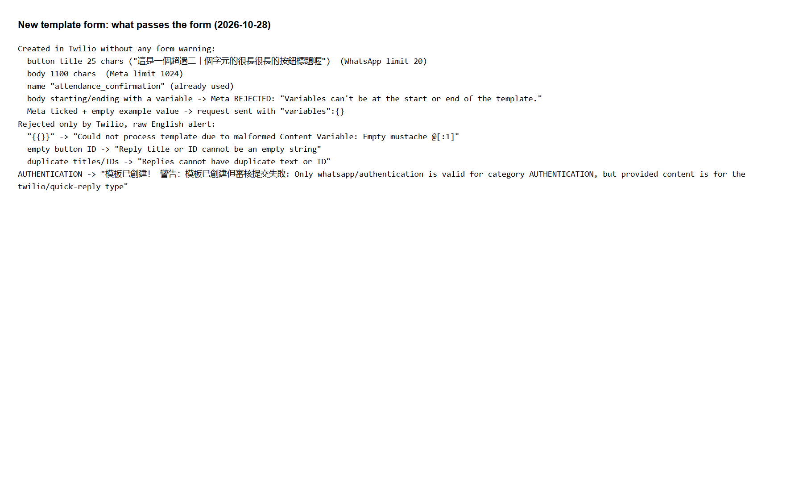
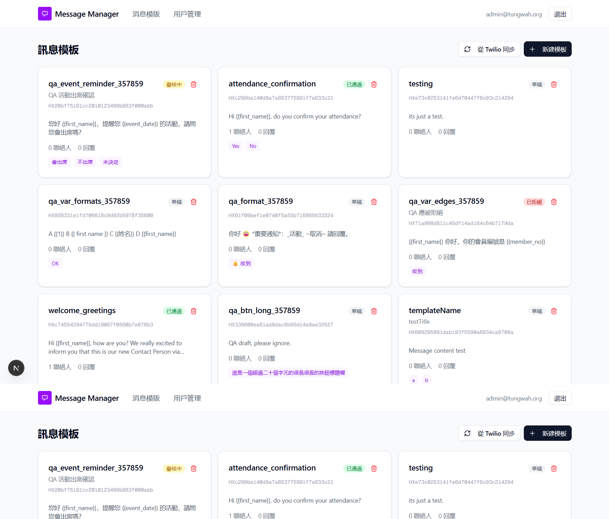
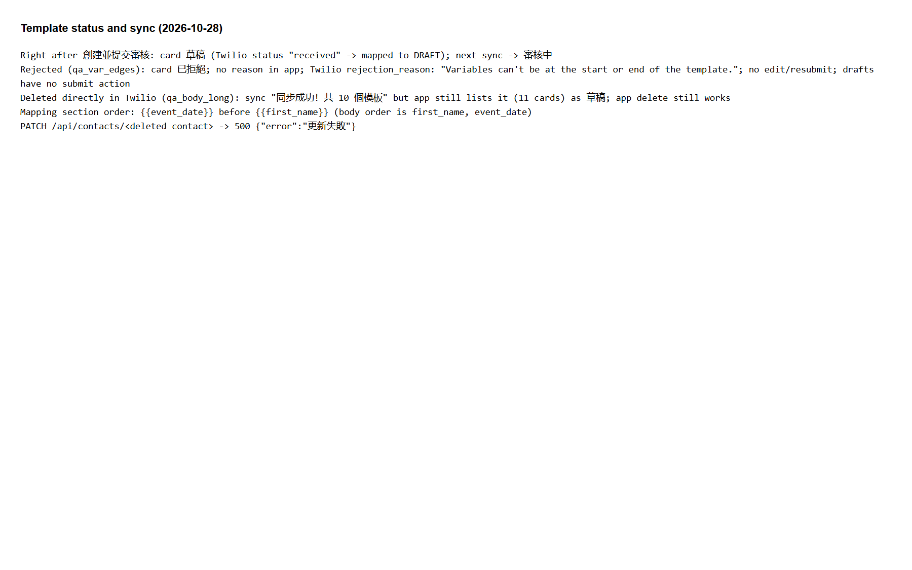

# Run report: tung-wah-whatsapp / templates-2026-10-28 / local

| Field | Value |
|---|---|
| Result | **FAIL (8 failed)** |
| Run | 2026-10-28_1506_local_manual |
| Runner | manual |
| Base URL | http://localhost:3000/ |
| Started | 2026-10-28 15:06 |
| Duration | 3.3s |

## Summary

| Total | Pass | Fail | Flaky | Blocked | Skipped |
|---:|---:|---:|---:|---:|---:|
| 12 | 4 | 8 | 0 | 0 | 0 |

## Results

| ID | Title | Status | Checks | Time | Notes | Evidence |
|---|---|---|---|---|---|---|
| TWW-064 | Submit a two-variable template for Meta review | fail | - | 0.0s | product-bug; BUG-022 | [1](screenshots/TWW-064-m01-31-pending-card.png) |
| TWW-065 | AUTHENTICATION category is usable or not offered | fail | - | 0.0s | product-bug; BUG-023 | [1](screenshots/TWW-065-m01-34-template-validation.png) |
| TWW-066 | Create form checks WhatsApp template limits before submitting | fail | - | 0.0s | product-bug; BUG-024 | [1](screenshots/TWW-066-m01-34-template-validation.png) |
| TWW-067 | Rejected template shows the reason and can be fixed | fail | - | 0.0s | product-bug; BUG-025 | [1](screenshots/TWW-067-m01-32-templates-rejected-duplicate.png) |
| TWW-068 | Draft templates can be submitted for review later | fail | - | 0.0s | product-bug; BUG-025 | [1](screenshots/TWW-068-m01-35-template-status-sync.png) |
| TWW-069 | Sync removes templates deleted in Twilio | fail | - | 0.0s | product-bug; BUG-026 | [1](screenshots/TWW-069-m01-35-template-status-sync.png) |
| TWW-070 | Delete a template with contacts after confirmation | pass | - | 0.0s | - | [1](screenshots/TWW-070-m01-33-delete-template-dialog.png) |
| TWW-071 | Variable mapping and question title survive a sync | pass | - | 0.0s | - | - |
| TWW-072 | Variables are listed in message order | fail | - | 0.0s | product-bug; BUG-027 | [1](screenshots/TWW-072-m01-35-template-status-sync.png) |
| TWW-073 | Template variable names and formatting are accepted | pass | - | 0.0s | - | - |
| TWW-074 | Server refuses to send templates that are not approved | pass | - | 0.0s | - | - |
| TWW-076 | Updating a missing contact returns not found | fail | - | 0.0s | product-bug; BUG-028 | [1](screenshots/TWW-076-m01-35-template-status-sync.png) |

## Failures and warnings

### TWW-064: Submit a two-variable template for Meta review (fail)

- Failure type: product-bug (bug BUG-022)
- Source: `projects/tung-wah-whatsapp/cases/templates/TWW-064-submit-a-two-variable-template-for-meta.md`
- Note: 草稿 right after submission, 審核中 only after next sync.

### TWW-065: AUTHENTICATION category is usable or not offered (fail)

- Failure type: product-bug (bug BUG-023)
- Source: `projects/tung-wah-whatsapp/cases/templates/TWW-065-authentication-category-is-usable-or.md`
- Note: Submission failed (quick-reply content), orphan draft, English warning.

### TWW-066: Create form checks WhatsApp template limits before submitting (fail)

- Failure type: product-bug (bug BUG-024)
- Source: `projects/tung-wah-whatsapp/cases/templates/TWW-066-create-form-checks-whatsapp-template.md`
- Note: Limits not checked; raw English Twilio errors.

### TWW-067: Rejected template shows the reason and can be fixed (fail)

- Failure type: product-bug (bug BUG-025)
- Source: `projects/tung-wah-whatsapp/cases/templates/TWW-067-rejected-template-shows-the-reason-and.md`
- Note: Rejected: badge only, no reason or resubmit.

### TWW-068: Draft templates can be submitted for review later (fail)

- Failure type: product-bug (bug BUG-025)
- Source: `projects/tung-wah-whatsapp/cases/templates/TWW-068-draft-templates-can-be-submitted-for.md`
- Note: No submit action on drafts.

### TWW-069: Sync removes templates deleted in Twilio (fail)

- Failure type: product-bug (bug BUG-026)
- Source: `projects/tung-wah-whatsapp/cases/templates/TWW-069-sync-removes-templates-deleted-in-twilio.md`
- Note: Deleted-in-Twilio template stays after sync.

### TWW-072: Variables are listed in message order (fail)

- Failure type: product-bug (bug BUG-027)
- Source: `projects/tung-wah-whatsapp/cases/templates/TWW-072-variables-are-listed-in-message-order.md`
- Note: {{event_date}} listed before {{first_name}}.

### TWW-076: Updating a missing contact returns not found (fail)

- Failure type: product-bug (bug BUG-028)
- Source: `projects/tung-wah-whatsapp/cases/contacts/TWW-076-updating-a-missing-contact-returns-not.md`
- Note: PATCH missing contact -> 500.

