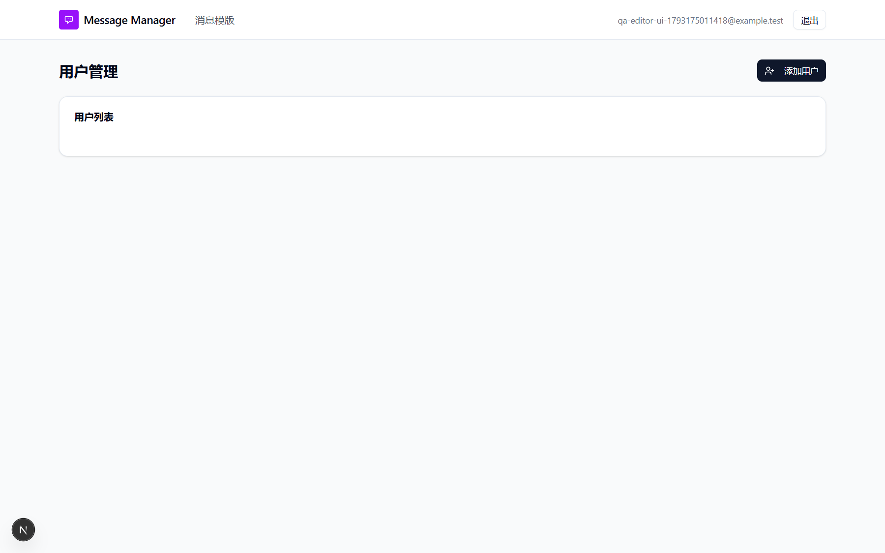
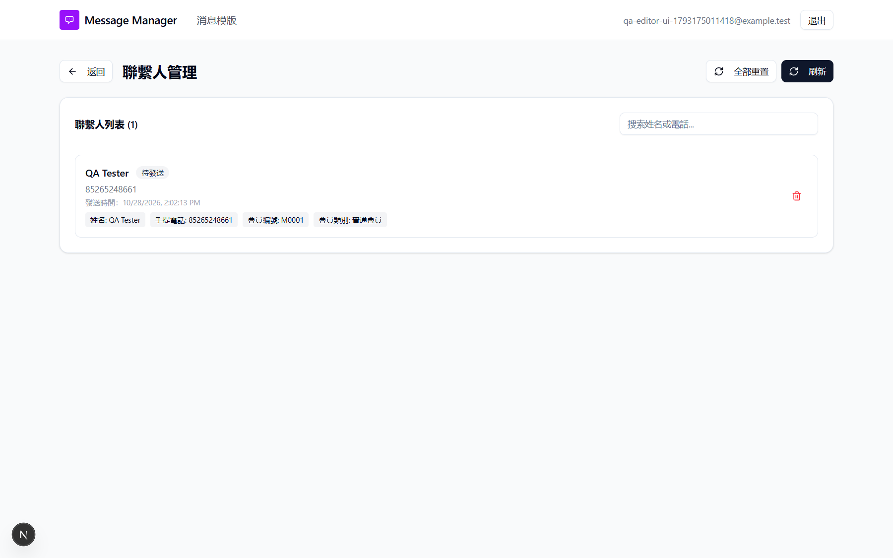
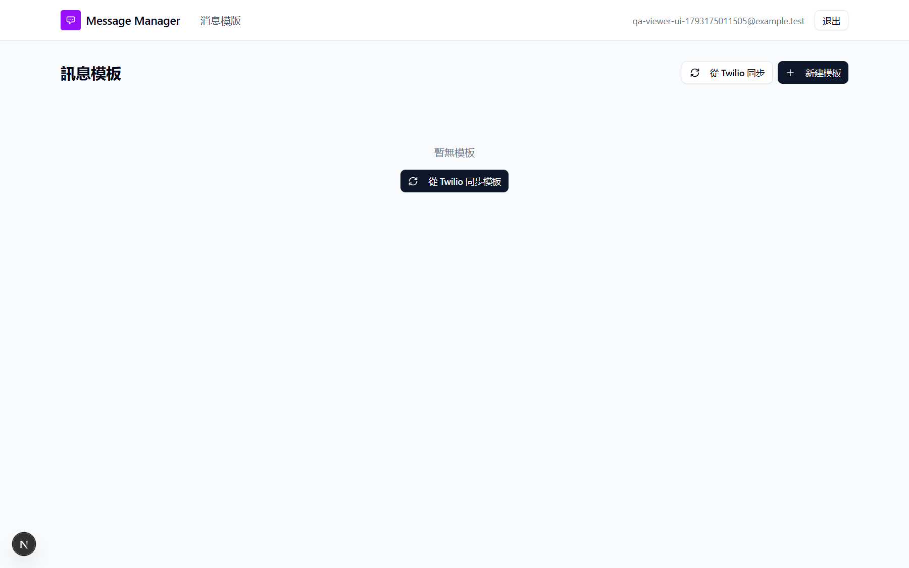
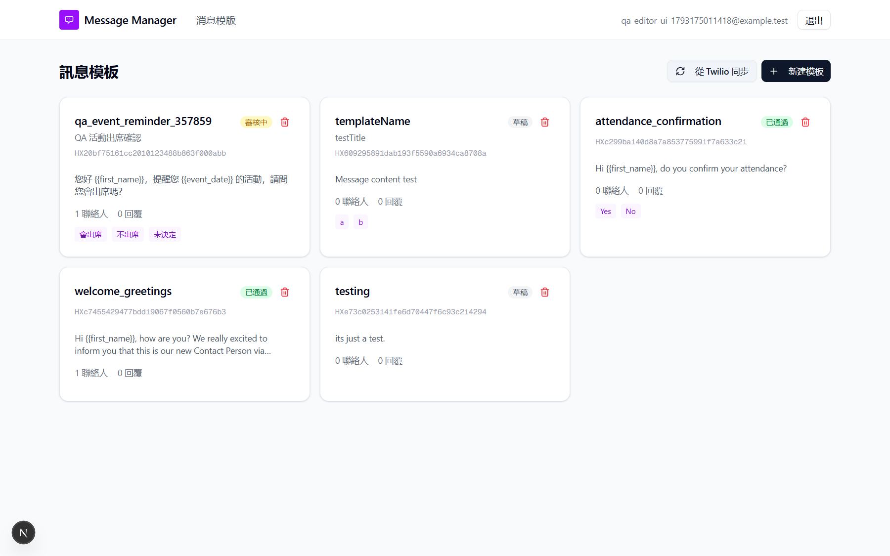
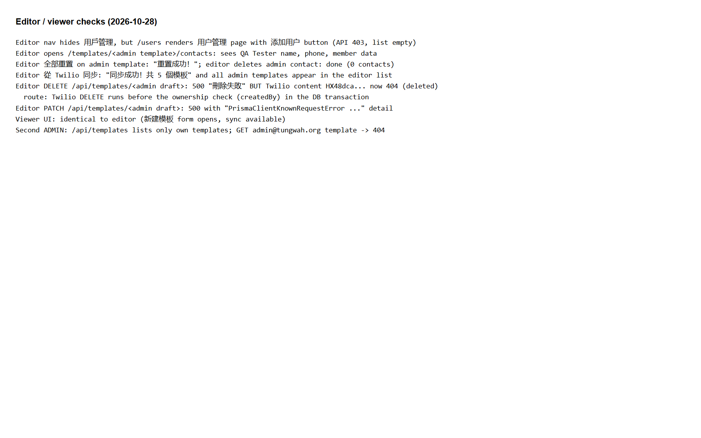

# Run report: tung-wah-whatsapp / login-roles-2026-10-28 / local

| Field | Value |
|---|---|
| Result | **FAIL (10 failed)** |
| Run | 2026-10-28_1518_local_manual |
| Runner | manual |
| Base URL | http://localhost:3000/ |
| Started | 2026-10-28 15:18 |
| Duration | 4.0s |

## Summary

| Total | Pass | Fail | Flaky | Blocked | Skipped |
|---:|---:|---:|---:|---:|---:|
| 13 | 3 | 10 | 0 | 0 | 0 |

## Results

| ID | Title | Status | Checks | Time | Notes | Evidence |
|---|---|---|---|---|---|---|
| TWW-077 | Logout ends the session and protects pages | pass | - | 0.0s | - | - |
| TWW-078 | Login form validation and wrong password message | pass | - | 0.0s | - | [1](screenshots/TWW-078-m01-37-login-wrong-password.png) |
| TWW-079 | Login returns to the page that was requested | fail | - | 0.0s | product-bug; BUG-030 | [1](screenshots/TWW-079-m01-43-login-findings.png) |
| TWW-080 | Login does not redirect to external sites | pass | - | 0.0s | - | - |
| TWW-081 | Logout invalidates the session token | fail | - | 0.0s | product-bug; BUG-019 | [1](screenshots/TWW-081-m01-43-login-findings.png) |
| TWW-082 | Login form supports password managers and screen readers | fail | - | 0.0s | product-bug; BUG-031 | [1](screenshots/TWW-082-m01-36-login-page.png) |
| TWW-083 | Editor cannot open the user management page | fail | - | 0.0s | product-bug; BUG-032 | [1](screenshots/TWW-083-m01-39-editor-users-page.png) |
| TWW-084 | Editor cannot change contacts of another user's template | fail | - | 0.0s | product-bug; BUG-001 | [1](screenshots/TWW-084-m01-40-editor-sees-admin-contacts.png) |
| TWW-085 | Users cannot delete or edit other users' templates | fail | - | 0.0s | product-bug; BUG-029 | [1](screenshots/TWW-085-m01-44-role-findings.png) |
| TWW-086 | API errors do not expose internal details | fail | - | 0.0s | product-bug; BUG-033 | [1](screenshots/TWW-086-m01-44-role-findings.png) |
| TWW-087 | Viewer has a read-only interface | fail | - | 0.0s | product-bug; BUG-002 | [1](screenshots/TWW-087-m01-42-viewer-templates.png) |
| TWW-088 | Sync shows each user only the templates they may see | fail | - | 0.0s | product-bug; BUG-002 | [1](screenshots/TWW-088-m01-41-editor-after-sync.png) |
| TWW-089 | Admins can see and manage templates created by other admins | fail | - | 0.0s | untriaged | [1](screenshots/TWW-089-m01-44-role-findings.png) |

## Failures and warnings

### TWW-079: Login returns to the page that was requested (fail)

- Failure type: product-bug (bug BUG-030)
- Source: `projects/tung-wah-whatsapp/cases/auth/TWW-079-login-returns-to-the-page-that-was.md`
- Note: callbackUrl=/users -> /templates; /login shown while logged in.

### TWW-081: Logout invalidates the session token (fail)

- Failure type: product-bug (bug BUG-019)
- Source: `projects/tung-wah-whatsapp/cases/security/TWW-081-logout-invalidates-the-session-token.md`
- Note: Copied token valid after signout (/api/users 200).

### TWW-082: Login form supports password managers and screen readers (fail)

- Failure type: product-bug (bug BUG-031)
- Source: `projects/tung-wah-whatsapp/cases/accessibility/TWW-082-login-form-supports-password-managers.md`
- Note: Labels unlinked, no autocomplete, placeholder admin@tungwah.org.

### TWW-083: Editor cannot open the user management page (fail)

- Failure type: product-bug (bug BUG-032)
- Source: `projects/tung-wah-whatsapp/cases/security/TWW-083-editor-cannot-open-the-user-management.md`
- Note: /users renders with 添加用户 for editor.

### TWW-084: Editor cannot change contacts of another user's template (fail)

- Failure type: product-bug (bug BUG-001)
- Source: `projects/tung-wah-whatsapp/cases/security/TWW-084-editor-cannot-change-contacts-of.md`
- Note: Editor saw, reset and deleted admin contacts.

### TWW-085: Users cannot delete or edit other users' templates (fail)

- Failure type: product-bug (bug BUG-029)
- Source: `projects/tung-wah-whatsapp/cases/security/TWW-085-users-cannot-delete-or-edit-other-users.md`
- Note: Editor DELETE -> 500 but Twilio content deleted.

### TWW-086: API errors do not expose internal details (fail)

- Failure type: product-bug (bug BUG-033)
- Source: `projects/tung-wah-whatsapp/cases/security/TWW-086-api-errors-do-not-expose-internal.md`
- Note: PATCH -> 500 with Prisma error detail.

### TWW-087: Viewer has a read-only interface (fail)

- Failure type: product-bug (bug BUG-002)
- Source: `projects/tung-wah-whatsapp/cases/security/TWW-087-viewer-has-a-read-only-interface.md`
- Note: Viewer UI identical to editor; create form opens.

### TWW-088: Sync shows each user only the templates they may see (fail)

- Failure type: product-bug (bug BUG-002)
- Source: `projects/tung-wah-whatsapp/cases/security/TWW-088-sync-shows-each-user-only-the-templates.md`
- Note: Editor sync lists all admin templates.

### TWW-089: Admins can see and manage templates created by other admins (fail)

- Failure type: untriaged
- Source: `projects/tung-wah-whatsapp/cases/templates/TWW-089-admins-can-see-and-manage-templates.md`
- Note: Second admin sees only own templates; admin template 404. Waiting on Q-009.

