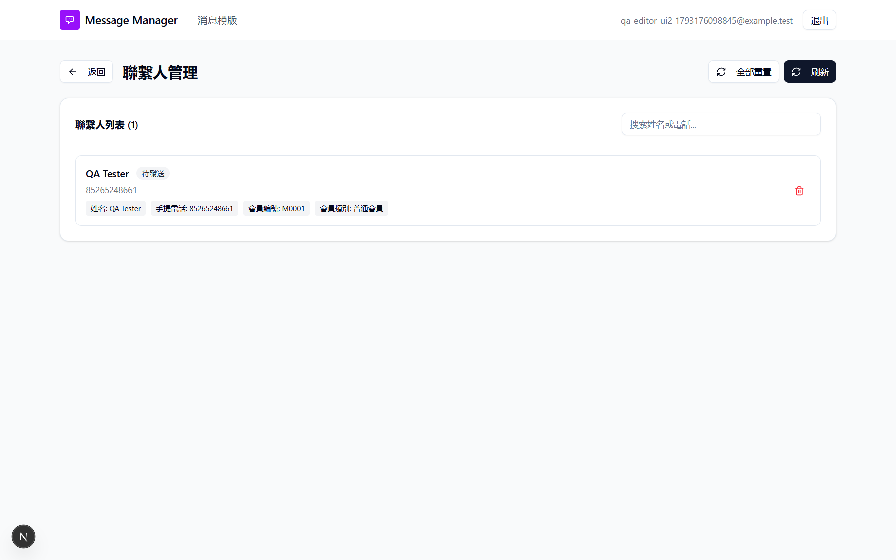
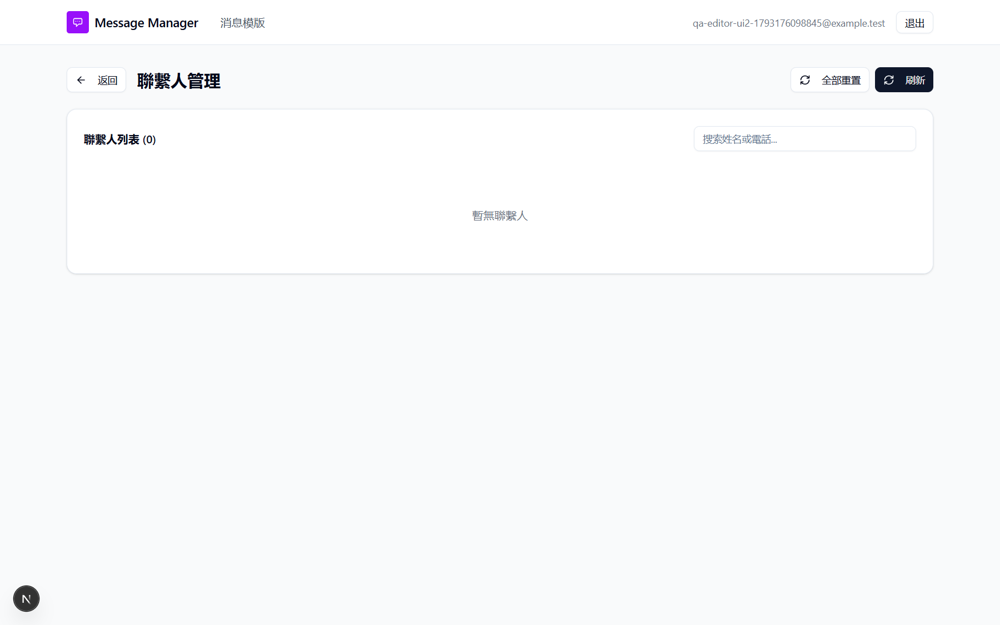

# Run report: tung-wah-whatsapp / ui-only-bug001-002-2026-10-28 / local

| Field | Value |
|---|---|
| Result | **FAIL (3 failed)** |
| Run | 2026-10-28_1531_local_manual |
| Runner | manual |
| Base URL | http://localhost:3000/ |
| Started | 2026-10-28 15:31 |
| Duration | 1.1s |

## Summary

| Total | Pass | Fail | Flaky | Blocked | Skipped |
|---:|---:|---:|---:|---:|---:|
| 3 | 0 | 3 | 0 | 0 | 0 |

## Results

| ID | Title | Status | Checks | Time | Notes | Evidence |
|---|---|---|---|---|---|---|
| TWW-012 | Editor cannot see another user's contacts or report | fail | - | 0.0s | product-bug; BUG-001 | [1](screenshots/TWW-012-m01-46-ui-editor-sees-contacts.png) |
| TWW-014 | Viewer cannot create templates or upload contacts | fail | - | 0.0s | product-bug; BUG-002 | [1](screenshots/TWW-014-m01-49-ui-viewer-created-and-uploaded.png) |
| TWW-084 | Editor cannot change contacts of another user's template | fail | - | 0.0s | product-bug; BUG-001 | [1](screenshots/TWW-084-m01-47-ui-editor-deleted-contact.png) |

## Failures and warnings

### TWW-012: Editor cannot see another user's contacts or report (fail)

- Failure type: product-bug (bug BUG-001)
- Source: `projects/tung-wah-whatsapp/cases/security/TWW-012-editor-cannot-read-another-user-s.md`
- Note: UI only: after sync the admin card shows, /contacts lists QA Tester, report link downloads reply_report_<id>.xlsx.

### TWW-014: Viewer cannot create templates or upload contacts (fail)

- Failure type: product-bug (bug BUG-002)
- Source: `projects/tung-wah-whatsapp/cases/security/TWW-014-viewer-cannot-create-templates-upload.md`
- Note: UI only: viewer sync shows admin templates, created qa_viewer_made (模板已創建！), uploaded a contact (上傳成功！).

### TWW-084: Editor cannot change contacts of another user's template (fail)

- Failure type: product-bug (bug BUG-001)
- Source: `projects/tung-wah-whatsapp/cases/security/TWW-084-editor-cannot-change-contacts-of.md`
- Note: UI only: 全部重置 -> 重置成功！, trash -> contact deleted (0 contacts).

